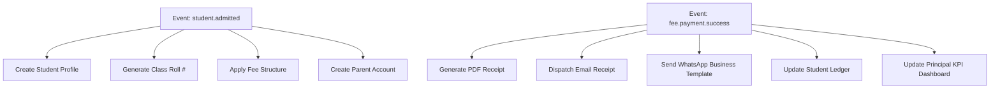

# ⚡ i2A SchoolOS — Centralized Event-Driven Automation Engine
> **Zero-Manual Workload Pipeline Specification**

---

## 📌 1. Event Trigger & Subscriber Matrix



---

## 📌 2. Event Payload Contracts

### `fee.payment.success`
```json
{
  "eventId": "evt-894210",
  "eventType": "fee.payment.success",
  "tenantId": "sch-001",
  "timestamp": "2026-10-08T10:45:00Z",
  "payload": {
    "receiptNo": "INV-2026-001245",
    "studentId": "std-101",
    "studentName": "Rahul Kumar",
    "paidAmount": 2500,
    "paymentMode": "UPI"
  }
}
```
