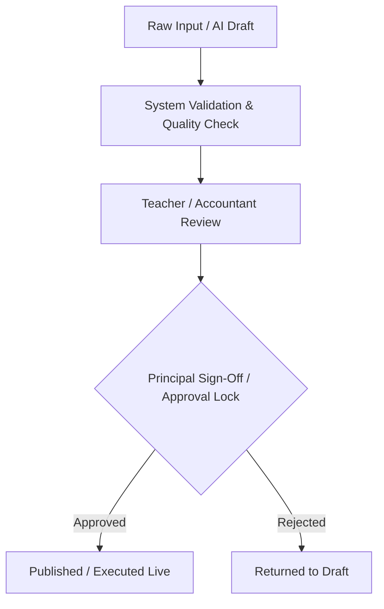

# 🏫 i2A SchoolOS — Product Architecture & Core Ecosystem Specification
> **One School. One Platform. Maximum Automation.**  
> *SaaS Enterprise School Operating System Product Architecture*

---

## 📌 1. Product Identity & Domain Map

**i2A SchoolOS** is an integrated Cloud Multi-Tenant SaaS platform uniting ERP, LMS, Examination, Fee Management, Communication, and AI Assistant capabilities into a single operational workspace.

### Domain Decomposition
1. **SaaS & Super Admin**: Multi-school tenant provisioning, billing slabs, feature flags, system health monitoring.
2. **School Setup & Identity**: Multi-tenant setup, custom branding (logo, stamps, signatures, palette), academic session management.
3. **Admission Engine**: Online application portal, document verification workflow, entrance test scheduling, controlled school approval pipeline.
4. **Student Information System (SIS)**: 360° digital student profile, parent linkage, document vault, academic history, financial ledgers.
5. **Staff & HR Management**: Staff profiles, class allocations, leave tracking, automated prorated payroll calculator.
6. **Academic & LMS Engine**: Curriculum hierarchy (Class -> Subject -> Book -> Chapter -> Topic), digital notes, homework, assignments.
7. **AI Academic Engine**: Book PDF OCR, concept extraction, multi-format question generation, automated difficulty balancing.
8. **Examination & Assessment System**: Preloaded academic calendar, timer-based online test engine, objective auto-grading, subjective teacher marking workspace.
9. **Financial & Fee Management**: Custom fee structures, flexible billing frequencies, payment gateway integration, auto-reconciliation, branded PDF receipts.
10. **Multi-Channel Communication Hub**: WhatsApp Business API Cloud Engine, Email SMTP adapter, In-App push notifications, Notice Board.
11. **Parent, Teacher & Student Portals**: Role-filtered personalized dashboards tailored to exact authorization scope.
12. **Auxiliary Operations**: Conflict-free timetable engine, library book cataloging, bus route tracking, asset inventory audit.
13. **School Website Builder**: Automated subdomain public website generator (`schoolname.yourschoolos.com`).
14. **Principal AI Assistant & Audit Engine**: Conversational Hindi/English natural language decision assist and forensic audit logger.

---

## 🔄 2. Core Operational Philosophy

```
ENTER ONCE → AUTOMATE EVERYWHERE
```

- **Single Entry Ingestion**: When a student is admitted via the admission pipeline, the system automatically populates:
  - Student Profile & Roll Number
  - Parent & Guardian Account
  - Assigned Class & Section Roster
  - Active Fee Ledger & Invoice Schedule
  - Attendance Profile
  - Exam & Progress Profile
  - Parent & Student Communication Channels

---

## 🛡️ 3. School-Controlled Approval Architecture (Liability Reduction)

To protect the software provider from operational and legal liability, high-impact operations mandate controlled approval checkpoints:



| Operation | Automation Mode | Controlled Approval Boundary |
|---|---|---|
| **AI Question Paper Generation** | `AI_DRAFT` | Teacher Review -> Principal Lock -> Published Exam |
| **Online Admission** | `APPLICATION_SUBMITTED` | Doc Verification -> Entrance Test -> Principal Final Sign-Off |
| **Fee Concession & Discount** | `REQUESTED` | Accountant Entry -> Principal Approval -> Ledger Entry |
| **Examination Results** | `AUTO_EVALUATED` | Teacher Subjective Evaluation -> Principal Lock -> Parent Portal Publish |
| **Payroll Disbursement** | `CALCULATED` | HR / Accountant Verification -> Principal Payout Release |

---

## 🎨 4. Branding & Customization Propagation Matrix

Every school configures its identity once in the **School Setup Wizard**, which dynamically propagates to all generated assets:

- **Fee Receipts**: Logo + Address + Invoice Header + GST/Reg # + Principal Signature + Digital Stamp
- **Report Cards**: School Name + Theme Palette + Student Photo + Attendance Rate + Teacher/Principal Remarks + Signatures
- **Certificates (TC/Bonafide)**: Official Header + Registration Code + Date + Authorized Signatory Seal
- **Student ID Cards**: School Name + Primary Color Accent + Photo + Emergency Contacts
- **Public School Website**: Subdomain Banner + Principal Desk Message + Faculty Listing + Admission Link

---

## 🗺️ 5. Implementation Status & Product Maturity

- **Product Architecture Specification**: `COMPLETE`
- **Tenant Isolation Boundaries**: `ENFORCED`
- **Approval Engine Controls**: `ACTIVE`
