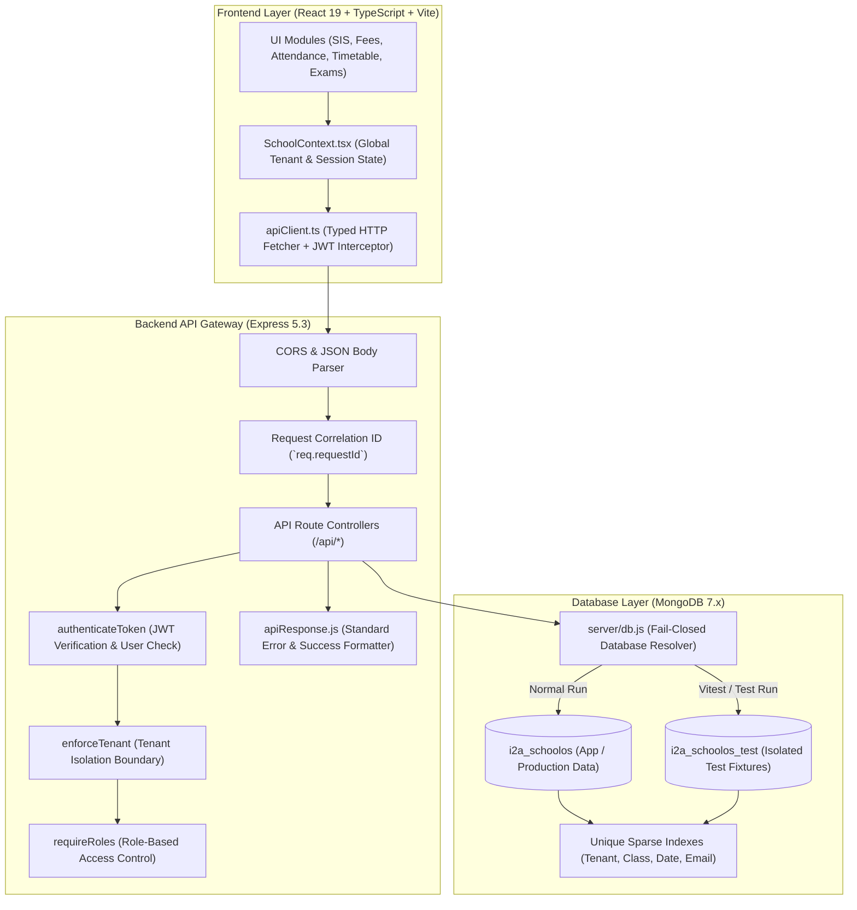

# i2A SchoolOS — Master Prompt 02: Current Architecture
**Document ID:** `ARCH-MP02-001`  
**Phase:** Master Prompt 02 — Architecture Hardening & API Contracts  
**Auditor / Architect:** Principal Software Architect, Senior Backend Engineer  
**Date:** 2026-10-17  
**Project Root:** `D:\i2A_School ERP & Managment`  
**Git Branch:** `phase-a-remediation`  

---

## 1. System Architecture Overview

i2A SchoolOS is a multi-tenant Education Management & School Operating System architected with a decoupled Single Page Application (SPA) frontend, an Express 5 REST API gateway, and an isolated MongoDB persistence engine.

---

## 2. Component Responsibilities & Boundaries

### 2.1 Frontend Layer (`src/`)
- **React 19 SPA (`src/App.tsx`):** Renders role-based portal dashboards (Principal, Admin, Teacher, Student, Parent, Platform Admin) and public SaaS onboarding.
- **State Store (`src/context/SchoolContext.tsx`):**
  - Manages tenant switching, active role selection, multi-tenant branding themes, and synchronization with backend services.
  - Implements fail-safe local fallback defaults when backend is unreachable, while preserving authoritative server responses upon successful synchronization.
- **API Client (`src/services/apiClient.ts`):**
  - Centralized single point of network egress.
  - Automatically attaches `Authorization: Bearer <token>` from `sessionStorage`.
  - Parses HTTP responses, normalizes 204 No Content, extracts machine-readable error codes (`code`), validation error details (`details`), and request correlation IDs (`requestId`).
  - Clears authentication session on 401 Unauthorized responses.

### 2.2 Backend Gateway Layer (`server/index.js`)
- Express 5.3 server running on port 5000 (configurable via `PORT`).
- Attaches `req.requestId` (`req-<timestamp>-<random>`) and `req.startTime` for end-to-end diagnostic traceability.
- Exposes unauthenticated health check endpoint (`GET /api/health`) reporting database status, uptime, and system health.
- Mounts 14 specialized route modules covering authentication, tenancy, SIS, admissions, attendance, timetables, homework, examinations, fees, marketplace, operations, subscriptions, payments, and notifications.
- Intercepts unmatched routes via global 404 handler returning standardized `ROUTE_NOT_FOUND`.
- Global error boundary safely masking internal error stack traces from public exposure.

### 2.3 Security & Access Control (`server/middleware/auth.js`)
- **`authenticateToken`:**
  - Decodes and verifies HMAC SHA-256 JWT tokens with secret `JWT_SECRET`.
  - Verifies that the user account still exists in the active database and has not been marked `SUSPENDED` or `LOCKED`.
  - Injects authoritative user context into `req.user` (`id`, `email`, `role`, `schoolId`, `studentId`, `childrenIds`, `assignedClasses`).
- **`enforceTenant`:**
  - Prevents cross-tenant parameter tampering.
  - If a user with `schoolId = 'I2A-SCH-000001'` requests resources targeting `'I2A-SCH-000002'`, immediate 403 `CROSS_TENANT_VIOLATION` is returned.
  - Injects authoritative `req.tenantFilter = { schoolId: req.user.schoolId }` for all database operations.
  - Super Admin (`SUPER_ADMIN`) bypasses tenant restriction to enable multi-school management.
- **`requireRoles`:**
  - Restricts endpoint execution to specified authoritative roles (e.g. `PRINCIPAL`, `ADMIN`, `SUPER_ADMIN`).

### 2.4 Database Reliability Layer (`server/db.js`)
- Dynamic fail-closed database selection via `getDatabaseName()`.
- Test environments must explicitly provide `TEST_DB_NAME`, which cannot be identical to the application database `i2a_schoolos`.
- Automatically enforces compound unique indexes on collection initialization:
  - `users`: `{ email: 1 }` (unique, sparse), `{ schoolId: 1, role: 1 }`
  - `tenants`: `{ id: 1 }` (unique), `{ code: 1 }`
  - `students`: `{ id: 1 }` (unique), `{ schoolId: 1, admissionNo: 1 }`
  - `attendance_locks`: `{ id: 1 }` (unique, sparse), `{ schoolId: 1, date: 1, className: 1 }` (unique compound)
  - `processed_webhooks`: `{ eventId: 1 }` (unique replay prevention)

---

## 3. Structural Evaluation & Identified Couplings

1. **State Hydration vs Server State:** `SchoolContext.tsx` contains static fallback seed arrays for offline and initial rendering. While useful for rapid UI development, production operations must treat the MongoDB backend as the sole authoritative source of truth.
2. **Deterministic Primary Keys:** Earlier attendance lock upserts lacked explicit `id` attributes on creation. This was rectified by introducing deterministic IDs (`lock-<schoolId>-<date>-<className>`) to ensure exact-ID teardown and unambiguous client references.
3. **Fail-Closed Database Isolation:** Previously, tests silently targeted the application database `i2a_schoolos` when `TEST_DB_NAME` was omitted. Hardened fail-closed logic now guarantees that tests fail closed unless pointed at a dedicated test database (`i2a_schoolos_test`).
