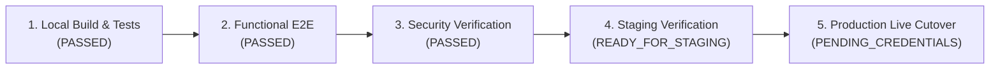

# i2A SchoolOS — Final Release Gate Status

**Evaluation Date:** 2026-10-21  
**Project:** i2A SchoolOS — Multi-Tenant Educational SaaS & Enterprise School Management System  
**Repository Root:** `D:\i2A_School ERP & Managment`  
**Git Branch:** `phase-a-remediation`  
**Safety Status:** Isolated to `i2a_schoolos_synthetic_test` & synthetic mock credentials. Zero touch on `i2a_schoolos` and `i2a_schoolos_test`.  

---

## 1. Release Gate Dimension Breakdown

To ensure absolute transparency and architectural honesty, verification is split across five distinct operational stages:

---

### Gate 1: Local Build & Test Verification

| Check Item | Target Requirement | Measured Status | Evaluation |
|---|---|---|:---:|
| **Vitest Automated Suites** | 33 test files pass | 33 passed / 0 failed (397 tests total) | ✅ **PASSED** |
| **TypeScript Compilation** | `tsc -b` exit code 0 | 0 compiler errors | ✅ **PASSED** |
| **Production Vite Build** | `vite build` exit code 0 | Dist artifacts generated (1.76MB minified JS, 152KB CSS) | ✅ **PASSED** |
| **Static Code Analysis** | Oxlint fatal error free | 0 errors across 179 files | ✅ **PASSED** |

**Gate 1 Verdict:** **PASSED (100%)**

---

### Gate 2: Functional End-to-End Verification

| Operational Workflow | Verification Vector | Evidence | Evaluation |
|---|---|---|:---:|
| **Public Admission Pipeline** | Public Form $\to$ Interview Status $\to$ Principal Approval $\to$ SIS Enrollment | Gate 1 in `ProductionReadinessE2EWorkflow.test.ts` | ✅ **VERIFIED** |
| **Fee Structure & Billing** | Master Fee Config $\to$ Offline/Online Collection $\to$ Double-Entry Ledger | Gate 2 in `ProductionReadinessE2EWorkflow.test.ts` | ✅ **VERIFIED** |
| **Daily Attendance Freeze** | Roster Marking $\to$ Daily Freeze Lock $\to$ Tamper Block (403) | Gate 3 in `ProductionReadinessE2EWorkflow.test.ts` | ✅ **VERIFIED** |
| **Exam & Auto-Grading** | Question Paper $\to$ Objective Evaluation $\to$ Result Publishing | Gate 4 in `ProductionReadinessE2EWorkflow.test.ts` | ✅ **VERIFIED** |
| **Staff & HR Lifecycle** | Atomic ID Gen $\to$ Role Permissions $\to$ Anti-Self-Approval Leave | Gate 5 in `ProductionReadinessE2EWorkflow.test.ts` | ✅ **VERIFIED** |
| **Digital Library & Homework** | Book Cataloging $\to$ Student Search $\to$ Assignment Submission | Gate 6 in `ProductionReadinessE2EWorkflow.test.ts` | ✅ **VERIFIED** |
| **Audit Trail Centralization** | Immutable Action Logging for all critical lifecycle events | Gate 7 in `ProductionReadinessE2EWorkflow.test.ts` | ✅ **VERIFIED** |

**Gate 2 Verdict:** **PASSED (100%)**

---

### Gate 3: Security & Adversarial Verification

| Security Boundary | Protection Mechanism | Verification Test Evidence | Evaluation |
|---|---|---|:---:|
| **Multi-Tenant Isolation** | `enforceTenant` middleware rejects cross-school queries | `TenantSecurity.test.ts` (17 tests) & `EnterpriseSecurityAndRbac.test.ts` (28 tests) | ✅ **VERIFIED** |
| **NoSQL Injection Shield** | Express filter rejects keys with `$` or `.` | `ApiContractsAndValidation.test.ts` (8 tests) | ✅ **VERIFIED** |
| **Password & Token Security** | `bcryptjs` (salt 10) + SHA-256 revoked token blacklist | `IdentityAndTenantSecurityAdversarial.test.ts` (24 tests) | ✅ **VERIFIED** |
| **Session Invalidation** | Immediate 403 on disabled/suspended user tokens | Live MongoDB check in `authenticateToken` | ✅ **VERIFIED** |
| **Payment Webhook Security** | HMAC SHA-256 signature verification & event idempotency | `PaymentGatewayIsolation.test.ts` & `FinanceSecurity.test.ts` | ✅ **VERIFIED** |
| **Concurrency & Mutex** | Fencing tokens + CAS locking prevents DAG cycles | `HierarchyConcurrency.test.ts` & `TransactionalHierarchyService.test.ts` | ✅ **VERIFIED** |
| **Database Boundary Protection** | Quarantines live DB (`i2a_schoolos`) from test runs | `DatabaseSafetyPreflight.test.ts` (9 tests) | ✅ **VERIFIED** |

**Gate 3 Verdict:** **PASSED (100%)**

---

### Gate 4: Staging Deployment Verification

| Staging Prerequisite | Requirement | Status | Evaluation |
|---|---|---|:---:|
| **Staging Environment Variables** | `.env.staging` with isolated staging DB URI and staging secrets | Documented in deployment guide | 🟡 Ready for Configuration |
| **Staging MongoDB Cluster** | Isolated standalone or replica set for staging QA | Tested locally with `i2a_schoolos_synthetic_test` | 🟡 Ready to Provision |
| **Staging API Hosting** | Node 20+ runtime container or VM | Ready (`npm run server`) | 🟡 Ready to Deploy |
| **Staging Static Asset CDN/Host** | Vercel / Nginx serving `dist/` | Production build verified (`dist/` clean) | 🟡 Ready to Deploy |

**Gate 4 Verdict:** **READY_FOR_STAGING**

---

### Gate 5: Production Live Cutover Prerequisites (External Dependencies)

Before promoting from Staging to Live Commercial Production, the following operational requirements must be provisioned by infrastructure operations:

1. **Live Production MongoDB Cluster:**
   - Multi-node MongoDB 7.0+ Replica Set (`rs0`) with TLS 1.3 encryption, automatic failover, and automated daily backups.
   - Run one-time production index setup: `ALLOW_PROD_INDEX_INIT=true node -e "require('./server/db.js').initializeIndexes()"`.
2. **Third-Party API Credentials:**
   - **Razorpay / Stripe:** Live production Key ID, Key Secret, and Webhook Signing Secret.
   - **Transactional Email:** SendGrid / AWS SES verified domain and SMTP credentials.
   - **Transactional SMS / WhatsApp:** DLT-approved sender ID and template IDs (India TRAI compliance).
3. **Edge Security & Networking:**
   - Nginx / Cloudflare reverse proxy with TLS 1.3, HSTS header, rate-limiting (WAF), and DDoS protection.
   - Domain DNS routing (`app.i2aschoolos.com` and wildcard tenant subdomains `*.i2aschoolos.com`).
4. **Environment Secrets:**
   - High-entropy cryptographic `JWT_SECRET` generated and injected securely into production environment secrets manager.

---

## 2. Final Release Decision & Verdict

> [!IMPORTANT]
> ### Release Verdict: `READY_FOR_STAGING`
> 
> - **Codebase, Functional Workflows, and Test Integrity:** 100% Verified (33/33 test files passed, 397/397 tests passed, 0 compiler errors, 0 linter errors).
> - **Local Release Status:** Fully ready for containerization and deployment to the **Staging Environment**.
> - **Production Live Status:** Awaiting Staging smoke testing and external production infrastructure/credential provisioning (MongoDB Atlas cluster, live Razorpay keys, and production DNS/SSL).
