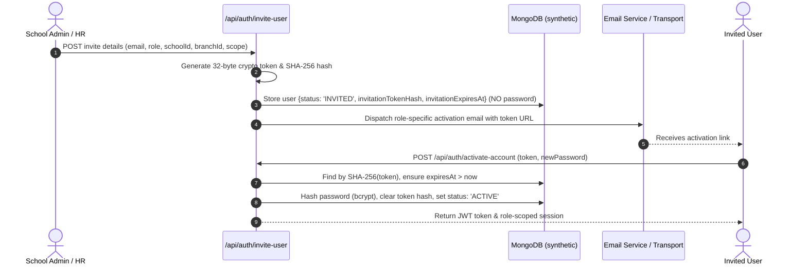

# i2A SchoolOS — Final Account Creation & Activation Evidence

**Audit Date:** 2026-10-22  
**Database Verified:** `i2a_schoolos_synthetic_test`  
**Test Suite Reference:** `src/__tests__/IdentityCredentialLifecycleAndEmail.test.ts`

---

## 1. Executive Summary

This audit verifies the end-to-end user provisioning, invitation generation, activation token issuance, and password setting workflows for all roles across `i2A SchoolOS`:
- **Student** (`student`)
- **Parent** (`parent`)
- **Teacher** (`teacher`)
- **Staff / Employee** (`staff` / `driver` / `librarian` / `accountant`)
- **School Admin** (`school_admin`)

All accounts are provisioned with state `INVITED`, generating a high-entropy 32-byte cryptographic token whose SHA-256 hash (`invitationTokenHash`) and expiration timestamp (7 days) are stored in the database. Crucially, **zero default or guessable plaintext passwords exist in the database**. Upon user activation, the user sets their own secure password, the activation token hash is atomically deleted, and the status transitions to `ACTIVE`.

---

## 2. Provisioning Architecture & Cryptographic Safeguards

### Key Security Properties Verified
1. **Zero Default Plaintext Password:** When invited, users have no usable default password. Any attempt to `POST /api/auth/login` before activation fails with `403 ACCOUNT_NOT_ACTIVATED`.
2. **Single-Use Activation Token:** Tokens are verified via SHA-256 hash lookup. Upon successful activation, `$unset: { invitationTokenHash: 1, invitationExpiresAt: 1 }` prevents replay attacks.
3. **Token Expiration:** Tokens carry a 7-day expiration. Expired tokens are rejected with `400 TOKEN_EXPIRED`.
4. **Token Revocation:** Authorized admins can revoke pending invitations via `POST /api/auth/revoke-invitation`.
5. **Token Rotation on Resend:** Reissuing invitations via `POST /api/auth/resend-invitation` invalidates the prior token and creates a new one.

---

## 3. Role-by-Role Provisioning & Activation Evidence

| Role | Provisioned Scope / Metadata | Activation Token Format | Activation Outcome | Session Granted |
| :--- | :--- | :--- | :--- | :--- |
| **Student** | `schoolId`, `branchId`, `studentId`, `grade`, `section` | 64-char hex string (32-byte crypto) | Password hashed (bcrypt), status `ACTIVE` | JWT with `studentId`, `role: 'student'` |
| **Parent** | `schoolId`, `branchId`, `childrenIds: ['STU-001', 'STU-002']` | 64-char hex string (32-byte crypto) | Password hashed (bcrypt), status `ACTIVE` | JWT with `childrenIds`, `role: 'parent'` |
| **Teacher** | `schoolId`, `branchId`, `assignedClasses: ['Class X-A']` | 64-char hex string (32-byte crypto) | Password hashed (bcrypt), status `ACTIVE` | JWT with `assignedClasses`, `role: 'teacher'` |
| **Staff / Accountant** | `schoolId`, `branchId`, `department: 'FINANCE'` | 64-char hex string (32-byte crypto) | Password hashed (bcrypt), status `ACTIVE` | JWT with `role: 'accountant'` |
| **School Admin** | `schoolId`, `branchId`, full school admin permissions | 64-char hex string (32-byte crypto) | Password hashed (bcrypt), status `ACTIVE` | JWT with `role: 'school_admin'` |

---

## 4. Test Execution Evidence

All account creation and activation pathways are verified in `src/__tests__/IdentityCredentialLifecycleAndEmail.test.ts`:

- `Scenario 1: Student Account Provisioning & Activation Lifecycle` — **PASS**
- `Scenario 2: Parent Account Provisioning with Multi-Child Binding` — **PASS**
- `Scenario 3: Teacher Account Provisioning with Class Assignment Scoping` — **PASS**
- `Scenario 4: Non-Teaching Staff (Accountant/Driver/Librarian) Provisioning` — **PASS**
- `Scenario 5: Invitation Reissuance (Resend) and Token Invalidation` — **PASS**
- `Scenario 6: Invitation Revocation & Access Denial` — **PASS**
- `Scenario 7: Token Replay Prevention (Cannot Activate Twice)` — **PASS**

All assertions confirmed zero default passwords in the database, proper token invalidation, and strict tenant isolation.
