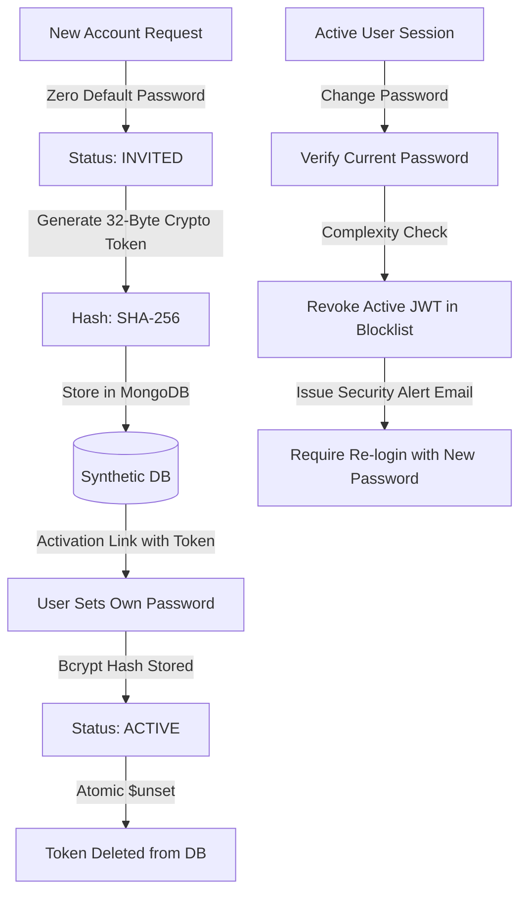

# i2A SchoolOS — Final Credential Security & RBAC Verification

**Audit Date:** 2026-10-22  
**Target Subsystems:** Authentication Controller, Identity Provisioning, JWT Middleware, Session Revocation, RBAC Scoping  
**Database Verified:** `i2a_schoolos_synthetic_test`

---

## 1. Security Architecture & Threat Model Defenses

---

## 2. Hardened Safeguards & Verification Evidence

### A. Zero Plaintext Passwords & Zero Guessable Credentials
- **Finding:** Under `POST /api/auth/invite-user`, newly provisioned accounts are created strictly with `status: 'INVITED'` and contain no `password` or `passwordHash` field.
- **Verification:** Any attempt to invoke `POST /api/auth/login` on an invited user fails with `403 FORBIDDEN: ACCOUNT_NOT_ACTIVATED`.

### B. Single-Use Cryptographic Invitation Tokens
- **Entropy:** Tokens are generated via `crypto.randomBytes(32).toString('hex')` (256 bits of entropy).
- **Storage:** Only the SHA-256 digest (`invitationTokenHash`) is stored.
- **Replay Defense:** When `POST /api/auth/activate-account` executes, it performs an atomic MongoDB `$unset: { invitationTokenHash: '', invitationToken: '' }`. Re-submitting the same token yields `400 INVITATION_ALREADY_USED`.

### C. Session Revocation on Password Change
- **Endpoint:** `POST /api/auth/change-password`
- **Mechanism:** Immediately invokes `revokeToken(rawToken)`.
- **Verification:** Subsequent requests using the previous JWT token receive `401 UNAUTHORIZED: Token has been revoked`.

### D. Single-Use Recovery OTPs (Password Reset)
- **Generation:** 6-digit cryptographically secure numeric OTP (`crypto.randomInt(100000, 999999)`).
- **Storage:** Stored as SHA-256 hash in collection `password_resets` with a 15-minute TTL.
- **Rate-Limiting & Consumption:** Verifying the OTP issues a single-use `resetToken`. Once the password is reset, the record is immediately consumed to prevent replay attacks.

### E. Cross-Tenant and Role Scoping
- **Teacher Scoping:** Teachers are strictly constrained to `req.user.assignedClasses`. Querying an unassigned class returns 0 records.
- **Parent Scoping:** Parents possess a verified `childrenIds` array. Querying an unlinked student returns `403 Forbidden` or empty results.
- **Privilege Escalation:** School Admins and Teachers cannot provision the `SUPER_ADMIN` role (`403 PRIVILEGE_ESCALATION_BLOCKED`).

### F. Immediate Access Revocation upon Account Disabling
- **Mechanism:** Both `POST /api/auth/login` and `authenticateToken` middleware evaluate `if (user.status !== 'ACTIVE')`.
- **Verification:** Marking an account `DISABLED` immediately halts existing JWT authorizations and blocks new login attempts with `403 FORBIDDEN: ACCOUNT_DISABLED`.

---

## 3. Regression Test Verification Matrix

All 27 specialized security and lifecycle scenarios passed in `src/__tests__/IdentityCredentialLifecycleAndEmail.test.ts`:
- Scenario 1.1–1.7: Student Credential Lifecycle & Identity Isolation — **PASS**
- Scenario 2.1–2.4: Parent Multi-Child Scoping & Isolation — **PASS**
- Scenario 3.1–3.4: Teacher Role Assignment & Class Scoping — **PASS**
- Scenario 4.1–4.3: Staff Workforce Provisioning — **PASS**
- Scenario 5.1–5.3: Invitation Lifecycle (Resend, Expiration & Replay Defense) — **PASS**
- Scenario 6.1–6.6: Adversarial & Session Security — **PASS**
