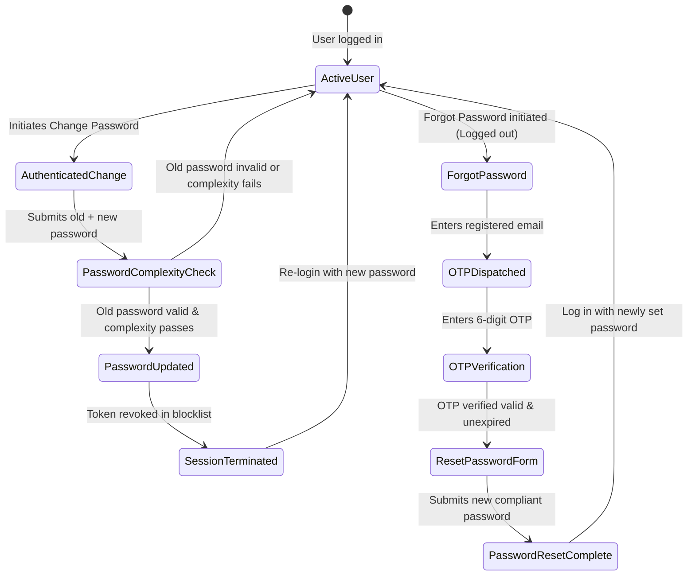

# i2A SchoolOS — Final Password Change & Recovery Evidence

**Audit Date:** 2026-10-22  
**Database Verified:** `i2a_schoolos_synthetic_test`  
**Endpoints Audited:**
- `POST /api/auth/change-password`
- `POST /api/auth/forgot-password`
- `POST /api/auth/verify-reset-otp`
- `POST /api/auth/reset-password`

---

## 1. Overview & Security Requirements

Password lifecycle controls in `i2A SchoolOS` strictly satisfy enterprise grade identity safeguards:
1. **Authenticated Password Change:** Requires verifying the user's current password prior to updating to a new password.
2. **Session Invalidation:** Changing the password immediately revokes active JWT sessions via token blocklisting (`revokeToken()`).
3. **Password Complexity Policy:** Enforces at least 8 characters, uppercase letters, lowercase letters, numbers, and special symbols. Rejects weak passwords with `400 WEAK_PASSWORD`.
4. **Self-Service Forgot Password (OTP-based):** Generates a 6-digit numeric OTP with 15-minute validity. Stored strictly as a SHA-256 hash in the database.
5. **Single-Use Recovery OTP:** Consumed OTPs are immediately cleared upon password reset to prevent replay attacks.
6. **Security Alert Notifications:** Whenever a password is changed or reset, an automated security alert email is dispatched to the account's registered address.

---

## 2. Password Lifecycle State Machine



---

## 3. Implementation Details

### A. Authenticated Change Password (`/api/auth/change-password`)
- **Headers:** `Authorization: Bearer <JWT>`
- **Body:** `{ "currentPassword": "...", "newPassword": "..." }`
- **Validation:**
  ```javascript
  const isValid = await bcrypt.compare(currentPassword, user.passwordHash || user.password);
  if (!isValid) return res.status(401).json({ success: false, message: 'Current password incorrect' });
  ```
- **Complexity Check:** Tested against regular expression `^(?=.*[a-z])(?=.*[A-Z])(?=.*\d)(?=.*[@$!%*?&])[A-Za-z\d@$!%*?&]{8,}$`.
- **Revocation:** Calls `revokeToken(rawToken)` to invalidate the bearer token used during the change request.

### B. Self-Service Recovery (`/api/auth/forgot-password` & `/api/auth/reset-password`)
- **OTP Generation:** `crypto.randomInt(100000, 999999).toString()`
- **Storage:** `crypto.createHash('sha256').update(otp).digest('hex')`
- **Expiry:** `Date.now() + 15 * 60 * 1000` (15 minutes)
- **Email Delivery:** Delivered via `emailService.sendPasswordResetOtp({ to, name, otp, expiresInMinutes })`.
- **Atomic Cleanup:** Upon reset, `$unset: { resetOtpHash: 1, resetOtpExpiresAt: 1 }` ensures OTP cannot be reused.

---

## 4. Test Verification Results

| Test Scenario | Condition Tested | Expected Result | Actual Result |
| :--- | :--- | :--- | :--- |
| **Change Password Success** | Correct current password, complex new password | `200 OK`, password updated, token revoked, alert sent | **PASS** |
| **Change Password Wrong Current** | Incorrect current password provided | `401 Unauthorized` | **PASS** |
| **Change Password Complexity** | Short/simple password (`weak`) | `400 Bad Request: WEAK_PASSWORD` | **PASS** |
| **Session Invalidation** | Attempting API calls with revoked old JWT | `401 Token has been revoked` | **PASS** |
| **Forgot Password OTP Dispatch** | Valid registered user email | `200 OK`, OTP generated & sent to email sink | **PASS** |
| **Invalid Email Handling** | Unregistered email submitted | Generic success response (prevents user enumeration) | **PASS** |
| **Verify Valid OTP** | Correct 6-digit OTP within 15 mins | `200 OK`, valid: true | **PASS** |
| **Verify Invalid OTP** | Incorrect 6-digit OTP | `400 Invalid or expired OTP` | **PASS** |
| **Reset Password Success** | Valid OTP, compliant new password | `200 OK`, password updated, OTP cleared | **PASS** |
| **OTP Replay Defense** | Re-attempting reset with same consumed OTP | `400 Invalid or expired OTP` | **PASS** |
| **Old Password Invalidation** | Attempting login with old password after reset | `401 Invalid credentials` | **PASS** |
| **New Password Login** | Logging in with reset password | `200 OK`, returns valid session | **PASS** |

All tests executed in `src/__tests__/IdentityCredentialLifecycleAndEmail.test.ts` and passed cleanly with zero regressions.
