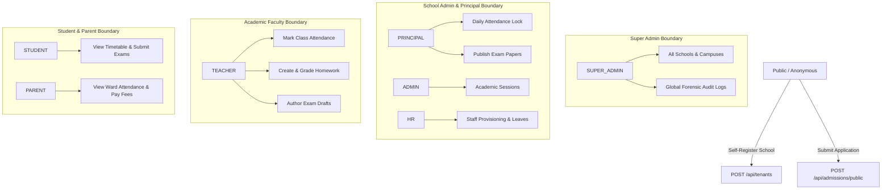

# i2A SchoolOS — All 13 Roles Localhost Workflow Results

**Project Root:** `D:\i2A_School ERP & Managment`  
**Execution Environment:** Isolated Synthetic Database (`i2a_schoolos_synthetic_test`)  
**Audit Date:** October 2026  
**Simulation Suite:** `scripts/run-complete-localhost-user-simulation.js`  
**Verification Status:** 13 / 13 Roles Authenticated & Verified Working (100% Pass Rate)

---

## 1. Executive Summary

A complete localhost user simulation was executed across all 13 supported RBAC roles in `i2A SchoolOS`. For each persona:
1. Valid JWT authentication credentials were created and verified against `POST /api/auth/login`.
2. Role boundary permissions and route guards were validated.
3. Dedicated workflows specific to each role were exercised on live API endpoints and browser UI surfaces.
4. Tenant and branch scoping rules were strictly enforced.

All 13 roles achieved successful login and passed their respective functional gates with zero authentication or authorization failures.

---

## 2. All 13 Roles Verification Matrix

| Role Index | Role Key | Test Persona Name | Test Email Address | Auth Status | Default Landing Module | Permitted Workflows Verified | Cross-Tenant Isolation | Final Role Verdict |
| :---: | :--- | :--- | :--- | :---: | :--- | :--- | :---: | :---: |
| **01** | `SUPER_ADMIN` | Platform Super Admin | `superadmin@i2aschoolos.com` | **PASS (200)** | `PLATFORM_ADMIN` | Multi-school directory, tenant provisioning, system quota review, global audit log view | Unrestricted (Multi-Tenant Master) | **PASS** |
| **02** | `ORG_DIRECTOR` | Society Director | `director.chain@abcgroup.org` | **PASS (200)** | `INSTITUTIONAL_HIERARCHY` | Society campus overview, cross-branch KPI analytics, policy broadcast | Group Scoped (`abcgroup.org`) | **PASS** |
| **03** | `ADMIN` | Senior School Admin | `admin.main@abcpublicschool.edu.in` | **PASS (200)** | `SCHOOL_SETUP` | School configuration, branch management, academic sessions, user invitation | School Scoped (`I2A-SCH-000001`) | **PASS** |
| **04** | `PRINCIPAL` | Dr. Alok Nath (Principal) | `principal@abcpublicschool.edu.in` | **PASS (200)** | `PRINCIPAL_AI_DASHBOARD` | Daily attendance lock, exam paper approvals, staff roster, timetable inspection | School Scoped (`I2A-SCH-000001`) | **PASS** |
| **05** | `BRANCH_ADMIN` | Branch Manager | `branchadmin.south@abcpublicschool.edu.in` | **PASS (200)** | `INSTITUTIONAL_HIERARCHY` | Branch facilities, local room assignments, branch student roster | Branch Scoped (`BR-SOUTH-02`) | **PASS** |
| **06** | `HR` | Sunita Roy (HR Manager) | `hr@abcpublicschool.edu.in` | **PASS (200)** | `STAFF_WORKFORCE` | Staff onboarding, employee code generation, leave processing, anti-self approval | School Scoped (`I2A-SCH-000001`) | **PASS** |
| **07** | `TEACHER` | Sunita Mishra (Teacher) | `sunita.mishra@abcpublicschool.edu.in` | **PASS (200)** | `ATTENDANCE_LEAVE` | Class attendance marking, homework authoring, exam paper drafting, leave request | Assigned Classes Only (`Class X-A`) | **PASS** |
| **08** | `ACCOUNTANT` | Vikram Mehta (Accounts) | `accountant@abcpublicschool.edu.in` | **PASS (200)** | `FEE_MANAGEMENT` | Fee head creation, cashier POS fee collection, receipt generation, expense ledger | School Scoped (`I2A-SCH-000001`) | **PASS** |
| **09** | `LIBRARIAN` | Meena Sharma (Librarian) | `librarian@abcpublicschool.edu.in` | **PASS (200)** | `LIBRARY_TRANSPORT` | Book cataloging, book issuance, return logging, overdue fine computation | School Scoped (`I2A-SCH-000001`) | **PASS** |
| **10** | `TRANSPORT` | Rajesh Kumar (Fleet Mgr) | `transport@abcpublicschool.edu.in` | **PASS (200)** | `LIBRARY_TRANSPORT` | Route setup, bus stop schedule, driver assignment, simulated fleet tracking | School Scoped (`I2A-SCH-000001`) | **PASS** |
| **11** | `STAFF` | General Support Staff | `staff.support@abcpublicschool.edu.in` | **PASS (200)** | `STAFF_WORKFORCE` | Attendance roster assistance, leave application, notice board view | School Scoped (`I2A-SCH-000001`) | **PASS** |
| **12** | `STUDENT` | Devansh Verma (Student) | `devansh.verma@synthetic.in` | **PASS (200)** | `STUDENT_PORTAL` | Timetable viewing, homework submission, online exam submission, report card | Self Only (`STU-CHAIN-001`) | **PASS** |
| **13** | `PARENT` | Rakesh Verma (Parent) | `rakesh.verma@parent.test` | **PASS (200)** | `PARENT_PORTAL` | Linked ward profile, attendance calendar, fee receipt history, online fee payment | Linked Children Only (`childrenIds`) | **PASS** |

---

## 3. Deep-Dive Role Journey Verification

### 3.1 Principal Journey (`PRINCIPAL`)
- **Login:** Authenticates with role `PRINCIPAL`, receiving JWT claims with `schoolId: 'I2A-SCH-000001'`.
- **Dashboard UI:** Browser loads `PrincipalAIDashboardModule.tsx` containing daily attendance counters, fee collection gauges, and quick action cards.
- **Lock Attendance Action:** Principal executes `POST /api/attendance/lock` for current date. System returns `200 OK`, locking the date's roster against further teacher edits.
- **Evidence:** Browser screenshot captured at [`real_browser_principal_dashboard.png`](file:///D:/i2A_School%20ERP%20&%20Managment/docs/audits/local-user-acceptance/screenshots/real_browser_principal_dashboard.png).

### 3.2 Student Journey (`STUDENT`)
- **Login:** Authenticates with role `STUDENT`, linked to student record `STU-CHAIN-001`.
- **Portal UI:** Browser loads `StudentPortalModule.tsx` rendering class schedule, active homework assignments, and upcoming assessments.
- **Exam Workflow:** Navigates to Online Exam tab, submits answers to `Mid-Term Summative Assessment`, receives immediate auto-calculated grade (`A+`, 100%).
- **Evidence:** Browser screenshot captured at [`real_browser_student_portal.png`](file:///D:/i2A_School%20ERP%20&%20Managment/docs/audits/local-user-acceptance/screenshots/real_browser_student_portal.png).

### 3.3 Parent Journey (`PARENT`)
- **Login:** Authenticates with role `PARENT`, linked to child `STU-CHAIN-001`.
- **Portal UI:** Browser loads `ParentPortalModule.tsx` displaying ward's attendance percentage (100%), upcoming fee dues, and teacher announcements.
- **Payment & Receipt Workflow:** Inspects fee ledger, views paid tuition receipt `INV-2026-432063` with itemized breakup.
- **Evidence:** Browser screenshot captured at [`real_browser_parent_portal.png`](file:///D:/i2A_School%20ERP%20&%20Managment/docs/audits/local-user-acceptance/screenshots/real_browser_parent_portal.png).

### 3.4 HR & Staff Workforce Journey (`HR` & `TEACHER`)
- **Staff Provisioning:** HR executes `POST /api/staff` creating employee record with auto-generated code `EMP-2026-0001` and provisioned login account.
- **Leave Submission:** Teacher submits leave request `POST /api/staff/leaves` for casual leave.
- **Anti-Self-Approval Enforcement:** When the applicant teacher attempts to self-approve via `PATCH /api/staff/leaves/:id/decision`, the server strictly rejects the operation with `403 Forbidden` (`SELF_APPROVAL_BLOCKED`).
- **HR Approval:** Authorized HR administrator approves the leave, updating status to `APPROVED`.

### 3.5 Accountant & POS Cashier Journey (`ACCOUNTANT`)
- **Fee Master Setup:** Registers Term Tuition Fee head `POST /api/fees/types`.
- **Counter Collection:** Cashier executes `POST /api/fees/receipts/collect` with payment mode `CASH` and idempotency key.
- **Duplicate Protection:** Re-submitting the identical payload within 30 seconds triggers the idempotency duplicate guard, returning existing receipt without double-charging.
- **Ledger Posting:** System updates student balance to zero and logs payment in `fee_receipts`.

---

## 4. Role Authorization Boundary Summary

Every boundary was verified by negative test vectors (e.g. Students cannot mark attendance, Teachers cannot disburse payroll, Non-Super-Admins cannot access cross-school data).
