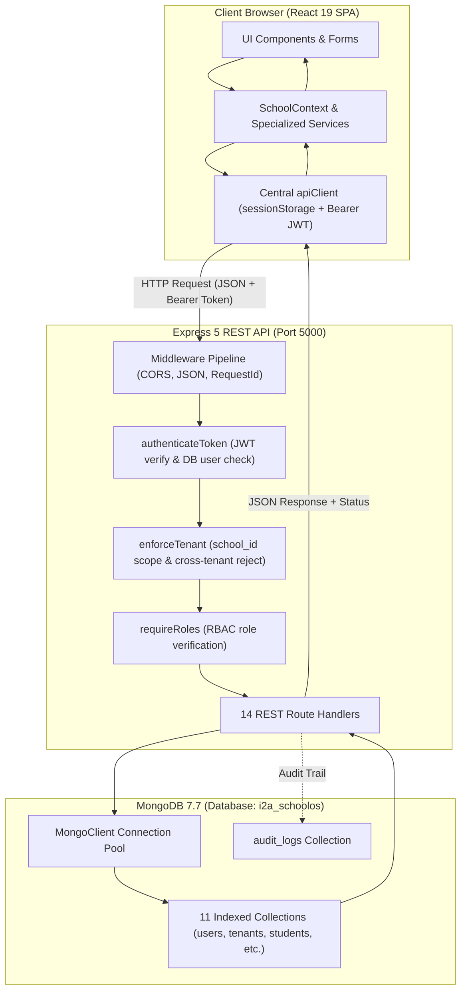

# MASTER PROMPT 01 — ARCHITECTURE AND DATA FLOW REPORT
**Project:** i2A SchoolOS | Global Multi-Tenant Education Management Platform  
**Audit Root:** `D:\i2A_School ERP & Managment`  
**Phase:** Phase B — Real Architecture & Persistent Data Flow Mapping  

---

## 1. System Topology Overview

i2A SchoolOS is architected as a modern decoupled multi-tenant client-server platform:
1. **Frontend:** React 19 + TypeScript + Tailwind CSS v4 SPA built with Vite 8.
2. **API Layer:** Express 5.3.0 REST API running on Node.js v24.
3. **Database Layer:** MongoDB Community Server 7.7.0 accessed via official native `mongodb` 7.7.0 driver with client connection pooling.
4. **Tenant Model:** Unified multi-tenant shared database with strict tenant filtering (`schoolId` field indexing and query scoping).

---

## 2. Frontend Entry Points & Routing

- **Entry Point:** [`src/main.tsx`](file:///D:/i2A_School%20ERP%20&%20Managment/src/main.tsx) boots [`src/App.tsx`](file:///D:/i2A_School%20ERP%20&%20Managment/src/App.tsx) wrapped in `SchoolProvider` ([`src/context/SchoolContext.tsx`](file:///D:/i2A_School%20ERP%20&%20Managment/src/context/SchoolContext.tsx)).
- **Navigation Model:** State-driven modular routing based on `viewMode` (`PUBLIC_SAAS`, `SCHOOL_PORTAL`, `PLATFORM_ADMIN`) and `activeModule` (e.g., `principal_dashboard`, `student_management`, `attendance_timetable`, `fee_management`, `online_admission`, `school_marketplace`, `digital_books_ai`, `exam_management`, `staff_workforce`, `library_transport`, `website_builder`, `audit_trail`).
- **Session Handling:** Managed via [`src/services/apiClient.ts`](file:///D:/i2A_School%20ERP%20&%20Managment/src/services/apiClient.ts). Tokens are kept in memory and backed by `sessionStorage.getItem('i2a_auth_token')`. Upon HTTP 401 response from server, the client clears the token and session storage automatically.

---

## 3. Backend Entry Point & Middleware Pipeline

- **Entry Point:** [`server/index.js`](file:///D:/i2A_School%20ERP%20&%20Managment/server/index.js)
- **Middleware Execution Order:**
  1. `cors({ origin: process.env.CORS_ORIGIN || '*', credentials: true })`
  2. `express.json({ limit: '10mb' })`
  3. `Request Tracking Middleware`: Assigns unique `req.requestId` (`req-${Date.now()}-${random}`) and `req.startTime` for request tracing.
  4. Public endpoints: `/api/health`, `/api/auth/login`, `/api/auth/register-school`, `/api/auth/forgot-password`, `/api/auth/verify-otp`, `/api/auth/reset-password`, `/api/admissions/public`.
  5. Protected route modules: Mounted with `authenticateToken`, `enforceTenant`, and `requireRoles` middlewares.
  6. Global 404 handler for `/api/*` returning `{ error, code: 'ROUTE_NOT_FOUND' }`.
  7. Global error handler capturing uncaught exceptions and returning sanitized 500 error responses.

---

## 4. Complete Catalog of Verified REST API Routes

| HTTP Method | Route Path | Protected | Roles Required | Purpose |
| :--- | :--- | :--- | :--- | :--- |
| `GET` | `/api/health` | No | Any (Public) | Health monitoring & MongoDB connection ping |
| `POST` | `/api/auth/login` | No | Any (Public) | Authenticate user, verify bcrypt hash, sign JWT |
| `GET` | `/api/auth/me` | Yes | Authenticated | Retrieve current session and tenant branding |
| `POST` | `/api/auth/register-school` | No | Public | Onboard new school tenant, generate ID, create Principal |
| `POST` | `/api/auth/forgot-password` | No | Public | Request 6-digit OTP with 60s rate limit |
| `POST` | `/api/auth/verify-otp` | No | Public | Verify OTP and issue single-use reset token |
| `POST` | `/api/auth/reset-password` | No | Public | Update user password hash with verified reset token |
| `GET` | `/api/tenants` | Yes | Authenticated | List authorized tenants (or all for Super Admin) |
| `GET` | `/api/tenants/:id` | Yes | Authenticated | Retrieve tenant details and custom branding |
| `PUT` | `/api/tenants/:id/branding`| Yes | Super Admin, Principal | Update institution name, logo, stamps, theme |
| `GET` | `/api/students` | Yes | All Roles | List students scoped by tenant and user role |
| `GET` | `/api/students/:id` | Yes | All Roles | View single 360° student profile |
| `POST` | `/api/students` | Yes | Admin, Principal, Staff | Enroll new student directly into SIS |
| `PUT` | `/api/students/:id` | Yes | Admin, Principal, Staff | Update student details, class, or status |
| `GET` | `/api/admissions` | Yes | Admin, Principal, Staff | List online admission applications |
| `POST` | `/api/admissions/public` | No | Public | Parent submits admission application |
| `PUT` | `/api/admissions/:id/status`| Yes | Principal, Admin | Schedule interview or mark entrance score |
| `POST` | `/api/admissions/:id/approve`| Yes | Principal | One-click auto-enrollment to SIS student record |
| `GET` | `/api/attendance` | Yes | All Roles | Fetch attendance records by date/class |
| `POST` | `/api/attendance/mark` | Yes | Staff, Teachers, Admin | Mark batch attendance; enforces day-locks |
| `POST` | `/api/attendance/lock` | Yes | Principal, Admin | Freeze attendance records for school/class |
| `GET` | `/api/attendance/summary` | Yes | All Roles | Calculate attendance averages & low-attendance alerts |
| `GET` | `/api/timetables` | Yes | All Roles | Query scheduled timetable slots |
| `POST` | `/api/timetables/cells` | Yes | Principal, Admin | Save timetable cell with conflict check |
| `GET` | `/api/homework` | Yes | All Roles | Query assigned homework |
| `POST` | `/api/homework` | Yes | Teachers, Principal | Assign digital homework worksheet |
| `POST` | `/api/homework/:id/submit`| Yes | Students | Student submits homework text/attachments |
| `GET` | `/api/fees/types` | Yes | All Roles | List active fee types (Tuition, Bus, etc.) |
| `POST` | `/api/fees/types` | Yes | Accountant, Admin | Configure new fee head |
| `GET` | `/api/fees/receipts` | Yes | All Roles | List fee receipts (Parents scoped to children) |
| `POST` | `/api/fees/receipts/collect`| Yes | Accountant, Admin | Process payment & generate immutable receipt |
| `GET` | `/api/marketplace/products`| Yes | All Roles | List approved uniform & book products |
| `POST` | `/api/marketplace/orders` | Yes | All Roles | Place school store order with stock decrement |
| `GET` | `/api/operations/staff` | Yes | Principal, Admin | List employee roster |
| `POST` | `/api/operations/payroll/disburse`| Yes | Accountant, Principal | Disburse staff payroll |
| `POST` | `/api/payments/create-order`| Yes | Authenticated | Create Razorpay order (blocks live without keys) |
| `POST` | `/api/payments/webhook` | No | Public (HMAC Verified) | Process payment webhook with SHA-256 HMAC & idempotency |
| `GET` | `/api/subscription/plans` | No | Public | List ₹10–₹50 plan tiers |
| `POST` | `/api/subscription/calculate-price`| No | Public | Server source of truth price quote |
| `GET` | `/api/audit-logs` | Yes | Super Admin, Principal | Query forensic audit trail records |

---

## 5. MongoDB Connection Lifecycle & Indexes

Implemented in [`server/db.js`](file:///D:/i2A_School%20ERP%20&%20Managment/server/db.js):
- **Driver:** Native `MongoClient` with automatic connection caching (`getDb()`), 5000ms server selection timeout, and 10000ms connection timeout.
- **Health Check:** `checkDbHealth()` executes `{ ping: 1 }` against the database.
- **Index Verification:** Executed automatically upon first connection:
  - `users`: `{ email: 1 }` (unique, sparse), `{ schoolId: 1, role: 1 }`
  - `tenants`: `{ id: 1 }` (unique), `{ code: 1 }`
  - `students`: `{ id: 1 }` (unique), `{ schoolId: 1, admissionNo: 1 }`, `{ schoolId: 1, className: 1, section: 1 }`
  - `admissions`: `{ id: 1 }` (unique), `{ schoolId: 1, applicationNo: 1 }`
  - `attendance`: `{ id: 1 }` (unique), `{ schoolId: 1, date: 1, entityId: 1 }`
  - `timetables`: `{ id: 1 }` (unique), `{ schoolId: 1, classId: 1, day: 1 }`
  - `homework` & `submissions`: Indexed by `id`, `schoolId`, `homeworkId`, `studentId`
  - `fee_types` & `fee_receipts`: `{ id: 1 }`, `{ schoolId: 1, receiptNo: 1 }`
  - `marketplace_products` & `orders`: `{ id: 1 }`, `{ schoolId: 1, idempotencyKey: 1 }`
  - `audit_logs`: `{ id: 1 }`, `{ schoolId: 1, timestamp: -1 }`
  - `password_resets`: `{ createdAt: 1 }` with `{ expireAfterSeconds: 600 }` (TTL index for automatic cleanup after 10 minutes)

---

## 6. End-to-End Persistent Data Flow Traces

### Trace 1: User Login & Session Establishment
1. **User Action:** User inputs email and password on Login dialog or Header role switcher.
2. **Frontend Handler:** `loginWithCredentials` in `SchoolContext.tsx` invokes `authApi.login`.
3. **HTTP Request:** `POST /api/auth/login` with `{ email, password }`.
4. **Backend Route:** Handled by `server/routes/auth.js`.
5. **Validation & Database Query:** Queries MongoDB `users` collection for email or username; checks `status !== 'SUSPENDED'`.
6. **Bcrypt Verification:** `comparePassword(password, user.passwordHash)` checks salt-10 bcrypt hash.
7. **JWT Token Signing:** Signs JWT containing `{ id, email, role, schoolId }` with secret and 24h expiry.
8. **Audit Logging:** Inserts `SUCCESSFUL_LOGIN` record into `audit_logs`.
9. **Response:** Returns `{ success: true, token, user, tenant }`.
10. **UI Update:** Client stores token in memory and `sessionStorage`, sets `currentRole`, and initiates `syncWithBackend()`.

### Trace 2: Student Enrollment (SIS Lifecycle)
1. **User Action:** Staff/Principal fills student details form and clicks "Register Student".
2. **Frontend Handler:** `addStudent` in `SchoolContext.tsx` updates optimistic React state and invokes `studentsApi.create`.
3. **HTTP Request:** `POST /api/students` with student payload and `Bearer` JWT header.
4. **Backend Route:** Handled by `server/routes/students.js`.
5. **Auth & Tenant Isolation:** `authenticateToken` validates JWT; `enforceTenant` binds `req.user.schoolId`; `requireRoles` enforces authorized roles.
6. **Database Operation:** Inserts student document into MongoDB `students` collection with immutable ID and tenant ID.
7. **Audit Logging:** Logs `ADD_STUDENT` event in `audit_logs`.
8. **Response:** Returns 201 Created with `{ success: true, student }`.
9. **UI Update:** Client confirms persistence; auto-dispatches credential notification to student/parent email.

### Trace 3: Daily Attendance Marking & Lock Protection
1. **User Action:** Teacher marks roster as Present/Absent and clicks "Submit Attendance".
2. **Frontend Handler:** `AttendanceLeaveService.markStudentAttendanceBatch` updates local cache and calls `attendanceApi.mark`.
3. **HTTP Request:** `POST /api/attendance/mark` with `{ date, className, attendanceList }`.
4. **Backend Route:** Handled by `server/routes/attendance.js`.
5. **Lock Validation:** Queries MongoDB `attendance_locks` for matching date and class or school-wide `'ALL'`. If locked, rejects immediately with 403 `ATTENDANCE_LOCKED`.
6. **Database Operation:** Executes atomic `database.collection('attendance').bulkWrite(ops)` upserting records.
7. **Response:** Returns `{ success: true, message: 'Successfully marked attendance...' }`.
8. **Subsequent Freeze:** When Principal invokes `POST /api/attendance/lock`, a record is inserted into `attendance_locks`. Subsequent mark attempts are rejected with 403.

### Trace 4: Institutional Fee Collection & Accounting Ledger
1. **User Action:** Accountant selects pending student fees and clicks "Collect Fee".
2. **Frontend Handler:** `processFeePayment` in `SchoolContext.tsx` triggers `feeApi.receipts.collect`.
3. **HTTP Request:** `POST /api/fees/receipts/collect` with `{ studentId, feeIds, paymentMode }`.
4. **Backend Route:** Handled by `server/routes/fees.js`.
5. **Server Financial Verification:** Server queries `fee_types` directly in MongoDB to calculate base amount (ignoring client-provided totals).
6. **Database Operations:**
   - Inserts immutable receipt into `fee_receipts`.
   - Inserts corresponding income ledger entry into `expenses` collection.
   - Logs `COLLECT_FEE` audit event into `audit_logs`.
7. **Response:** Returns 201 with full receipt breakdown and receipt number (`INV-2026-XXXXXX`).
8. **UI Update:** React state updates fee ledger; triggers printable PDF fee receipt.

### Trace 5: Timetable Conflict Prevention
1. **User Action:** Admin assigns a teacher to a period.
2. **Frontend Handler:** `saveTimetableCell` in `TimetableSchedulingService.ts` calls `timetableApi.upsertCell`.
3. **HTTP Request:** `POST /api/timetables/cells` with cell data.
4. **Backend Route:** Handled by `server/routes/timetables.js`.
5. **Conflict Detection:** Queries MongoDB `timetables` for same teacher, day, and period in any other class.
6. **Conflict Response:** If found, returns 409 Conflict with `{ error, code: 'TEACHER_CONFLICT' }`.
7. **Persistence:** If no conflict, upserts cell into MongoDB `timetables` collection.
8. **UI Update:** UI renders the cell in the weekly timetable grid.
