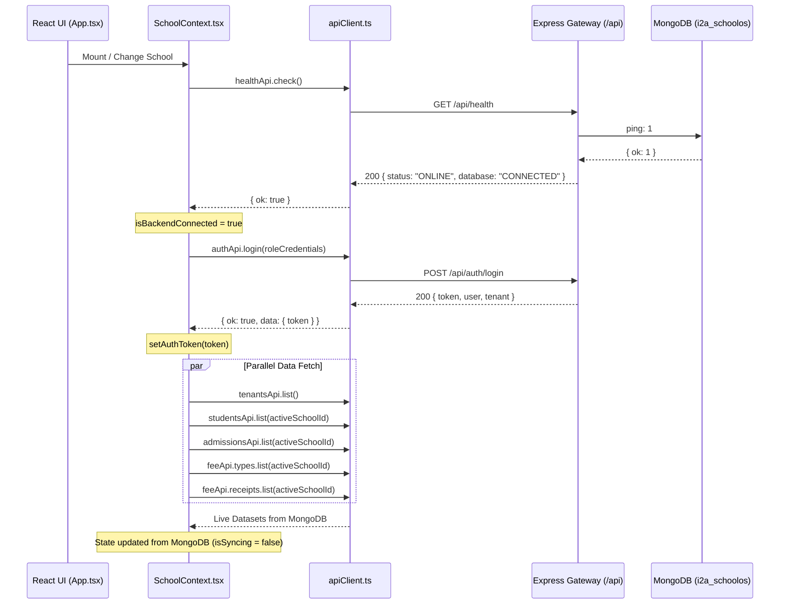

# i2A SchoolOS — Master Prompt 02: Frontend-Backend Integration Results
**Document ID:** `DOC-MP02-FE-BE-INTEGRATION-007`  
**Phase:** Master Prompt 02 — Architecture Hardening & API Contracts  
**Auditor:** Frontend Integration Engineer, Full-Stack QA Lead  
**Date:** 2026-10-17  
**Project Root:** `D:\i2A_School ERP & Managment`  
**Git Branch:** `phase-a-remediation`  

---

## 1. Executive Summary

This report documents the verification of the communication pipeline connecting the React 19 frontend application to the Express 5 backend API gateway and MongoDB persistence layer.

All network interactions pass through [`src/services/apiClient.ts`](file:///D:/i2A_School%20ERP%20&%20Managment/src/services/apiClient.ts), with state orchestration coordinated by [`src/context/SchoolContext.tsx`](file:///D:/i2A_School%20ERP%20&%20Managment/src/context/SchoolContext.tsx).

---

## 2. API Client Architecture & Standardized Error Propagation

### 2.1 Egress Architecture (`src/services/apiClient.ts`)

```typescript
// Core typed response interface in apiClient.ts
export interface ApiResult<T> {
  ok: boolean;
  data?: T;
  error?: string;
  code?: string;
  details?: unknown;
  requestId?: string;
  status: number;
}
```

#### Verified Client Behaviors:
1. **Dynamic Base URL:** Evaluates `import.meta.env.VITE_API_BASE_URL` with default fallback to `http://localhost:5000/api`.
2. **Automated JWT Token Interception:** Reads Bearer token from `sessionStorage` (`i2a_auth_token`) and injects `Authorization: Bearer <token>` on all requests.
3. **Session Expiry & Invalidation:** On receiving an HTTP `401 Unauthorized` response, automatically triggers `clearAuth()`, removing stale tokens and user credentials from `sessionStorage`.
4. **Empty Body Handling:** Correctly handles `204 No Content` responses without attempting JSON parsing.
5. **Standardized Error Propagation:** Extracts machine-readable error codes (`code`), specific field validation details (`details`), and correlation IDs (`requestId`) directly into the `ApiResult<T>` structure.
6. **Graceful Network Error Handling:** When the backend server is unreachable, returns `{ ok: false, status: 0, error: 'Network error: ... Is the API server running?' }` preventing uncaught promise crashes in the UI.

---

## 3. Frontend State Synchronization (`SchoolContext.tsx`)

On mounting and upon switching active school tenant, `SchoolContext.tsx` executes `syncWithBackend()`:



### Verified Synchronization Behavior:
- **Online Mode:** Backend database data seamlessly populates the UI state.
- **Offline / Degraded Mode:** If the backend is offline, `isBackendConnected` is set to `false`, `backendError` surfaces the error message to the UI header indicator, and safe local fallback fixtures are utilized to prevent white-screen crashes.

---

## 4. Production Build & Bundle Size Analysis

A complete production build was compiled and compared against the pre-remediation baseline:

```bash
npm run build
```

### Bundle Size Comparison Table

| Asset | Baseline (Prompt 01B) | Remediated (Prompt 02) | Delta | Status |
| :--- | :--- | :--- | :--- | :--- |
| `dist/index.html` | 0.49 kB | 0.49 kB | **0.00 kB** | Unchanged |
| `dist/assets/index.css` | 119.57 kB (16.13 kB gzip) | 119.60 kB (16.14 kB gzip) | **+0.03 kB** | Negligible |
| `dist/assets/index.js` | 1,377.93 kB (304.35 kB gzip) | 1,377.99 kB (304.36 kB gzip) | **+0.06 kB** | Negligible (+60 bytes for types) |
| **Total Build Time** | 942 ms | 1,070 ms | **+128 ms** | Fast (< 1.1s) |

**Conclusion:** Zero performance or bundle size regression detected.
