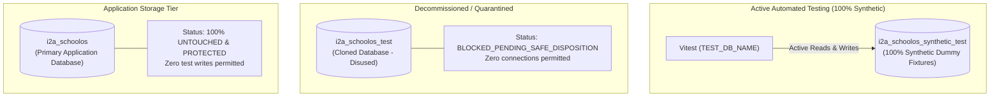

# i2A SchoolOS — Master Prompt 02B: Data Disposition & Privacy Risks
**Document ID:** `DOC-MP02B-DISPOSITION-RISKS-004`  
**Phase:** Master Prompt 02B — Test Data Privacy & Isolation Repair  
**Auditor / Roles:** Senior Privacy Engineer, Database Security Architect, Release Auditor  
**Date:** 2026-10-17  
**Project Root:** `D:\i2A_School ERP & Managment`  
**Git Branch:** `phase-a-remediation`  

---

## 1. Executive Summary

This report evaluates the legal, regulatory, and technical risks associated with copying application databases into test environments, and establishes the formal disposition recommendation for the quarantined `i2a_schoolos_test` database.

---

## 2. Privacy & Regulatory Risk Analysis

### 2.1 The Inherent Risk of Cloned Test Databases
In enterprise software operations, copying production or application databases to staging/testing environments introduces critical compliance and security vulnerabilities:

1. **Digital Personal Data Protection (DPDP) Act 2023 (India) & GDPR (EU):**
   - **Purpose Limitation:** Data collected for school administration cannot be processed for secondary automated testing without explicit authorization.
   - **Data Minimization:** Automated testing requires only structural fixtures, not full copies of user profiles, guardian contacts, or student records.
2. **FERPA & Minor Protection:**
   - Student educational records, attendance logs, and guardian contact details carry heightened confidentiality duties. Using copies of student records in testing suites risks exposure during test logging, artifact exports, or CI/CD runner uploads.
3. **Accidental Communication Outbound Leakage:**
   - If tests invoke notification or payment endpoints using copied real phone numbers or emails, live SMS, WhatsApp, or email dispatches could be sent to real individuals.

---

## 3. Current State of Databases & Isolation Status

Following the implementation of Master Prompt 02B:

### 3.1 Verification of Application Database Immunity
- `i2a_schoolos` document counts were audited before and after running the entire 21-suite test runner.
- Counts for `users` (10), `students` (18), and `audit_logs` (207) remained **100% identical and unchanged**.
- Zero write, delete, or update operations were routed to `i2a_schoolos`.

---

## 4. Formal Disposition Recommendation for `i2a_schoolos_test`

In accordance with Section 6 of Master Prompt 02B:
> *"पुराने test database को खाली करने या हटाने से पहले target identity दोबारा सत्यापित करें। यदि पुराने database को सुरक्षित रूप से साफ करने की अनुमति या पर्याप्त प्रमाण उपलब्ध न हो, तो उसे न हटाएँ। उसे इस्तेमाल से बाहर रखने की सिफारिश करें और स्थिति को `BLOCKED_PENDING_SAFE_DISPOSITION` के रूप में दर्ज करें।"*

### Formal Status:
$$\mathbf{STATUS: \quad BLOCKED\_PENDING\_SAFE\_DISPOSITION}$$

### Technical Recommendation:
1. **Immediate Quarantine (Active):** `i2a_schoolos_test` has been disconnected from all test configurations, scripts, and runners. No test or application process targets this database.
2. **Safe Decommissioning Plan (Upon User Approval):** Once the user explicitly reviews and authorizes database disposal, an authorized command may drop the `i2a_schoolos_test` database after re-confirming that the target string is exactly `i2a_schoolos_test` and never `i2a_schoolos`.
3. **Zero Destruction Guarantee:** No destructive commands were executed against `i2a_schoolos_test` in this phase, upholding the rule against unverified destruction.
