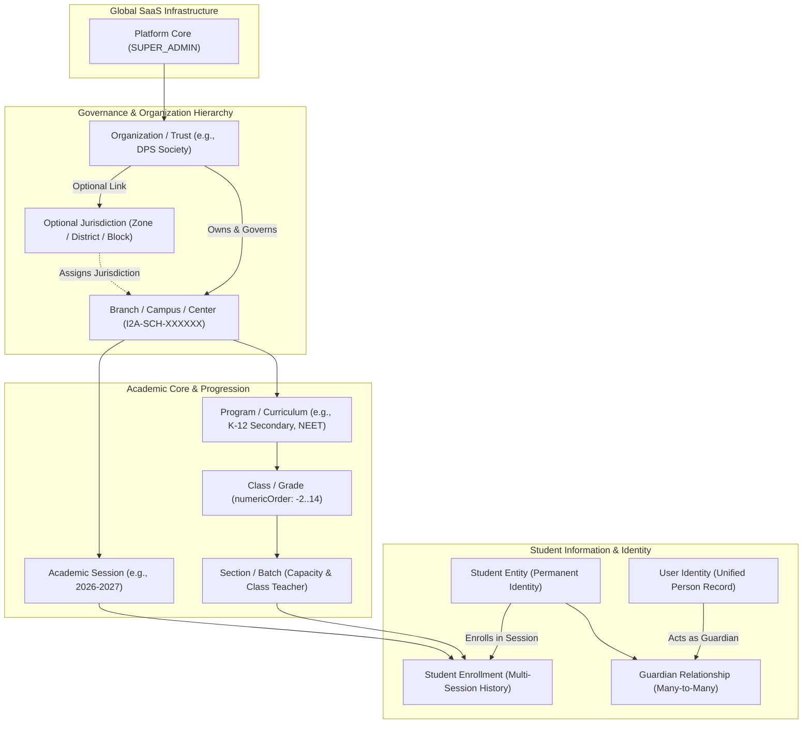

# i2A SchoolOS — Master Prompt 03: Domain Model Overview
**Document ID:** `DOC-MP03-DOMAIN-OVERVIEW-001`  
**Phase:** Master Prompt 03 — Domain Model, Data Dictionary & Organization Hierarchy  
**Architect:** Principal Software Architect, Database Architect, Multi-Tenant SaaS Security Lead  
**Date:** 2026-10-17  
**Project Root:** `D:\i2A_School ERP & Managment`  
**Git Branch:** `phase-a-remediation`  

---

## 1. Executive Summary & Domain Philosophy

Educational software architectures often fail in enterprise and multi-campus scenarios because they build upon rigid, single-school assumptions (e.g. hardcoding grade names "Class 1 to 12", assuming a single physical building, or conflating a legal trust with an individual school).

**i2A SchoolOS** establishes a **Universal Hierarchical Education Domain Architecture**. Whether deployed for a standalone rural playschool, an ICSE high school in Kolkata, a multi-campus educational society (e.g., Delhi Public School Society), a competitive test-prep academy in Kota, or a state education department, the same core domain model models the administrative, academic, and financial reality without requiring code changes.

---

## 2. Resolving Tenancy, Organization, and School Boundaries

Previous documentation analysis revealed potential confusion regarding the terms **Tenant**, **Organization**, and **School**. In Master Prompt 03, this relationship is formalized:

| Concept | Domain Role | Database Representation | Example |
| :--- | :--- | :--- | :--- |
| **Tenant** | Data isolation boundary. Scopes MongoDB collections, unique indexes, and queries. | `tenantFilter = { schoolId }` or `{ orgId }` | `I2A-SCH-000001` or `org-synth-dps` |
| **Organization** | Legal trust, corporate society, or government department that owns one or multiple schools. | `organizations` collection (`id: "org-xxx"`) | `Delhi Public Educational Trust` |
| **School / Branch / Campus** | Operating physical campus or virtual learning center where classes, students, timetables, and exams occur. | `tenants` collection (`id: "I2A-SCH-XXXXXX"`) | `ABC Public School, City Campus` |

### Architectural Invariants:
1. **Standalone School Model:** When a school is independent (not part of a group), `orgId = null`. It acts as its own self-contained tenant. No intermediate organizational or regional layers are forced.
2. **Multi-School Group Model:** When schools belong to an educational trust, each campus has an immutable `id: "I2A-SCH-XXXXXX"` and an `orgId: "org-xxx"`.
   - The Parent Organization Director (`ORG_DIRECTOR`) has read/management visibility across all child branches belonging to that organization.
   - An individual Branch Administrator (`PRINCIPAL` / `ADMIN`) is strictly confined to their authorized branch ID (`schoolId`).
3. **Identical Name Disambiguation:** Names of schools (e.g., "St. Xavier's High School" or "Ideal Public School") are **never** treated as unique keys. Two schools with identical names operating under different trusts or as independent entities have separate, immutable system identifiers (`I2A-SCH-000001` vs `I2A-SCH-000004`) and zero data leakage.

---

## 3. Core Subdomains & Boundaries

### 3.1 Subdomain 1: Institutional Governance & Hierarchy
- **Entities:** `Organization`, `AdministrativeUnit`, `BranchCampus`, `InstitutionConfiguration`.
- **Key Rules:**
  - Strict cycle detection prevents recursive hierarchy loops (e.g. Org A -> Org B -> Org A).
  - Validation ensures child organizations cannot reference non-existent parent organizations.
  - Official government identifiers (UDISE+ 11-digit code) are strictly validated via regex `^[0-9]{11}$` and never auto-generated or fabricated.

### 3.2 Subdomain 2: Academic Masters & Readiness
- **Entities:** `AcademicSession`, `ProgramCourse`, `ClassGrade`, `SectionBatch`, `SubjectMaster`.
- **Key Rules:**
  - **Single Active Session Rule:** Exactly one academic session per school may hold `isCurrent: true` and status `ACTIVE`. Activating a new session automatically transitions the previous session to `COMPLETED`.
  - **Flexible Grade Ordering:** Grades use `numericOrder` supporting Pre-Primary (Nursery = -2, LKG = -1, UKG = 0), K-12 (Grades 1 to 12), and Higher Ed / Coaching (13+). Hardcoded string matching is completely avoided.
  - **Section Capacity Enforcement:** Sections maintain `capacity` and `currentEnrolled`.

### 3.3 Subdomain 3: Student Information System & Academic Progression
- **Entities:** `StudentEntity`, `StudentEnrollmentEntity`, `StudentGuardianRelationshipEntity`.
- **Key Rules:**
  - **Separation of Student Identity from Enrollment:** The `StudentEntity` represents the lifelong educational identity (demographics, DOB, medical records, APAAR/PEN IDs). The `StudentEnrollmentEntity` records session-specific placement (academic session, class, section, roll number, promotion status).
  - **Multi-Session Progression:** Historical records (`PROMOTED`, `RETAINED`, `TRANSFERRED`) are preserved across sessions.
  - **Many-to-Many Guardianship:** Multiple guardians (Father, Mother, Legal Guardian) can be linked to a single student, and one guardian can be linked to multiple siblings, with designated primary contact and pickup authorizations.

### 3.4 Subdomain 4: Identity, Access & Role Scoping
- **Entities:** `UserAccountEntity`, `UserBranchAssignmentEntity`, `RolePermission`.
- **Key Rules:**
  - Server-side authoritative verification: `req.user` extracted strictly from cryptographically verified JWT tokens. Client parameters are never blindly trusted.
  - Granular RBAC enforces endpoint authorization (`SUPER_ADMIN`, `ORG_DIRECTOR`, `PRINCIPAL`, `ADMIN`, `TEACHER`, `ACCOUNTANT`, `STAFF`, `TRANSPORT`, `PARENT`, `STUDENT`).

### 3.5 Subdomain 5: Financial Operations & Auxiliary Systems
- **Entities:** `FeeType`, `FeeStructure`, `FeeReceipt`, `MarketplaceProduct`, `MarketplaceOrder`.
- **Key Rules:**
  - **Paise-Precision Financials:** All monetary calculations use strict 64-bit integer paise (e.g. ₹1,500.00 = `150000`). Floating-point arithmetic is prohibited.
  - **Tenant Boundary Enforcement:** All foreign references (student IDs, fee structures) must match the caller's tenant context.
