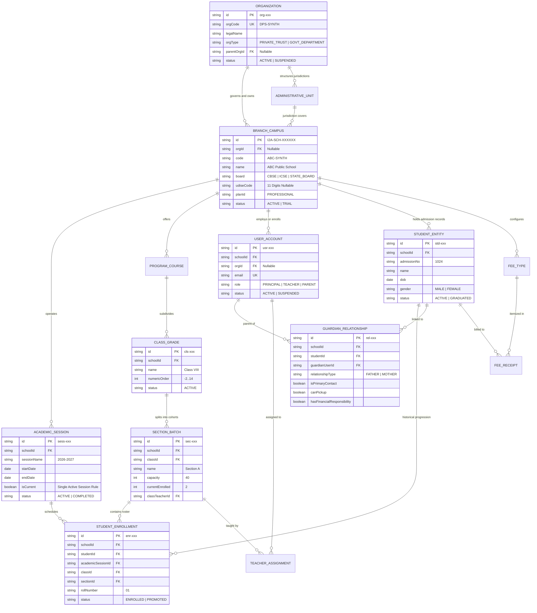

# i2A SchoolOS — Master Prompt 03: Entity Relationship Map
**Document ID:** `DOC-MP03-ERD-MAP-004`  
**Phase:** Master Prompt 03 — Domain Model, Data Dictionary & Organization Hierarchy  
**Architect:** Database Architect, Data Modeling Lead  
**Date:** 2026-10-17  
**Project Root:** `D:\i2A_School ERP & Managment`  
**Git Branch:** `phase-a-remediation`  

---

## 1. Global Multi-Tenant Entity Relationship Diagram

The following Mermaid diagram maps the complete relational architecture of i2A SchoolOS across governance, academic structures, student identity, and access control.

---

## 2. Cardinality & Relational Invariants

| Parent Entity | Child Entity | Cardinality | Deletion Rule | Enforced Boundary |
| :--- | :--- | :--- | :--- | :--- |
| `ORGANIZATION` | `BRANCH_CAMPUS` | `1 : N` | `RESTRICT` | Cannot delete Organization while branches exist. |
| `BRANCH_CAMPUS` | `ACADEMIC_SESSION` | `1 : N` | `RESTRICT` | Cannot delete branch while sessions exist. |
| `ACADEMIC_SESSION` | `STUDENT_ENROLLMENT`| `1 : N` | `RESTRICT` | Sessions containing enrollments cannot be deleted. |
| `CLASS_GRADE` | `SECTION_BATCH` | `1 : N` | `RESTRICT` | Cannot drop class containing active sections. |
| `STUDENT_ENTITY` | `STUDENT_ENROLLMENT`| `1 : N` | `RESTRICT` | Student identity preserved across historical sessions. |
| `STUDENT_ENTITY` | `GUARDIAN_RELATIONSHIP`| `M : N` | `CASCADE` | Removing student removes guardian links. |
| `USER_ACCOUNT` | `GUARDIAN_RELATIONSHIP`| `M : N` | `CASCADE` | Removing parent user cleans up relationship links. |
| `SECTION_BATCH` | `STUDENT_ENROLLMENT`| `1 : N` | `RESTRICT` | Section capacity enforced; cannot exceed max capacity. |

---

## 3. Cross-Tenant Integrity Validation Rules

In accordance with strict multi-tenant isolation:
1. **Foreign Key Alignment:** A `STUDENT_ENROLLMENT` document must satisfy:
   $$\text{student.schoolId} = \text{session.schoolId} = \text{class.schoolId} = \text{section.schoolId} = \text{enrollment.schoolId}$$
2. If any foreign entity belongs to a different school or tenant, the transaction is rejected with `CROSS_TENANT_VIOLATION`.
3. **Primary Contact Rule:** For any student, exactly one guardian link in `guardian_relationships` can have `isPrimaryContact: true`. When a new primary contact is designated, previous primary flags are automatically updated to `false`.
