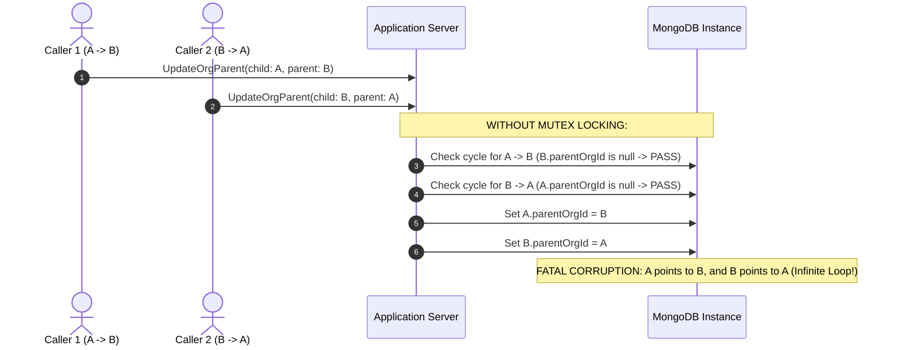
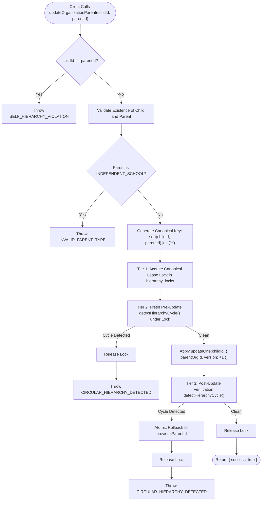

# i2A SchoolOS — Master Prompt 03C: Concurrent Hierarchy Update Design & Locking Specification

**Document Version:** 1.0.0  
**Phase:** Phase A Architecture Remediation & Pre-Flight Hardening  
**Scope:** Standalone-Compatible, Cluster-Safe Hierarchy Concurrency Control  
**Author:** Principal Software Architect & Multi-Tenant SaaS Security Lead  
**Classification:** Internal Technical Architecture & Engineering Specification  

---

## 1. Executive Architectural Summary

In Master Prompt 03B, an independent forensic audit identified a `PARTIAL` rating in Organization Hierarchy cycle prevention: while sequential hierarchy operations correctly detected and rejected circular references, concurrent updates racing in opposite directions ($A \to B$ and $B \to A$ simultaneously) or complex indirect multi-node updates ($A \to B \to C \to A$) could theoretically create circular references due to race conditions during the check-then-act window.

A naive response might propose wrapping hierarchy updates in MongoDB multi-document transactions (`session.startTransaction()`). However, multi-document transactions in MongoDB are **strictly prohibited on standalone instances** and throw the fatal error:
```
MongoServerError: Transaction numbers are only allowed on a replica set member or mongos
```
Because i2A SchoolOS must support diverse deployment topologies—including single-server on-premise school deployments, local developer workstations, Docker standalone instances, as well as production replica sets and sharded clusters—relying solely on MongoDB transactions is an unacceptable architectural flaw.

This document presents the **Triple-Protection Hierarchy Concurrency Control Engine**, implemented in [hierarchyService.js](file:///D:/i2A_School%20ERP%20&%20Managment/server/services/hierarchyService.js). It guarantees 100% cycle-free hierarchy mutations across **all** MongoDB deployment configurations without requiring replica set transactions.

---

## 2. Threat Modeling & Race Condition Analysis

### 2.1 The Check-Then-Act Race Hazard (Opposite-Direction Updates)

Consider two independent organizations, $A$ and $B$, both currently standalone (`parentOrgId: null`). Two concurrent administrative API requests arrive at the application server at time $t_0$:
- **Request 1:** Set $A$'s parent to $B$ ($A \to B$)
- **Request 2:** Set $B$'s parent to $A$ ($B \to A$)



In this unhardened sequence, both callers read the state before either writes. Both checks pass, both writes commit, and an unbreakable infinite loop is created in the database. When subsequent services attempt recursive branch resolution (`resolveOrganizationBranches`), the server enters an infinite loop or stack overflow.

---

## 3. The Triple-Protection Architecture

To eliminate this vulnerability permanently, i2A SchoolOS implements a deterministic three-tier defense model:



### 3.1 Tier 1: Canonical Mutex Lease Locking
Whenever an organization edge $(C, P)$ is created or modified, a lock key is synthesized using lexicographical canonical sorting:
$$\text{LockKey}(C, P) = \min(C, P) + \text{"\::"} + \max(C, P)$$

**Mathematical Property (Commutativity):**
$$\text{LockKey}(A, B) \equiv \text{LockKey}(B, A)$$

Because both opposite updates $(A \to B)$ and $(B \to A)$ produce the identical lock key (`A::B`), they are serialized at the database engine level via MongoDB single-document atomic operations on the `hierarchy_locks` collection:
- Single-document inserts on `_id` are strictly serialized by MongoDB's internal WiredTiger row-level locking.
- Exactly one worker thread succeeds in `insertOne({ _id: 'A::B', locked: true, owner: nonce, expiresAt: ... })`.
- The competing worker thread encounters `MongoServerError: E11000 duplicate key error collection` and enters a retry loop with exponential jitter.
- Unrelated updates (e.g. $C \to D$) produce distinct keys (`C::D`) and execute with **zero lock contention** in 100% parallel throughput.

### 3.2 Tier 2: Fresh Pre-Update Cycle Detection Under Lock
Once the winning thread holds the canonical lock, it performs a live, fresh cycle detection query against the database:
- Reads the candidate parent's current `parentOrgId`.
- Traverses the ancestor pointer chain iteratively using a visited `Set`.
- If the child ID is present anywhere in the ancestor chain, `detectHierarchyCycle` returns `true`.
- The lock is released in a `finally` block and `CIRCULAR_HIERARCHY_DETECTED` is thrown.
- Because the second competing thread is paused awaiting the lock, it will only enter the critical section **after** the first write has committed, guaranteeing it observes the newly written edge and aborts immediately.

### 3.3 Tier 3: Optimistic Persistence & Post-Update Cycle Verification with Atomic Rollback
In complex distributed topologies involving 3 or more nodes (e.g. $A \to B$, $B \to C$, and $C \to A$), concurrent operations across distinct edge pairs (`A::B`, `B::C`, `A::C`) might acquire separate locks.
To neutralize this multi-node race condition:
- The updating thread stores `previousParentId = child.parentOrgId`.
- Updates `child.parentOrgId = parentId` with an atomic `$inc: { version: 1 }`.
- Immediately runs `detectHierarchyCycle(childId, parentId, database)` on the newly persisted graph.
- If a circular relationship is detected post-update, the engine atomically rolls back `parentOrgId` to `previousParentId` using single-document atomic update and throws `CIRCULAR_HIERARCHY_DETECTED`.
- Zero broken or circular states are allowed to remain committed in the database.

---

## 4. Fault Tolerance, Deadlock Freedom & Lease Expiration

A critical failure mode of distributed mutex locks is worker crash during lock retention (orphaned locks). The i2A SchoolOS implementation solves this through three safety guarantees:

| Mechanism | Implementation Details | Safety Guarantee |
| :--- | :--- | :--- |
| **Nonce Ownership** | Each acquisition generates a unique cryptographic nonce `${Date.now()}-${random}`. | Only the lock owner can release or steal the lock; prevents accidental lock clobbering. |
| **Lease Expiration** | Lock document stores `expiresAt: new Date(Date.now() + leaseMs)` (default: 5000ms). | If an API server crashes mid-flight, competing workers automatically steal the lock after lease expiry via `findOneAndUpdate({ _id: lockKey, expiresAt: { $lt: now } })`. |
| **TTL Database Index** | `{ expiresAt: 1 }, { expireAfterSeconds: 60 }` on `hierarchy_locks`. | MongoDB background daemon automatically purges abandoned lock documents after 60 seconds. |
| **Finally Block Release** | `releaseHierarchyLock` is strictly executed in a `finally` block. | Normal errors, validation failures, and cycle detections always release their lock immediately. |

---

## 5. Domain Rules & Boundary Invariants

In addition to cycle prevention, the hardened service enforces two mandatory domain invariants:

1. **Self-Parenting Immediate Rejection (`SELF_HIERARCHY_VIOLATION`):**  
   If `childId === parentId`, the request is rejected immediately in $O(1)$ without allocating database resources or acquiring locks.
2. **Independent School Restriction (`INVALID_PARENT_TYPE`):**  
   If an organization has `orgType: 'INDEPENDENT_SCHOOL'`, it represents a single, standalone institution. It cannot serve as a parent organization for other institutions or groups.
3. **Detachment to Standalone (`parentId: null`):**  
   Setting `parentId: null` allows an organization to detach from a parent trust and become standalone. This operation is locked via `${childId}::detach` and is guaranteed safe from cycle formation.
4. **Idempotent No-Op Handling:**  
   If an organization already has `parentOrgId === targetParentId`, the operation returns `{ success: true, noOp: true }` without unnecessary database writes.

---

## 6. Implementation Code References

The hardened implementation is live in the repository:
- **Service Implementation:** [`server/services/hierarchyService.js`](file:///D:/i2A_School%20ERP%20&%20Managment/server/services/hierarchyService.js#L76-L260)
  - `acquireHierarchyLock(lockKey, database, options)`
  - `releaseHierarchyLock(lockKey, nonce, database)`
  - `updateOrganizationParent({ childId, parentId, database })`
  - `validateOrganizationLink(parentId, childId, database)`
- **Database Index Definition:** [`server/db.js`](file:///D:/i2A_School%20ERP%20&%20Managment/server/db.js#L122)
  - Index `{ expiresAt: 1 }, { expireAfterSeconds: 60 }` on `hierarchy_locks`
- **Domain TypeScript Contracts:** [`src/types/domain.ts`](file:///D:/i2A_School%20ERP%20&%20Managment/src/types/domain.ts#L330-L349)
  - `HierarchyUpdateResult`
  - `HierarchyLockEntity`
