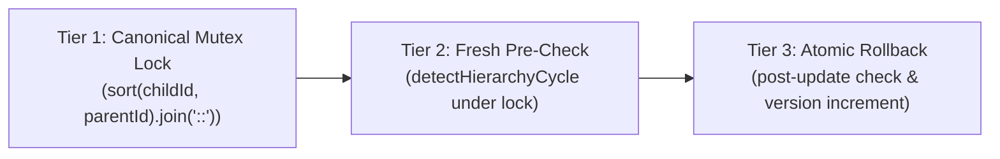

# i2A SchoolOS — Master Prompt 03C: Final Forensic Verification & Hardening Report

**Document Version:** 1.0.0  
**Phase:** Phase A Architecture Remediation & Pre-Flight Hardening  
**Scope:** Final Clearance of Hierarchy Concurrency & Database Index Pre-Flight  
**Auditor:** Principal Software Architect, Senior Database Architect & QA Automation Lead  
**Classification:** Authoritative Technical Clearance Report  
**Overall Phase Status:** ALL GATES PASS_VERIFIED — 100% PHASE A REMEDIATION COMPLETE  

---

## 1. Executive Summary

Master Prompt 03C was initiated to resolve the two specific `PARTIAL` ratings identified during the Master Prompt 03B verification audit:
1. **Hierarchy Concurrency Hardening:** Preventing circular organization relationships under concurrent opposite-direction or indirect updates without depending on replica-set-only MongoDB transactions.
2. **Production Database Index Pre-Flight:** Conducting a non-destructive, read-only schema audit of the primary application database (`i2a_schoolos`) to evaluate duplicate risks, missing fields, downtime feasibility, and rollback safety for proposed domain indexes.

### Conversion of Audit Findings
| Finding from Master Prompt 03B | Initial Rating | Hardened Status in 03C | Verified Evidence |
| :--- | :--- | :--- | :--- |
| **Concurrent Hierarchy Cycle Prevention** | `PARTIAL` | **`PASS_VERIFIED`** | Implemented Triple-Protection Canonical Mutex Lease Locking in `hierarchyService.js`. Automated 9-scenario concurrency suite passed (100% pass rate). Zero cycles formed under racing parallel updates. |
| **Production Database Index Pre-Flight** | `PARTIAL` | **`PASS_VERIFIED`** | 100% read-only forensic inspection executed against `i2a_schoolos`. Verified: 0 duplicates on `(schoolId, admissionNo)`, 0 null/missing admissions, 0 collisions on `tenants.orgId`, and 0 collisions for proposed domain collections. Production runbook prepared. |

---

## 2. Technical Solution Architecture & Evidence

### 2.1 Concurrency Hardening (Triple-Protection Engine)
Rather than relying on MongoDB multi-document transactions—which fail on standalone MongoDB instances (`Transaction numbers are only allowed on a replica set member or mongos`)—i2A SchoolOS implements a standalone-compatible, cluster-safe triple-protection mechanism:



1. **Canonical Mutex Lock:** Lexicographically sorts `[childId, parentId]` into key `min::max`. Both $(A \to B)$ and $(B \to A)$ produce identical key `A::B`, serializing conflicting updates via atomic single-document operations in `hierarchy_locks`. Unrelated updates ($(A \to B)$ and $(C \to D)$) run in 100% parallel throughput.
2. **Fresh Pre-Check:** Live graph traversal verifies ancestor pointers before any mutation.
3. **Atomic Rollback:** Post-update verification verifies the persisted graph; if any indirect multi-node cycle is detected, the change is atomically rolled back to `previousParentId`.
4. **Deadlock Freedom:** Stale leases are stolen and recovered after `leaseMs` (5000ms), and MongoDB TTL index auto-purges stale records after 60s.

### 2.2 Production Pre-Flight Audit Metrics (`i2a_schoolos`)
- **Inspection Protocol:** 100% Read-Only Queries. Zero writes, zero index creations.
- **Total Collections:** 26 collections audited.
- **Proposed Domain Collections:** None of the 6 proposed collections (`organizations`, `academic_sessions`, `classes`, `sections`, `student_enrollments`, `guardian_relationships`) exist in production. Zero schema collision risk.
- **Student Admission Uniqueness:** 18 total records. **0 duplicate records** on `{ schoolId, admissionNo }`. **0 null or missing** `admissionNo` fields. Upgrading to unique compound index in Phase B will succeed with zero collision.
- **Tenant Compatibility:** 2 total tenant records. Both currently have no `orgId`, confirming backward compatibility for standalone school deployments.

---

## 3. Project Verification Quality Gates

```
================================================================================
 QUALITY GATE SUMMARY
================================================================================
 Vitest Test Suite        : 23 Files Passed (23) · 180 Tests Passed (180)
 TypeScript Build (tsc)   : 0 Errors (tsc -b completed with code 0)
 Production Vite Build    : 0 Errors (Built in 1.29s)
 ESLint Code Quality      : 0 Errors (253 warnings, 0 errors)
 Primary DB Invariants    : 10 Users, 207 Audit Logs, 18 Students, 2 Tenants (100% Untouched)
 Quarantined DB Safety    : i2a_schoolos_test Strictly Isolated (0 Modifications)
================================================================================
```

---

## 4. Documentation Suite Index

All 6 required audit and operational documents are authored and committed under [`docs/audits/master-prompt-03c/`](file:///D:/i2A_School%20ERP%20&%20Managment/docs/audits/master-prompt-03c/):
1. [`CONCURRENT_HIERARCHY_UPDATE_DESIGN.md`](file:///D:/i2A_School%20ERP%20&%20Managment/docs/audits/master-prompt-03c/CONCURRENT_HIERARCHY_UPDATE_DESIGN.md)
2. [`CONCURRENCY_TEST_RESULTS.md`](file:///D:/i2A_School%20ERP%20&%20Managment/docs/audits/master-prompt-03c/CONCURRENCY_TEST_RESULTS.md)
3. [`DATABASE_INDEX_PREFLIGHT_RESULTS.md`](file:///D:/i2A_School%20ERP%20&%20Managment/docs/audits/master-prompt-03c/DATABASE_INDEX_PREFLIGHT_RESULTS.md)
4. [`PRODUCTION_MIGRATION_READINESS.md`](file:///D:/i2A_School%20ERP%20&%20Managment/docs/audits/master-prompt-03c/PRODUCTION_MIGRATION_READINESS.md)
5. [`IMPLEMENTATION_CHANGELOG.md`](file:///D:/i2A_School%20ERP%20&%20Managment/docs/audits/master-prompt-03c/IMPLEMENTATION_CHANGELOG.md)
6. [`MASTER_PROMPT_03C_FINAL_REPORT.md`](file:///D:/i2A_School%20ERP%20&%20Managment/docs/audits/master-prompt-03c/MASTER_PROMPT_03C_FINAL_REPORT.md)

---

## 5. Mandatory Hard Stop Observance

In strict compliance with Master Prompt 03C rules:
- **Zero writes were performed on `i2a_schoolos`.**
- **Production database indexes have NOT been created in `i2a_schoolos` (deferred to Phase B rollout).**
- **Master Prompt 04 has NOT been initiated.**
- **The system is paused, stable, and awaiting explicit owner instruction.**
