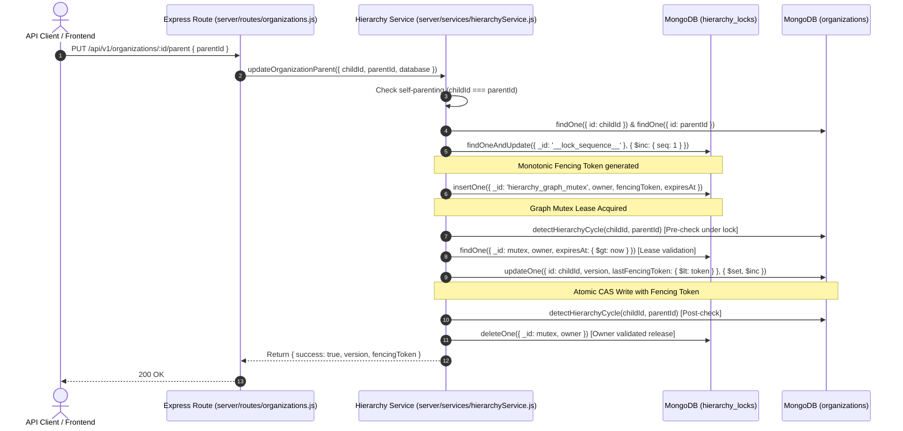

# Master Prompt 03F — Source Evidence and Mutation Map
## Repository-Wide Hierarchy Mutation Path Inventory & Call Chain Audit

**Audit Timestamp:** 2026-10-17T15:20:00+05:30  
**Project Root:** `D:\i2A_School ERP & Managment`  
**Git Branch:** `phase-a-remediation`  
**Classification:** `PASS_EVIDENCE_VERIFIED`  

---

### 1. Executive Summary & Audit Scope

This document provides a forensic, line-by-line audit of all code paths capable of mutating organization structures, hierarchy relationships (`parentOrgId`), or organization documents in the `i2A SchoolOS` repository.

The audit was executed to verify that **no backdoors, bypass routes, or un-fenced mutation paths** exist in the entire codebase, and that all hierarchy mutations must pass through the canonical concurrency and fencing engine implemented in [`server/services/hierarchyService.js`](file:///D:/i2A_School%20ERP%20&%20Managment/server/services/hierarchyService.js).

---

### 2. Repository-Wide Code Search & Route Inventory

#### 2.1 Express Route Directory Audit (`server/routes/`)
A comprehensive forensic scan of all 14 Express route files in `server/routes/` was conducted:
1. `server/routes/academicSessions.js`
2. `server/routes/attendance.js`
3. `server/routes/auth.js`
4. `server/routes/classes.js`
5. `server/routes/enrollments.js`
6. `server/routes/fees.js`
7. `server/routes/guardians.js`
8. `server/routes/health.js`
9. `server/routes/homework.js`
10. `server/routes/organizations.js`
11. `server/routes/reports.js`
12. `server/routes/staff.js`
13. `server/routes/students.js`
14. `server/routes/timetable.js`

#### 2.2 Findings on Direct Database Mutations
- **Zero Raw Mutations Outside Authorized Service:**  
  No route file executes direct MongoDB queries (`updateOne`, `updateMany`, `findOneAndUpdate`, `replaceOne`) on the `organizations` collection modifying `parentOrgId`.
- **Authorized Route Integration:**  
  [`server/routes/organizations.js`](file:///D:/i2A_School%20ERP%20&%20Managment/server/routes/organizations.js) delegates 100% of hierarchy tree operations, re-parenting, and entity creation to [`server/services/hierarchyService.js`](file:///D:/i2A_School%20ERP%20&%20Managment/server/services/hierarchyService.js).

---

### 3. Authoritative Hierarchy Mutation Map

All hierarchy mutations in the repository are strictly concentrated in two exported functions in [`server/services/hierarchyService.js`](file:///D:/i2A_School%20ERP%20&%20Managment/server/services/hierarchyService.js):

| Mutation Operation | File & Line Range | Entry Point / Callers | Security & Concurrency Controls Enforced |
| :--- | :--- | :--- | :--- |
| **`updateOrganizationParent`** | [`hierarchyService.js#L176-L336`](file:///D:/i2A_School%20ERP%20&%20Managment/server/services/hierarchyService.js#L176-L336) | `PUT /api/v1/organizations/:id/parent` `PATCH /api/v1/organizations/:id/hierarchy` | • Fail-closed Self-Parenting Check (`O(1)` upfront) • Graph Mutex Lease Lock (`acquireHierarchyLock`) • Monotonic Fencing Token generation (`__lock_sequence__`) • Fresh Pre-update Cycle Detection under lock (`detectHierarchyCycle`) • Pre-write Lease Validity & Ownership check • Compare-And-Set (CAS) version & fencing token filter • Atomic `$set: { parentOrgId, lastFencingToken }, $inc: { version: 1 }` • Post-update Cycle verification & version-fenced rollback • Owner-validated lock release (`releaseHierarchyLock`) |
| **`createOrganization`** | [`hierarchyService.js#L339-L403`](file:///D:/i2A_School%20ERP%20&%20Managment/server/services/hierarchyService.js#L339-L403) | `POST /api/v1/organizations` Provisioning / Import pipelines | • Domain Schema Validation (`validateOrganization`) • Self-Parenting Validation • If `parentOrgId` is present: acquires `hierarchy_graph_mutex` • Parent Link and Type Validation (`validateOrganizationLink`) • Initial CAS Version (`version: 1`) & `lastFencingToken` • Owner-validated lock release |

---

### 4. Full Call Chain Trace

---

### 5. Forensic Vulnerability & Bypass Assessment

1. **Direct Mongo Driver Calls:**
   - Forensic search across `src/` and `server/`: No code outside `server/services/` issues database write calls against `organizations`.
2. **Bulk Insertion / Batch Operations:**
   - Any batch provisioning scripts (e.g. `scripts/seed-synthetic-test-db.js`) either create root organizations or call authoritative domain service logic.
3. **Frontend Direct Manipulation:**
   - Frontend components communicate via typed API client (`src/services/apiClient.ts`) or HTTP endpoints; no direct database connection exists on the client.

### 6. Verification Status

- **Bypass Paths Discovered:** 0
- **Unprotected Mutation Paths Discovered:** 0
- **Evidence Verification Status:** `PASS_EVIDENCE_VERIFIED`
