# Master Prompt 03H — Replica Set Configuration Plan
## Infrastructure Inspection, Safe Local Replica Set Strategy, and Operational Runbook

**Audit Timestamp:** 2026-10-17T15:49:15+05:30  
**Project Root:** `D:\i2A_School ERP & Managment`  
**Git Branch:** `phase-a-remediation`  
**Execution Mode:** Local Development & Synthetic Testing Only  
**Verdict:** Strategy Formulated & Safely Verified  

---

### 1. Forensic Inspection of Existing MongoDB Installation

Prior to designing or applying any configuration changes, a read-only inspection of the active system was performed:

| Property | Inspected System Value | Source of Evidence |
| :--- | :--- | :--- |
| **MongoDB Version** | `v8.3.1` (Build: `094e631246d5b5bee5bd5f20b12f882bc8e286ea`, arch: amd64) | `mongod.exe --version` |
| **Windows Service Name** | `MongoDB` (Display: `MongoDB Server (MongoDB)`) | `Win32_Service` WMI query |
| **Service Binary Path** | `"C:\Program Files\MongoDB\Server\8.3\bin\mongod.exe"` | `PathName` from Service Manager |
| **Service Config Path** | `"C:\Program Files\MongoDB\Server\8.3\bin\mongod.cfg"` | Windows Service Argument |
| **Default Data Directory** | `C:\Program Files\MongoDB\Server\8.3\data` | `mongod.cfg` (`storage.dbPath`) |
| **Default Network Bind** | Port `27017`, Bind IP `127.0.0.1` | `mongod.cfg` (`net.port`, `net.bindIp`) |
| **Current Topology** | **STANDALONE** (`ismaster: true, setName: undefined`) | Live `adminCommand({ isMaster: 1 })` |
| **Active OS Privileges** | Non-Elevated Standard User (`IsInRole(Administrator): False`) | `WindowsIdentity.GetCurrent()` |
| **Config File Permissions** | `BUILTIN\Administrators` & `SYSTEM`: FullControl;<br>`BUILTIN\Users`: ReadOnly | Windows ACL inspection (`Get-Acl`) |

---

### 2. Constraints & Safety Invariants

In accordance with Section 1 of Master Prompt 03H:
1. **Administrative Access Boundary:** Modifying `C:\Program Files\MongoDB\Server\8.3\bin\mongod.cfg` or stopping/restarting the Windows Service requires Administrator privileges. Because the current process is non-elevated, attempting to stop or alter the system Windows Service directly would fail or violate security boundaries.
2. **Data Directory Preservation:** Under no circumstances will `C:\Program Files\MongoDB\Server\8.3\data` be deleted, reinitialized, or overwritten. The primary database `i2a_schoolos` and quarantined database `i2a_schoolos_test` reside there and must remain strictly undisturbed.
3. **Synthetic Test Isolation:** All replica set testing must exclusively target `i2a_schoolos_synthetic_test`.

---

### 3. Dual-Track Deployment Architecture

To satisfy both **immediate, safe development verification** and **future production deployment**, two distinct approaches are defined:

```mermaid
flowchart TD
    subgraph TrackA["Approach A: Non-Privileged Dedicated Test Replica Set (Active Now)"]
        A1["Port 27018 / Isolated Scratch DB Path"] --> A2["mongod.exe --replSet rs0 --port 27018"]
        A2 --> A3["rs.initiate() on 27018"]
        A3 --> A4["Zero Impact on Port 27017 Windows Service"]
        A4 --> A5["Runs Full ACID Multi-Document Transactions"]
    end

    subgraph TrackB["Approach B: System-Wide Service Reconfiguration on Port 27017 (Production)"]
        B1["User provides Administrator Elevation"] --> B2["Update mongod.cfg: replication.replSetName = rs0"]
        B2 --> B3["Restart-Service MongoDB"]
        B3 --> B4["rs.initiate() on 27017"]
        B4 --> B5["Preserves all data in C:\\Program Files\\...\\data"]
    end
```



---

### 4. Approach A: Dedicated Non-Privileged Replica Set (Active for Synthetic Testing)

#### 4.1 Specification
- **Port:** `27018`
- **Host:** `127.0.0.1`
- **Replica Set Name:** `rs0`
- **Data Directory:** `D:\i2A_School ERP & Managment\.mongo_rs_data` (isolated, non-root, git-ignored)
- **Connection URI:** `mongodb://127.0.0.1:27018/?replicaSet=rs0&directConnection=true`
- **Target Database:** `i2a_schoolos_synthetic_test`

#### 4.2 Automated Lifecycle Script
A helper script launches, health-checks, initiates, and shuts down this dedicated replica set:
- **Startup:**
  ```powershell
  & "C:\Program Files\MongoDB\Server\8.3\bin\mongod.exe" --port 27018 --dbpath "D:\i2A_School ERP & Managment\.mongo_rs_data" --replSet rs0 --bind_ip 127.0.0.1
  ```
- **Initiation:**
  ```javascript
  await admin.command({ replSetInitiate: {} });
  // Waits until hello.isWritablePrimary === true (takes ~500ms)
  ```
- **Verification:** Successfully executed and confirmed in live tests (`ACID MULTI-DOCUMENT TRANSACTION SUCCEEDED ON RS0!`).

---

### 5. Approach B: System-Wide Windows Service Reconfiguration Runbook (For Administrator)

When the system owner chooses to configure the primary Windows service permanently on port 27017:

#### 5.1 Step 1: Backup Configuration
```powershell
Copy-Item "C:\Program Files\MongoDB\Server\8.3\bin\mongod.cfg" "C:\Program Files\MongoDB\Server\8.3\bin\mongod.cfg.bak"
```

#### 5.2 Step 2: Edit `mongod.cfg` (Elevated Administrator)
Add the following block under `#replication:`:
```yaml
replication:
  replSetName: rs0
```

#### 5.3 Step 3: Restart Windows Service
```powershell
Restart-Service MongoDB
```

#### 5.4 Step 4: Initiate Replica Set on Primary Port
```powershell
mongosh --port 27017 --eval "rs.initiate()"
```

#### 5.5 Step 5: Rollback Procedure (If Needed)
If any failure occurs:
1. Restore original configuration:
   ```powershell
   Copy-Item -Force "C:\Program Files\MongoDB\Server\8.3\bin\mongod.cfg.bak" "C:\Program Files\MongoDB\Server\8.3\bin\mongod.cfg"
   ```
2. Restart service:
   ```powershell
   Restart-Service MongoDB
   ```
3. Database immediately returns to standalone mode with zero data loss.

---

### 6. Safety Audit Verdict

- **Windows Service Integrity:** Preserved without unauthorized changes.
- **Production Data Safety:** 100% Inviolate.
- **Replica Set Execution:** Fully proven and operational on port 27018 for synthetic testing.
- **Verdict:** `PASS_EVIDENCE_VERIFIED`
