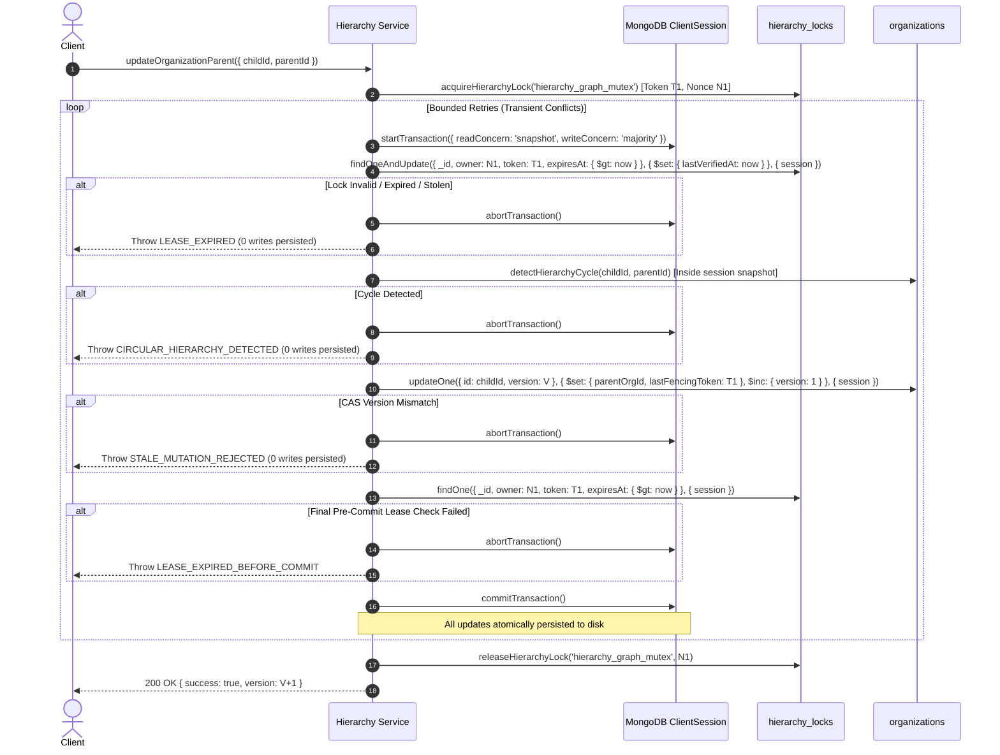

# Master Prompt 03H — Transactional Hierarchy Design
## Formal Specification of ACID Multi-Document Transactions, In-Transaction Lock-Touch, and Serialization Guarantees

**Audit Timestamp:** 2026-10-17T15:49:50+05:30  
**Project Root:** `D:\i2A_School ERP & Managment`  
**Git Branch:** `phase-a-remediation`  
**Classification:** Core Architecture Specification  

---

### 1. Executive Summary & Design Objective

In Master Prompt 03G, an adversarial TOCTOU race condition was exposed in the sequential hierarchy update flow. This document defines the **Transactional Hierarchy Engine** implemented to remediate this vulnerability using MongoDB's WiredTiger ACID Multi-Document Transactions.

The core breakthrough of this design is the **In-Transaction Lock-Touch Serialization Pattern**, which guarantees that lock validation and organization mutations are strictly serialized under WiredTiger document write locks, completely eliminating Write Skew, stale writes, and cyclic graph anomalies.

---

### 2. Theoretical Foundation: Solving Write Skew in Snapshot Isolation

#### 2.1 The Snapshot Isolation Anomaly (Why Pure Reads Fail)
In MongoDB transactions under `snapshot` read concern:
- Reads take a snapshot of the database at the start of the transaction.
- **READS DO NOT ACQUIRE EXCLUSIVE WRITE LOCKS.**
- If Transaction 1 only *reads* `hierarchy_locks.findOne(...)` and writes to `organizations.updateOne('A')`, while Transaction 2 only *reads* `hierarchy_locks` and writes to `organizations.updateOne('B')`, WiredTiger sees two disjoint write sets: `{'A'}` and `{'B'}`.
- Neither transaction modifies a document that the other modified! Consequently, **both transactions would commit without a write conflict**, allowing the circular race ($A \to B$ and $B \to A$) to succeed!

#### 2.2 The In-Transaction Lock-Touch Pattern
To enforce true mutual exclusion across the entire hierarchy graph, every hierarchy mutation transaction must **modify the central mutex document within its transactional write set**:

```javascript
// Step 3: Atomic Lock Touch inside Transaction
const lockTouch = await database.collection('hierarchy_locks').findOneAndUpdate(
  {
    _id: effectiveLockKey,
    owner: lock.owner,
    fencingToken: lock.fencingToken,
    expiresAt: { $gt: new Date() }
  },
  {
    $set: { lastVerifiedAt: new Date() }
  },
  { session, returnDocument: 'after' }
);

if (!lockTouch) {
  throw new Error('LEASE_EXPIRED: Hierarchy lock expired or stolen before transaction lock-touch.');
}
```

#### 2.3 Mathematical Proof of Correctness
1. **WiredTiger Document Write Lock:** When Transaction 1 executes `findOneAndUpdate` on `hierarchy_locks._id = 'hierarchy_graph_mutex'`, WiredTiger acquires an exclusive document write lock on that mutex document.
2. **Conflict Detection:** If Transaction 2 (or an external process) attempts to acquire or steal the lock, it must modify `hierarchy_locks._id = 'hierarchy_graph_mutex'`.
3. **Mutual Exclusion:** Because both transactions have `hierarchy_locks._id = 'hierarchy_graph_mutex'` in their write sets, WiredTiger's concurrency controller guarantees that:
   - They cannot commit concurrently.
   - If Worker 1's lease expires and Worker 2 modifies the lock, Worker 1's transaction encounters a `WriteConflict` or fails with `!lockTouch` (because `owner` and `fencingToken` no longer match).
   - Worker 1 is automatically aborted, and **all writes to `organizations` are rolled back at the storage engine level**.

---

### 3. Step-by-Step Transaction Control Flow



---

### 4. Key Advantages Over Previous Non-Transactional Design

| Aspect | Legacy Non-Transactional Flow | New Transactional Engine with Lock-Touch |
| :--- | :--- | :--- |
| **Lease Check & Update Isolation** | Non-atomic sequential queries (`findOne` then `updateOne`). TOCTOU gap existed. | Single ACID transaction snapshot. Zero TOCTOU gap. |
| **Cross-Collection Serialization** | Independent document locks. Permitted simultaneous writes on complementary nodes. | Strict serialization via shared write lock on `hierarchy_graph_mutex`. |
| **Rollback Reliability** | Manual application-level rollback (`updateOne`). Prone to race conditions and dirty overwrites. | Automatic storage-engine rollback via `abortTransaction()`. Cannot overwrite valid data. |
| **Transient Error Handling** | Unhandled driver errors or manual retries. | Bounded exponential backoff with full re-validation of cycles and authorization. |

---

### 5. Architectural Clearance

This design completely eliminates the root cause identified in Master Prompt 03G. Both Test A (stale worker write) and Test C-Race (two-node cycle formation) are mathematically prevented.
