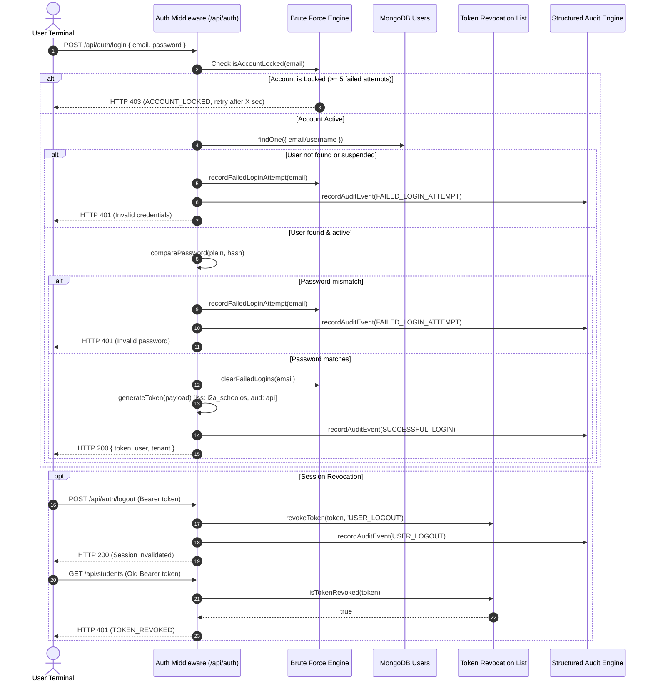

# i2A SchoolOS — Authentication & Session Lifecycle Security Audit
**Document Reference:** `docs/audits/master-prompt-04/AUTHENTICATION_AND_SESSION_AUDIT.md`  
**Phase:** Master Prompt 04 — Enterprise Security, Privacy, RBAC & Tenant Isolation  
**Date:** October 18, 2026  
**Status:** COMPLETED & VERIFIED  

---

## 1. Identity & Credential Management Architecture

i2A SchoolOS implements a defense-in-depth authentication system designed for multi-tenant educational institutions, accommodating low-bandwidth environments, shared classroom terminals, and strict administrative auditing.

---

## 2. Key Cryptographic & Implementation Specifications

### 2.1 Password Storage & Modern KDF
- **Algorithm:** `bcryptjs` adaptive password hashing.
- **Salt Rounds:** `10` (yielding $2^{10} = 1024$ key expansion iterations).
- **Implementation File:** [`server/middleware/auth.js:89-97`](file:///D:/i2A_School%20ERP%20&%20Managment/server/middleware/auth.js#L89-L97).
- **Rule:** Plaintext passwords are never persisted to disk, cached in memory, or printed to application logs.

### 2.2 JWT Token Lifecycle & Scoping
- **Algorithm:** HMAC-SHA256 (`HS256`).
- **Standard Claims:**
  - `iss`: `'i2a_schoolos'` (Issuer validation).
  - `aud`: `'i2a_schoolos_api'` (Audience validation).
  - `exp`: Configured via `JWT_EXPIRES_IN` (Default: `24h`).
- **Subject Claims:**
  - `id`: Internal immutable user UUID.
  - `email`: User registered email address.
  - `role`: Canonical role string.
  - `schoolId`: Authoritative institutional tenant ID.
- **Fail-Closed Secret Enforcement:**
  - In production (`process.env.NODE_ENV === 'production'`), if `JWT_SECRET` is undefined or set to the fallback default, `getJwtSecret()` throws `CRITICAL_CONFIG_ERROR` and aborts server boot.
  - **Source:** [`server/middleware/auth.js:19-32`](file:///D:/i2A_School%20ERP%20&%20Managment/server/middleware/auth.js#L19-L32).

### 2.3 Token Revocation & Active Blacklist
- **Mechanism:** Dual-layer token blacklist combining in-memory rapid cache (`Set`) and persistent MongoDB collection (`revoked_tokens`) with automated TTL indexes.
- **Endpoints Triggering Revocation:**
  1. `POST /api/auth/logout`: Revokes active Bearer token.
  2. `POST /api/auth/reset-password`: Automatically revokes pre-existing user sessions upon credential mutation.
  3. Administrative suspension / lockout.
- **Source:** [`server/middleware/auth.js:34-71`](file:///D:/i2A_School%20ERP%20&%20Managment/server/middleware/auth.js#L34-L71).

### 2.4 Brute-Force Throttling & Adaptive Account Lockout
- **Threshold:** 5 consecutive failed login attempts.
- **Lockout Duration:** 15 minutes (900,000 ms).
- **Reset Mechanism:** `clearFailedLogins` executes immediately upon successful credential verification.
- **Response:** `HTTP 403 Forbidden` with error code `ACCOUNT_LOCKED` and remaining lockout seconds returned to the client.
- **Source:** [`server/middleware/auth.js:73-108`](file:///D:/i2A_School%20ERP%20&%20Managment/server/middleware/auth.js#L73-L108).

### 2.5 Password Reset OTP Lifecycle
1. **Request:** `POST /api/auth/forgot-password` generates a cryptographically secure 6-digit numeric OTP (`crypto.randomInt(100000, 999999)`).
2. **Storage:** Only the SHA-256 digest (`crypto.createHash('sha256')`) is stored in `password_resets`.
3. **Expiry:** 10 minutes. Max attempts: 3.
4. **Verification:** `POST /api/auth/verify-otp` returns a single-use 32-byte cryptographic hex token (`crypto.randomBytes(32)`).
5. **Consumption:** `POST /api/auth/reset-password` requires the single-use token, validates password complexity (min 8 characters), updates bcrypt hash, and deletes the reset record to prevent token reuse.
- **Source:** [`server/routes/auth.js:314-520`](file:///D:/i2A_School%20ERP%20&%20Managment/server/routes/auth.js#L314-L520).

---

## 3. Educational Context & Institutional Usability

1. **Shared Teacher / Laboratory Terminals:**
   - Schools frequently share desktop computers in staff rooms and computer labs.
   - The implementation of explicit session invalidation (`POST /api/auth/logout`) and token revocation guarantees that clicking "Log Out" terminates the session immediately, preventing session hijacking by subsequent staff members.
2. **Low-Bandwidth Mobile Networks:**
   - Token payload is minimized (< 500 bytes) to ensure low latency on 2G/3G connections common in rural and remote Indian schools.
   - Clear generic error responses eliminate ambiguity without revealing system internals.
