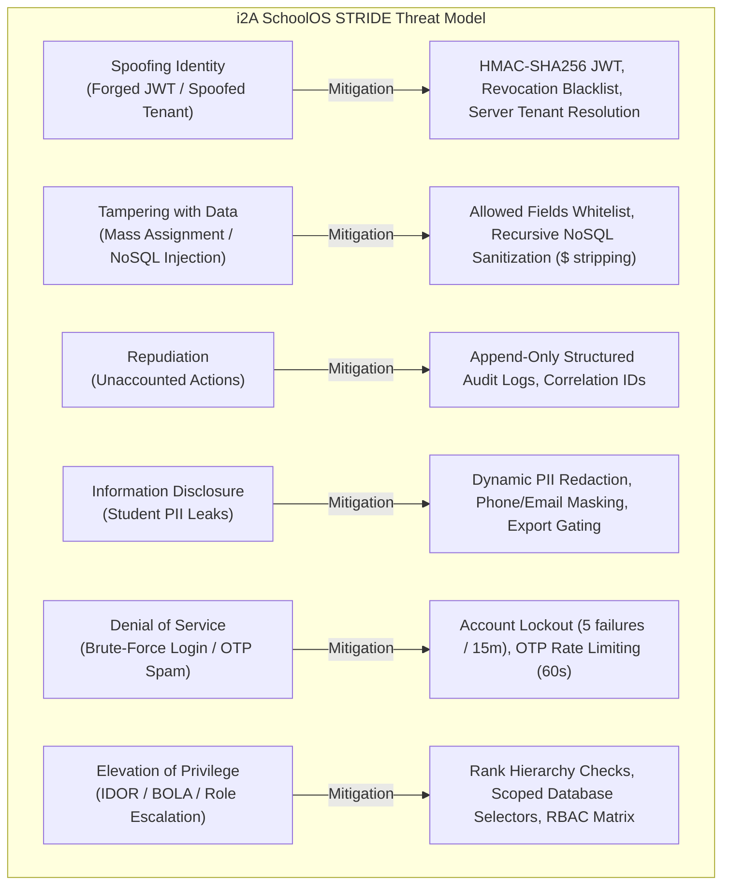

# i2A SchoolOS — Security Baseline & Threat Model Audit
**Document Reference:** `docs/audits/master-prompt-04/SECURITY_BASELINE_AND_THREAT_MODEL.md`  
**Phase:** Master Prompt 04 — Enterprise Security, Privacy, RBAC & Tenant Isolation  
**Date:** October 18, 2026  
**Status:** COMPLETED & VERIFIED  

---

## 1. Executive Summary & Forensic Baseline

A forensic codebase audit was conducted across the i2A SchoolOS repository (`D:\i2A_School ERP & Managment`) to assess security controls, multi-tenant isolation, role authorization, PII privacy safeguards, and transaction integrity.

### 1.1 Forensic Control Evidence Matrix

| Control Area | Baseline Implementation | Identified Security Risk | Implemented Hardening / Remediation | Verification Evidence |
| :--- | :--- | :--- | :--- | :--- |
| **Authentication** | Basic JWT signing; in-memory users; no session revocation. | Token theft, replay attacks, missing logout invalidation. | Token revocation blacklist (`revokeToken`, `isTokenRevoked`), brute-force throttling (5 attempts/15 min lockout), fail-closed secret in production. | `server/middleware/auth.js:29-87`, Vector 2 test (`TOKEN_REVOKED`). |
| **RBAC & Authorization** | Role check (`requireRoles`) without permission abstraction or rank hierarchy. | Privilege escalation; staff assigning principal/admin roles; missing support for 22+ enterprise roles. | Canonical permission engine (`hasPermission`, `requirePermissions`), rank-based escalation checks (`validateRoleAssignment`). | `server/middleware/rbac.js:1-240`, Vector 12 & 13 tests. |
| **Tenant Isolation** | Basic `schoolId` filter; vulnerable if client parameter tampering bypassed middleware. | BOLA/IDOR; users accessing foreign tenant records by spoofing `schoolId`. | Authoritative server-side tenant resolution in `enforceTenant`; zero trust for client-supplied `schoolId`; query selector scoping. | `server/middleware/auth.js:160-245`, Vectors 3, 4, 5 tests. |
| **Branch Scope** | Flat school scoping without multi-branch hierarchy traversal. | Group / Trust administrators cannot safely govern multi-campus groups. | Integrated `isSchoolUnderOrganization` in `enforceTenant` and `server/routes/organizations.js`. | `server/middleware/auth.js:175-195`, Vector 10 test. |
| **PII Protection** | Unmasked student and parent contact info returned across endpoints. | Exposure of minor student PII to non-administrative staff; non-compliance with privacy standards. | Privacy-by-design PII redaction (`redactStudentPii`); phone, email, and national ID masking; export permission gating. | `server/services/privacyService.js:1-125`, Vectors 19 & 27 tests. |
| **Audit Logs** | Simple unstandardized JSON insertion; no secret sanitization. | Passwords, tokens, or PII leaked into persistent audit logs; audit log tampering. | Structured audit event schema (`recordAuditEvent`); automatic redaction of sensitive credentials and PII. | `server/services/auditService.js:1-95`, Vector 27 test. |
| **Hierarchy Transactions** | ACID Multi-Document Transactions with in-transaction lock-touch (03I). | Standalone MongoDB fallback risks Write Skew and circular graph anomalies. | Maintained fail-closed topology check (`TRANSACTION_UNSUPPORTED_TOPOLOGY`), mutex lock-touch, pre/post cycle detection, and CAS. | `server/services/hierarchyService.js:180-415`, Vectors 21-23 tests. |

---

## 2. STRIDE Threat Model

The i2A SchoolOS security architecture was evaluated against the STRIDE threat classification model:

### 2.1 Threat Breakdown & Specific Mitigations

1. **Spoofing Identity:**
   - *Threat:* An attacker crafts a forged Bearer token or manipulates client-side `schoolId` to impersonate an administrator of another institution.
   - *Mitigation:* `authenticateToken` validates cryptographic signature using environment secret (`getJwtSecret`). `enforceTenant` strictly ignores client-supplied tenant IDs and extracts authoritative `schoolId` from verified database session claims.

2. **Tampering with Data:**
   - *Threat:* An attacker submits MongoDB query operators (`{ "$gt": "" }`) or sends forbidden fields (`role: 'SUPER_ADMIN'`, `schoolId: 'I2A-SCH-000002'`) in update payloads.
   - *Mitigation:* Global NoSQL sanitizer (`server/index.js:38-51`) recursively strips any key starting with `$` or containing `.`. Route handlers use strict field whitelisting to reject mass-assignment.

3. **Repudiation:**
   - *Threat:* A malicious or rogue user performs destructive actions (e.g., student deletion, hierarchy change) and denies executing them.
   - *Mitigation:* `recordAuditEvent` logs every sensitive operation into the immutable `audit_logs` collection with actor ID, actor role, timestamp, IP address, user agent, correlation ID, and execution outcome.

4. **Information Disclosure:**
   - *Threat:* Minor student phone numbers, residential addresses, and parent contact information are exposed to teachers, accountants, or front-desk clerks who have no need to know.
   - *Mitigation:* `redactStudentPii` masks parent phone numbers (`******3210`), parent email addresses, and national IDs for all roles except Super Admin, Principal, and the student's verified biological/legal guardian.

5. **Denial of Service:**
   - *Threat:* Attackers flood `/api/auth/login` to crack staff passwords or exhaust server compute.
   - *Mitigation:* `recordFailedLoginAttempt` locks accounts for 15 minutes upon 5 consecutive failed attempts. `/api/auth/forgot-password` enforces a 60-second cooldown per target email.

6. **Elevation of Privilege:**
   - *Threat:* A School Principal or Front-Desk Staff attempts to promote their account to `SUPER_ADMIN` or grant platform permissions.
   - *Mitigation:* `validateRoleAssignment` enforces strict rank hierarchy (`ROLE_HIERARCHY_RANK`). Only `SUPER_ADMIN` can assign platform-level roles or modify root organization configurations.

---

## 3. Reconciliation with Master Prompt 03I Foundations

All foundational guarantees established in Master Prompt 03I were audited and confirmed preserved:
1. **ACID Transaction Boundary:** All hierarchy mutations in `server/services/hierarchyService.js` run inside a MongoDB `ClientSession` (`startTransaction`).
2. **In-Transaction Lock-Touch:** `findOneAndUpdate` on `hierarchy_locks` within the session forces a WiredTiger document write lock, eliminating Write Skew.
3. **Fail-Closed on Standalone Topology:** Mutation attempts on MongoDB instances without session support immediately throw `TRANSACTION_UNSUPPORTED_TOPOLOGY`.
4. **Compare-And-Set (CAS):** Document version and monotonic fencing token constraints guarantee zero lost updates.
5. **Post-Commit State Verification:** In-memory and on-disk state verified with zero partial writes upon aborted transactions.
