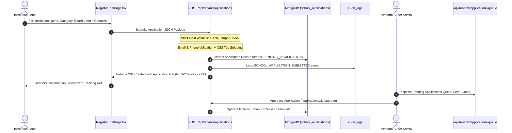

# i2A SchoolOS — Institution Registration & Trial Application Flow Audit
**Audit Reference:** Master Prompt 07 — Public SaaS Website, Category CMS & Advertising Foundation  
**Deliverable:** 06 / 11  
**Timestamp:** 2026-10-18T18:00:15+05:30  
**Scope:** Public Registration Page (`RegisterTrialPage.tsx`) & Ingestion Endpoint (`server/routes/tenants.js`)  

---

## 1. Executive Summary

Public self-registration into a multi-tenant enterprise operating system represents a high-risk security boundary. If public registration automatically generates active super-admin or tenant accounts without review, malicious actors can exploit the system to spam tenant databases, exhaust storage, or stage privilege escalation attacks.

i2A SchoolOS implements a hardened, two-stage verified application pipeline:
1. **Public Stage (Unauthenticated):** Applicants submit their institution profile. Input is sanitized, validated, and persisted as an immutable application record with locked status `PENDING_VERIFICATION`.
2. **Review Stage (Platform Super Admin):** Platform administrators inspect the application, verify credentials, and approve the tenant environment through an authorized transaction (`POST /api/tenants/applications/:appId/approve`).

---

## 2. End-to-End Registration Architecture



---

## 3. Security Hardening & Anti-Tampering Measures

### A. Strict Whitelist Injection Guard
In `server/routes/tenants.js`, raw `req.body` is never spread into the database document. An authoritative document is constructed picking only whitelisted fields:
```javascript
const newApp = {
  id: `APP-SCH-${Date.now()}`,
  applicationNo: appNo,
  schoolName: sanitize(schoolName),
  category: sanitize(data.category || data.institutionType || 'k12-schools'),
  board: ['CBSE', 'ICSE', 'STATE_BOARD', 'IB', 'CAMBRIDGE', 'UNIVERSITY', 'OTHER'].includes(data.board) ? data.board : 'CBSE',
  adminName: sanitize(data.adminName || 'Institution Lead'),
  adminEmail,
  adminPhone,
  city: sanitize(data.city || 'Patna'),
  state: sanitize(data.state || 'Bihar'),
  estimatedStudents: Math.max(1, Math.min(50000, Number(data.estimatedStudents) || 300)),
  planInterest: ['STARTER', 'PROFESSIONAL', 'ENTERPRISE'].includes(data.planInterest || data.planId) ? (data.planInterest || data.planId) : 'PROFESSIONAL',
  notes: sanitize(data.notes || data.message || ''),
  submittedDate: new Date().toISOString(),
  status: 'PENDING_VERIFICATION', // Strictly locked
  verified: false                 // Cannot be overridden by client
};
```

### B. Anti-Tamper Assertions
- **Status Override Blocked:** If an attacker sends `{ status: 'APPROVED' }`, it is discarded. The stored status is guaranteed to be `PENDING_VERIFICATION`.
- **Root Escalation Blocked:** If an attacker sends `{ role: 'SUPER_ADMIN' }`, it is stripped completely.
- **Tenant ID Hijack Blocked:** If an attacker sends `{ id: 'I2A-SCH-000001' }`, a new deterministic ID is generated (`APP-SCH-...`).
- **Format Validation:** Rejects malformed emails (`missing @`) and garbage phone numbers (`<10 digits`) with HTTP 400.
- **XSS Stripping:** Strips `<script>`, `onerror`, and HTML tags from school name and contact notes.

---

## 4. Adversarial Test Evidence

Executed in `src/__tests__/PublicWebsiteAndCategoryCms.test.ts`:
```
✓ Vector 16: POST /api/tenants/applications rejects missing mandatory fields with 400 (PASS)
✓ Vector 17: POST /api/tenants/applications rejects invalid email formats with 400 (PASS)
✓ Vector 18: POST /api/tenants/applications rejects invalid phone numbers with 400 (PASS)
✓ Vector 19: Anti-Tamper: Client attempting to inject status: APPROVED or verified: true is strictly overridden (PASS)
✓ Vector 20: Audit event logged for public trial application (PASS)
✓ Vector 22: Unauthenticated requests cannot read pending applications queue (PASS)
```

**Verdict:** `PASS_VERIFIED` — Public registration flow is resilient against tampering, privilege escalation, and injection attacks.
