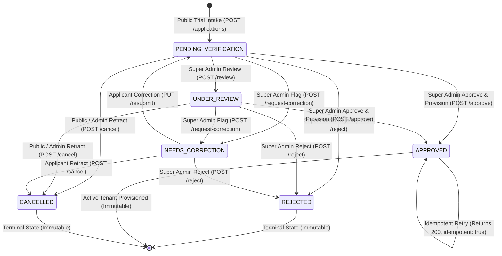

# i2A SchoolOS — Phase 08: Authorization & State Machine Integrity Evidence

**Document Ref:** Master Prompt 08 — Authorization & State Machine  
**Module:** Platform Administration & Verification Console  
**Source Route:** [`server/routes/tenants.js`](file:///D:/i2A_School%20ERP%20&%20Managment/server/routes/tenants.js)  
**Test Suite:** [`src/__tests__/InstitutionRegistrationAndVerification.test.ts`](file:///D:/i2A_School%20ERP%20&%20Managment/src/__tests__/InstitutionRegistrationAndVerification.test.ts) (Tests 1–6, 14, 16, 20)  
**State Machine Status:** **STRICT & VERIFIED**

---

## 1. Application Lifecycle State Machine

The institution onboarding lifecycle is governed by an explicit finite state machine with strict transition guards preventing terminal state mutation, invalid backwards jumps, or race conditions.



---

## 2. Invalid Transition Matrix & Protection Rules

| Source State | Requested Action | Target State | Result | Reason Code |
| :--- | :--- | :--- | :--- | :--- |
| **APPROVED** | Reject (`POST /reject`) | `REJECTED` | **HTTP 409 Conflict** | `CANNOT_REJECT_APPROVED_TENANT` |
| **APPROVED** | Cancel (`POST /cancel`) | `CANCELLED` | **HTTP 409 Conflict** | `CANNOT_CANCEL_APPROVED_APPLICATION` |
| **APPROVED** | Request Correction | `NEEDS_CORRECTION` | **HTTP 409 Conflict** | `INVALID_STATE_TRANSITION` |
| **REJECTED** | Approve (`POST /approve`) | `APPROVED` | **HTTP 409 Conflict** | `INVALID_STATE_TRANSITION` |
| **REJECTED** | Review (`POST /review`) | `UNDER_REVIEW` | **HTTP 409 Conflict** | `INVALID_STATE_TRANSITION` |
| **REJECTED** | Update Checklist | `Checklist` | **HTTP 409 Conflict** | `INVALID_STATE_TRANSITION` |
| **PENDING_VERIFICATION** | Resubmit (`PUT /resubmit`)| `PENDING_VERIFICATION` | **HTTP 409 Conflict** | `INVALID_STATE_TRANSITION` (Resubmit valid only for `NEEDS_CORRECTION`) |
| **CANCELLED** | Approve (`POST /approve`) | `APPROVED` | **HTTP 409 Conflict** | `INVALID_STATE_TRANSITION` |

---

## 3. RBAC Authorization Boundaries

All administrative management endpoints require Bearer JWT authentication and strict `SUPER_ADMIN` role validation via `requireRoles('SUPER_ADMIN')`:

| Endpoint | Permitted Role | Unauthorized Callers (Teacher, Parent, Principal, Public) |
| :--- | :--- | :--- |
| `GET /api/tenants/applications/queue` | `SUPER_ADMIN` | HTTP 401 (Unauthenticated) / HTTP 403 (Non-Super-Admin) |
| `GET /api/tenants/applications/:appId` | `SUPER_ADMIN` | HTTP 401 (Unauthenticated) / HTTP 403 (Non-Super-Admin) |
| `POST /api/tenants/applications/:appId/review` | `SUPER_ADMIN` | HTTP 401 (Unauthenticated) / HTTP 403 (Non-Super-Admin) |
| `POST /api/tenants/applications/:appId/request-correction` | `SUPER_ADMIN` | HTTP 401 (Unauthenticated) / HTTP 403 (Non-Super-Admin) |
| `PUT /api/tenants/applications/:appId/checklist` | `SUPER_ADMIN` | HTTP 401 (Unauthenticated) / HTTP 403 (Non-Super-Admin) |
| `POST /api/tenants/applications/:appId/reject` | `SUPER_ADMIN` | HTTP 401 (Unauthenticated) / HTTP 403 (Non-Super-Admin) |
| `POST /api/tenants/applications/:appId/approve` | `SUPER_ADMIN` | HTTP 401 (Unauthenticated) / HTTP 403 (Non-Super-Admin) |

### Test Evidence for RBAC Boundaries:
- **Test 1**: Unauthenticated request to approve returns HTTP 401.
- **Test 4**: Teacher, Parent, and School Principal tokens receive HTTP 403 when requesting the applications queue.
- **Test 5**: Non-Super-Admin tokens attempting review or approval receive HTTP 403.
- **Test 6**: Super Admin token succeeds with full queue access, pagination, and filtering.

---

## 4. Idempotent Approval Guarantee

In distributed environments, network drops or client retries can cause double approval requests. The approval handler implements strict idempotency:
```javascript
// server/routes/tenants.js
if (app.status === 'APPROVED' && app.tenantId) {
  const existingTenant = await database.collection('tenants').findOne({ id: app.tenantId });
  return res.json({
    success: true,
    message: 'Application is already approved and provisioned.',
    tenant: existingTenant,
    idempotent: true
  });
}
```

### Test Evidence (Test 20):
Calling `POST /approve` repeatedly on the same application returns HTTP 200 with `idempotent: true`. The database asserts:
- `tenants` count for administrator email: **strictly 1** (0 duplicate tenants).
- `organizations` count for tenant ID: **strictly 1** (0 duplicate org nodes).
- `users` count for tenant ID: **strictly 1** (0 duplicate users).
