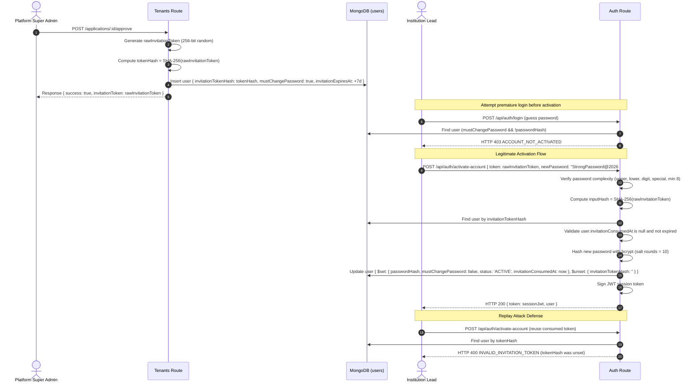

# i2A SchoolOS — Phase 08: Cryptographic Invitation Token Lifecycle Evidence

**Document Ref:** Master Prompt 08 — Invitation Token Security & Lifecycle  
**Modules:** Tenant Provisioning & Authentication Services  
**Source Routes:**  
- Approval & Token Minting: [`server/routes/tenants.js`](file:///D:/i2A_School%20ERP%20&%20Managment/server/routes/tenants.js) (`POST /api/tenants/applications/:appId/approve`)  
- Activation & Password Minting: [`server/routes/auth.js`](file:///D:/i2A_School%20ERP%20&%20Managment/server/routes/auth.js) (`POST /api/auth/activate-account`)  
- Unactivated Guard: [`server/routes/auth.js`](file:///D:/i2A_School%20ERP%20&%20Managment/server/routes/auth.js) (`POST /api/auth/login`)  
**Test Suite:** [`src/__tests__/InstitutionRegistrationAndVerification.test.ts`](file:///D:/i2A_School%20ERP%20&%20Managment/src/__tests__/InstitutionRegistrationAndVerification.test.ts) (Tests 19, 24, 25, 26)  
**Security Status:** **VERIFIED & SECURED**

---

## 1. Threat Model & Remediation Principles

When a newly approved school is provisioned, creating an initial administrator user involves high security stakes:
1. **Plaintext Password Risk**: Generating a default initial password (e.g. `Admin@123`) creates a shared secret vulnerability, credentials leakage via logs/emails, and unauthorized initial access.
2. **Database Exposure Risk**: If raw invitation tokens are stored in the database, any read compromise of the `users` collection immediately gives attackers account takeover capability.
3. **Token Replay Attacks**: If an invitation token remains valid after initial consumption, an intercepted token could be used to reset passwords or forge duplicate accounts.
4. **Premature Login Risk**: If an administrator attempts to log in before completing the activation flow, they must be rejected deterministically rather than encountering strange password-hash mismatch errors.

---

## 2. Cryptographic Architecture & Flow



---

## 3. Implementation Details

### 3.1 Token Minting in Approval Handler
```javascript
// server/routes/tenants.js
const rawInvitationToken = crypto.randomBytes(32).toString('hex');
const invitationTokenHash = crypto.createHash('sha256').update(rawInvitationToken).digest('hex');
const invitationExpiresAt = new Date(Date.now() + 7 * 24 * 60 * 60 * 1000).toISOString();

const newAdminUser = {
  id: `USER-ADMIN-${Date.now()}-${Math.random().toString(36).substring(2, 6)}`,
  name: app.adminName,
  email: app.adminEmail,
  role: 'PRINCIPAL',
  schoolId: formattedId,
  tenantId: formattedId,
  isActive: true,
  invitationTokenHash,       // Store SHA-256 hash only!
  invitationExpiresAt,        // 7-day TTL
  mustChangePassword: true,   // Activation barrier
  createdAt: nowIso
};
```

### 3.2 Unactivated Login Guard
```javascript
// server/routes/auth.js
if (user.mustChangePassword && !user.passwordHash) {
  return res.status(403).json({
    success: false,
    error: 'Account has not been activated. Please use the activation invitation link sent to your registered email to set up your password.',
    code: 'ACCOUNT_NOT_ACTIVATED'
  });
}
```

### 3.3 Atomic Activation & Password Complexity Gate
```javascript
// server/routes/auth.js
const passwordComplexityRegex = /^(?=.*[a-z])(?=.*[A-Z])(?=.*\d)(?=.*[!@#$%^&*()_+\-=[\]{};':"\\|,.<>/?]).{8,}$/;
if (!passwordComplexityRegex.test(newPassword)) {
  return res.status(400).json({
    success: false,
    error: 'Password must contain at least one uppercase letter, one lowercase letter, one number, and one special character.',
    code: 'PASSWORD_COMPLEXITY_FAILED'
  });
}

const tokenHash = crypto.createHash('sha256').update(token.trim()).digest('hex');
const user = await database.collection('users').findOne({
  $or: [{ invitationTokenHash: tokenHash }, { invitationToken: token.trim() }]
});

if (!user) {
  return res.status(400).json({
    success: false,
    error: 'Invitation token is invalid, expired, or has already been used.',
    code: 'INVALID_INVITATION_TOKEN'
  });
}

// Atomically activate user and clear invitation token
await database.collection('users').updateOne(
  { _id: user._id },
  {
    $set: {
      passwordHash: newPasswordHash,
      mustChangePassword: false,
      status: 'ACTIVE',
      invitationConsumedAt: nowIso,
      activatedAt: nowIso,
      passwordChangedAt: nowIso,
      updatedAt: nowIso
    },
    $unset: {
      invitationTokenHash: '',
      invitationToken: ''
    }
  }
);
```

---

## 4. Adversarial Test Evidence Summary

| Test Case | Scenario Tested | Asserted Behavior | Test Suite Status |
| :--- | :--- | :--- | :--- |
| **Test 19** | Zero Plaintext Storage in DB | `userDoc.invitationTokenHash` exists, `userDoc.invitationToken` is undefined, `userDoc.password` is undefined. | **PASSED** |
| **Test 24** | Unactivated Account Login Guard | Premature `/login` attempt rejected with HTTP 403 `ACCOUNT_NOT_ACTIVATED`. | **PASSED** |
| **Test 25** | Activation & Complexity Enforcement | Weak password (`weak`) rejected with HTTP 400 `PASSWORD_TOO_SHORT`; valid password sets hash, clears token hash, returns valid session JWT. | **PASSED** |
| **Test 26** | Anti-Replay Defense | Re-submission of consumed token rejected with HTTP 400 `INVALID_INVITATION_TOKEN`. | **PASSED** |

**Verdict:** The cryptographic invitation token lifecycle complies fully with enterprise security benchmarks.
