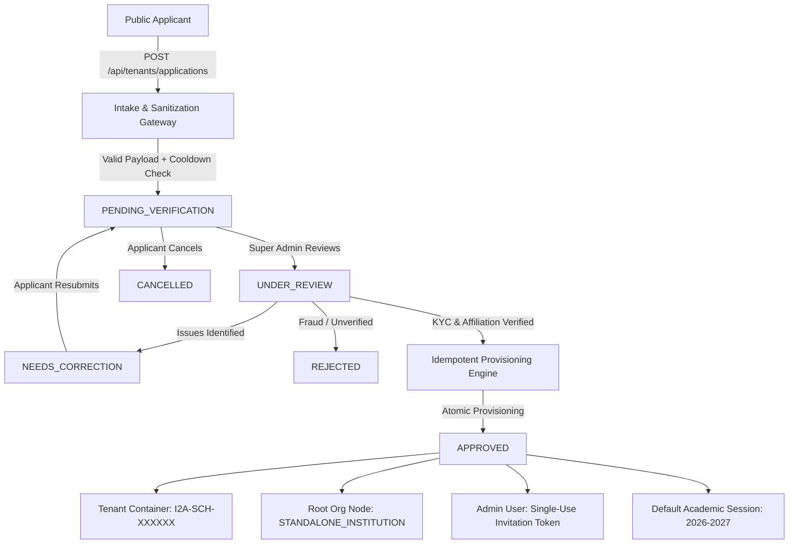

# Phase 08 — Architecture & Server-Authoritative State Machine
**i2A SchoolOS | Institution Registration, Verification & Secure Onboarding**
*Document Version:* 1.0.0  
*Environment:* Multi-Tenant Enterprise SaaS (Indian Educational Landscape)  
*Target Database:* Synthetic Test Database Verified (`mongodb://127.0.0.1:27017/i2a_schoolos_synthetic_test`)  
*Execution Mode:* Single Comprehensive Execution (Zero-Shortcut Engineering)

---

## 1. Architectural Overview & Boundary Isolation

i2A SchoolOS distinguishes strictly between an unverified public onboarding inquiry and an active multi-tenant container:

1. **Pre-Tenant Space (`school_applications` collection):**
   - Untrusted, public-facing applicant data intake.
   - Applications undergo server-side validation, schema normalization, XSS stripping, and spam/burst rate-limiting.
   - Applications do NOT possess a `tenantId` upon creation. They cannot query or interact with production school collections (`students`, `fees`, `attendance`, `exams`).
   - Monitored exclusively by the Central SaaS Operator console (`SUPER_ADMIN`).

2. **Tenant Space (`tenants`, `organizations`, `users`, `academic_sessions` collections):**
   - Isolated, production-grade institution container.
   - Created **only** upon explicit Super Admin approval via server-authoritative state transition.
   - Each approved institution is assigned a globally unique immutable identifier: `I2A-SCH-XXXXXX`.
   - Provisions a root organization node, an initial administrative user with a cryptographic single-use invitation token, and a default active academic session.



---

## 2. Server-Authoritative State Machine

The institution application lifecycle is governed by an immutable server-authoritative finite state machine. Client-submitted status transitions are strictly ignored; status changes can only occur through designated endpoints with role-based access checks.

### Supported States

| State | Scope | Description |
|---|---|---|
| `DRAFT` | Offline / Client | Local state prior to network submission. |
| `SUBMITTED` | Intake | Interim state during intake validation before persistence. |
| `PENDING_VERIFICATION` | Pre-Tenant Queue | Publicly submitted; awaiting Super Admin inspection. |
| `UNDER_REVIEW` | Active Audit | Super Admin has assigned themselves or flagged active verification. |
| `NEEDS_CORRECTION` | Applicant Action | Super Admin flagged missing/blurry docs; applicant can resubmit. |
| `APPROVED` | Final (Terminal) | Verified; isolated tenant and user provisioned. Immutable. |
| `REJECTED` | Final (Terminal) | Application rejected with formal compliance code. Immutable. |
| `CANCELLED` | Final (Terminal) | Voluntarily retracted by applicant prior to approval. |

---

## 3. State Transition Matrix & Security Guards

| From State | To State | Endpoint | Authorized Role | Guard Conditions | Audit Action |
|---|---|---|---|---|---|
| `(None)` | `PENDING_VERIFICATION` | `POST /api/tenants/applications` | Public | Valid mandatory fields, no active pending apps within 10 min | `SCHOOL_APPLICATION_SUBMITTED` |
| `PENDING_VERIFICATION` | `UNDER_REVIEW` | `POST /applications/:id/review` | `SUPER_ADMIN` | Application must exist and be in pending state | `APPLICATION_MOVED_UNDER_REVIEW` |
| `UNDER_REVIEW` | `NEEDS_CORRECTION` | `POST /applications/:id/request-correction` | `SUPER_ADMIN` | Notes min 5 chars; cannot be terminal | `APPLICATION_CORRECTION_REQUESTED` |
| `NEEDS_CORRECTION` | `PENDING_VERIFICATION` | `PUT /applications/:id/resubmit` | Public Applicant | Application must be in `NEEDS_CORRECTION` | `APPLICATION_CORRECTIONS_RESUBMITTED` |
| `PENDING_VERIFICATION` / `UNDER_REVIEW` | `REJECTED` | `POST /applications/:id/reject` | `SUPER_ADMIN` | Reason min 5 chars; cannot reject approved tenant | `APPLICATION_REJECTED` |
| `PENDING_VERIFICATION` / `UNDER_REVIEW` | `APPROVED` | `POST /applications/:id/approve` | `SUPER_ADMIN` | Idempotent check; cannot approve rejected/cancelled apps | `TENANT_PROVISIONED_FROM_APPLICATION` |
| `PENDING_VERIFICATION` / `UNDER_REVIEW` | `CANCELLED` | `POST /applications/:id/cancel` | Public Applicant / Admin | Cannot cancel already approved tenant | `APPLICATION_CANCELLED` |

### Disallowed & Illegal Transitions

Any attempt to execute an invalid transition returns HTTP `409 Conflict` with machine-readable code `INVALID_STATE_TRANSITION`:
- `REJECTED` $\to$ `APPROVED` (Blocked: permanently rejected applications cannot be resurrected into active tenants).
- `CANCELLED` $\to$ `APPROVED` (Blocked: retracted inquiries cannot be approved).
- `APPROVED` $\to$ `REJECTED` (Blocked: active tenants must be managed via tenant suspension, not application rejection).
- `APPROVED` $\to$ `CANCELLED` (Blocked: active tenant containers cannot be cancelled via public pre-tenant endpoints).
- `PENDING_VERIFICATION` $\to$ Resubmit (Blocked: resubmission is only permitted when explicit correction was requested).

---

## 4. Verification Checklist & Trust Model

The Super Admin inspection dossier includes a structured 6-point verification checklist (`verificationChecklist`):

```typescript
export interface ApplicationVerificationChecklist {
  identityVerified: boolean;             // Authorizer identity & official representation confirmed
  documentAuthenticityVerified: boolean; // KYC / Trust deed / Registration certificate validated
  affiliationVerified: boolean;          // CBSE / ICSE / State Board / University affiliation active
  addressVerified: boolean;              // Physical campus infrastructure & address confirmed
  feeCommercialVerified: boolean;        // Commercial subscription tier & student strength vetted
  antiFraudCheckPassed: boolean;         // Cross-tenant duplicate check & anti-spoofing audit passed
  verifiedBy?: string;                   // Super Admin User ID who signed off
  verifiedAt?: string;                   // ISO 8601 Timestamp of sign-off
}
```

Checklist modifications are recorded in the structured immutable audit log and persisted in MongoDB.

---

## 5. Status History & Public Tracking Boundary

Every application maintains an append-only timeline (`statusHistory` array):

```json
{
  "status": "NEEDS_CORRECTION",
  "changedAt": "2026-10-19T14:05:00.000Z",
  "changedBy": "USR-SUPERADMIN-001",
  "actorRole": "SUPER_ADMIN",
  "notes": "Please provide latest affiliation certificate"
}
```

### Public vs Internal Data Exposure Guard
When an applicant inspects their status via `GET /api/tenants/applications/status/:applicationNo`:
- **Allowed Public Fields:** `applicationNo`, `schoolName`, `category`, `board`, `city`, `state`, `status`, `submittedDate`, `correctionNotes` (when `NEEDS_CORRECTION`), `tenantId` (when `APPROVED`), safe public status timeline.
- **Strictly Stripped / Hidden:** `reviewerId`, internal `reviewNotes`, reviewer personal details, and internal verification checklist flags. Prevents social engineering and protects SaaS administrative staff anonymity.
