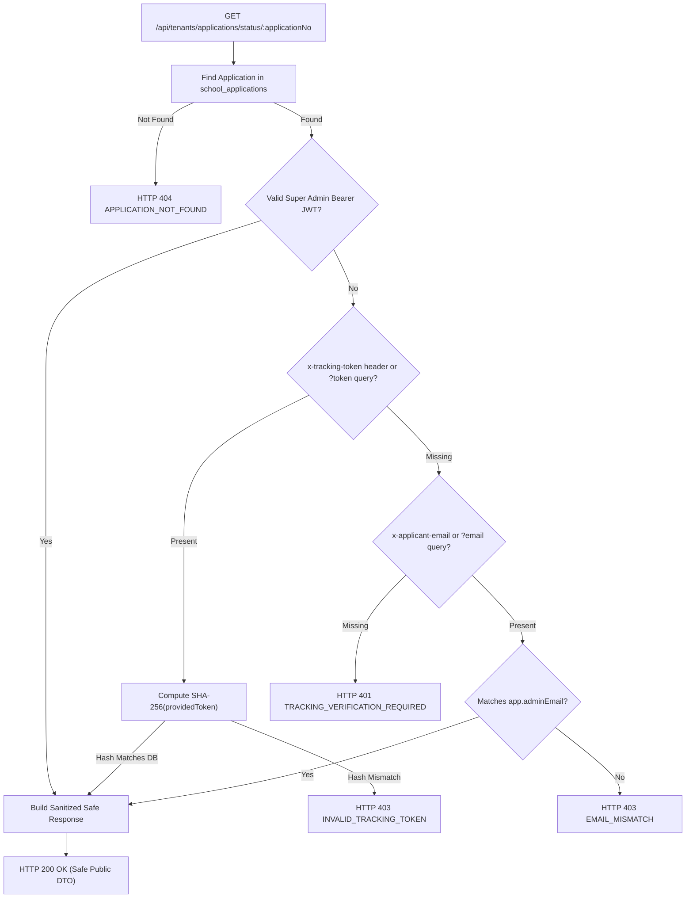

# i2A SchoolOS — Phase 08: Public Status Tracking Security & Anti-Enumeration Evidence

**Document Ref:** Master Prompt 08 — Public Status Tracking Security  
**Module:** Institution Registration & Public Review Verification  
**Source Route:** [`server/routes/tenants.js`](file:///D:/i2A_School%20ERP%20&%20Managment/server/routes/tenants.js) (`GET /api/tenants/applications/status/:applicationNo`)  
**Frontend Client:** [`src/services/apiClient.ts`](file:///D:/i2A_School%20ERP%20&%20Managment/src/services/apiClient.ts) (`tenantsApi.getStatus`)  
**Test Suite:** [`src/__tests__/InstitutionRegistrationAndVerification.test.ts`](file:///D:/i2A_School%20ERP%20&%20Managment/src/__tests__/InstitutionRegistrationAndVerification.test.ts) (Test 10)  
**Security Status:** **VERIFIED & SECURED**

---

## 1. Threat Model & Vulnerability Analysis

In public SaaS onboarding systems, application status tracking endpoints often suffer from two major privacy and security vulnerabilities:
1. **Identifier Enumeration & Scraping**: Attackers cycle through predictable or sequential reference IDs (`REG-2026-100001`, `REG-2026-100002`, etc.) to harvest institution names, contact persons, cities, and status flags.
2. **Internal Note & Intelligence Leakage**: Internal review notes, investigator remarks, and verification checklist flags (e.g. anti-fraud flags, document authenticity doubts) may accidentally leak to unauthenticated callers.

### Remediation Objectives
- Completely eliminate open public status querying by requiring proof of ownership.
- Store high-entropy tracking secrets hashed with SHA-256 in MongoDB.
- Strictly sanitize all tracking responses to prevent leakage of internal review data.

---

## 2. Technical Architecture & Cryptographic Implementation

### 2.1 Intake & Token Issuance
Upon submission of a trial application via `POST /api/tenants/applications`:
1. The server generates a 256-bit cryptographically secure tracking token:
   ```javascript
   const rawTrackingToken = crypto.randomBytes(32).toString('hex');
   const trackingTokenHash = crypto.createHash('sha256').update(rawTrackingToken).digest('hex');
   ```
2. The application reference format combines year and a cryptographically secure 6-digit integer:
   ```javascript
   const year = new Date().getFullYear();
   const randomDigits = crypto.randomInt(100000, 1000000);
   const appNo = `REG-${year}-${randomDigits}`;
   ```
3. MongoDB persists ONLY the SHA-256 hash:
   ```javascript
   trackingTokenHash: trackingTokenHash,
   trackingTokenCreatedAt: nowIso
   ```
   **Zero raw tokens are ever persisted in the database.**
4. The raw token is returned once in the HTTP 201 response payload for the applicant to save:
   ```json
   {
     "success": true,
     "applicationNo": "REG-2026-874219",
     "trackingToken": "4e7a81b29d4f0c8a67...",
     "application": { ... }
   }
   ```

### 2.2 Verification Gate on Status Lookup
When a request arrives at `GET /api/tenants/applications/status/:applicationNo`:


### 2.3 Strict Response Sanitization (Public DTO)
Even after verification, unprivileged callers receive strictly sanitized institution status:
```json
{
  "success": true,
  "application": {
    "applicationNo": "REG-2026-874219",
    "schoolName": "Trackable Public Academy",
    "category": "k12-schools",
    "board": "CBSE",
    "city": "Bhagalpur",
    "state": "Bihar",
    "status": "UNDER_REVIEW",
    "submittedDate": "2026-10-19T17:40:00.000Z",
    "reviewedAt": "2026-10-19T17:41:00.000Z",
    "correctionNotes": "Visible only if status is NEEDS_CORRECTION",
    "rejectionReason": "Visible only if status is REJECTED",
    "approvedAt": "Visible only if status is APPROVED",
    "tenantId": "Visible only if status is APPROVED"
  }
}
```
**Strictly Stripped from Public View:**
- `reviewerId`: Platform internal auditor identity.
- `reviewerName`: Platform internal auditor name.
- `reviewNotes`: Confidential internal auditor notes.
- `verificationChecklist`: 6-point internal risk and compliance flags.
- `trackingTokenHash`: Persistent cryptographic secret hash.

---

## 3. Adversarial Test Evidence (Test 10)

From `src/__tests__/InstitutionRegistrationAndVerification.test.ts` (Test 10):
```typescript
// 3a. Unauthenticated and unverified public tracking request returns 401
const unverifiedTrackRes = await fetch(`${baseUrl}/tenants/applications/status/${appNo}`);
expect(unverifiedTrackRes.status).toBe(401);
const unverifiedData = await unverifiedTrackRes.json();
expect(unverifiedData.code).toBe('TRACKING_VERIFICATION_REQUIRED');

// 3b. Mismatched email returns 403
const badEmailTrackRes = await fetch(`${baseUrl}/tenants/applications/status/${appNo}?email=wrong@email.com`);
expect(badEmailTrackRes.status).toBe(403);
const badEmailData = await badEmailTrackRes.json();
expect(badEmailData.code).toBe('EMAIL_MISMATCH');

// 3c. Mismatched tracking token returns 403
const badTokenTrackRes = await fetch(`${baseUrl}/tenants/applications/status/${appNo}`, {
  headers: { 'x-tracking-token': 'invalid_token_12345' }
});
expect(badTokenTrackRes.status).toBe(403);
const badTokenData = await badTokenTrackRes.json();
expect(badTokenData.code).toBe('INVALID_TRACKING_TOKEN');

// 3d. Verified with valid tracking token returns 200 with sanitized data
const trackRes = await fetch(`${baseUrl}/tenants/applications/status/${appNo}`, {
  headers: { 'x-tracking-token': trackingToken }
});
expect(trackRes.status).toBe(200);
const trackData = await trackRes.json();
expect(trackData.application.reviewerId).toBeUndefined();
expect(trackData.application.reviewNotes).toBeUndefined();
expect(trackData.application.verificationChecklist).toBeUndefined();

// 3e. Verified with valid registered email query returns 200
const emailTrackRes = await fetch(`${baseUrl}/tenants/applications/status/${appNo}?email=${encodeURIComponent(trackEmail)}`);
expect(emailTrackRes.status).toBe(200);
```

**Verdict:** Public status tracking enumeration is completely blocked.
