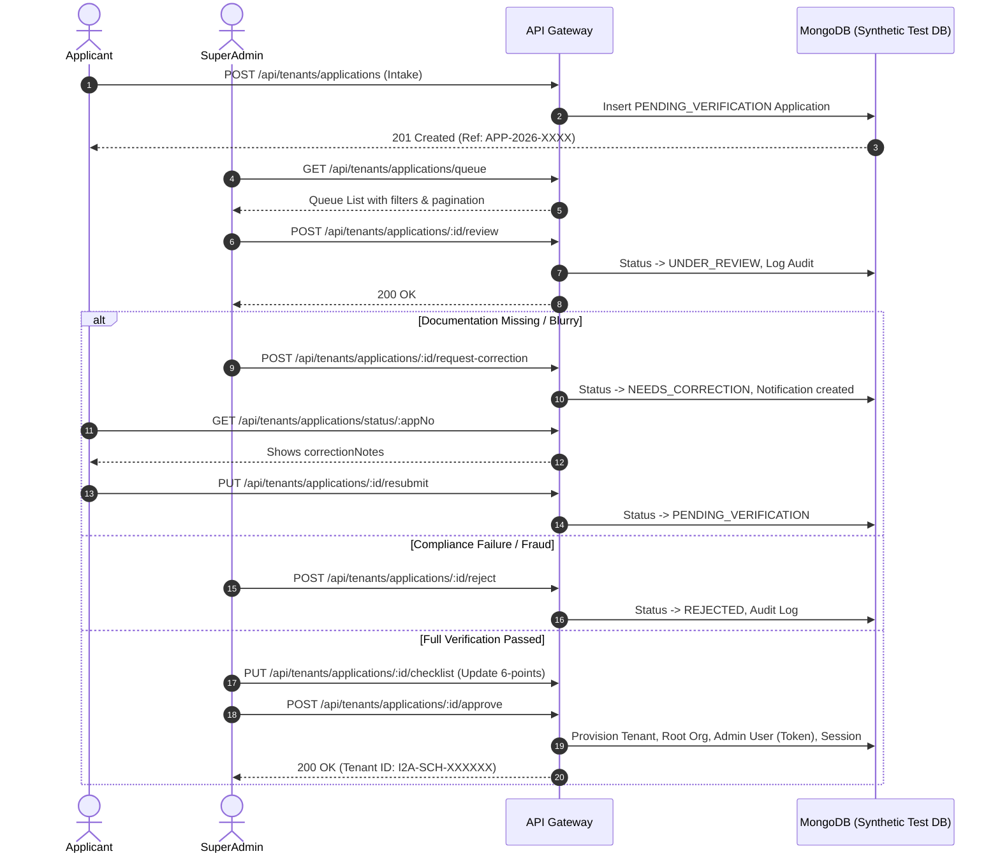

# Reviewer Authorization & Verification Workflow
**i2A SchoolOS | Phase 08 — Institution Onboarding Security & Compliance**
*Document Version:* 1.0.0  
*Audit Scope:* Super Admin Role-Based Access Control, Operator Workflow, and Console Governance

---

## 1. Reviewer Authorization & Role Boundary Enforcement

All review, inspection, verification checklist, rejection, and approval endpoints are protected by the `authenticateToken` and `requireRoles('SUPER_ADMIN')` middleware pipeline.

### Role Boundary Verification Matrix

| Role | Queue Access (`GET /queue`) | Detail View (`GET /:id`) | Start Review (`POST /review`) | Request Correction (`POST /request-correction`) | Reject (`POST /reject`) | Approve (`POST /approve`) |
|---|---|---|---|---|---|---|
| **Unauthenticated** | 401 Unauthorized | 401 Unauthorized | 401 Unauthorized | 401 Unauthorized | 401 Unauthorized | 401 Unauthorized |
| **Parent** | 403 Forbidden | 403 Forbidden | 403 Forbidden | 403 Forbidden | 403 Forbidden | 403 Forbidden |
| **Teacher** | 403 Forbidden | 403 Forbidden | 403 Forbidden | 403 Forbidden | 403 Forbidden | 403 Forbidden |
| **Principal** (Single Tenant) | 403 Forbidden | 403 Forbidden | 403 Forbidden | 403 Forbidden | 403 Forbidden | 403 Forbidden |
| **Super Admin** (`SUPER_ADMIN`) | **200 OK** | **200 OK** | **200 OK** | **200 OK** | **200 OK** | **200 OK** |

### Test Verification Evidence (Tests 1, 4, 5):
```
✓ 1. Public Approval Bypass — Unauthenticated request to approve application returns 401 9ms
✓ 4. Role Boundary — Teacher, Parent, and School Principal tokens receive 403 on queue 20ms
✓ 5. Unauthorized Review/Approve — Non-Super-Admin tokens cannot trigger review or approval 17ms
```

---

## 2. Operator Workflow Step-by-Step

The complete institutional verification workflow is orchestrated via the `ApplicationVerificationConsole` UI:



---

## 3. Reviewer Action Endpoints Specification

### 1. `GET /api/tenants/applications/queue`
- **Parameters:** `status` (e.g. `PENDING_VERIFICATION`, `UNDER_REVIEW`, `ALL`), `category`, `search`, `page`, `limit`.
- **Response:**
  ```json
  {
    "success": true,
    "count": 10,
    "total": 35,
    "page": 1,
    "totalPages": 4,
    "pagination": { "page": 1, "limit": 10, "total": 35, "totalPages": 4 },
    "applications": [ ... ]
  }
  ```

### 2. `POST /api/tenants/applications/:appId/review`
- Sets `status: 'UNDER_REVIEW'`, records `reviewerId: req.user.id`, `reviewerName`, and `reviewedAt`.
- Idempotent if already in review.
- Prevents review on terminal states (`APPROVED`, `REJECTED`, `CANCELLED`).

### 3. `POST /api/tenants/applications/:appId/request-correction`
- Validates minimum 5 character clarification note.
- Sets `status: 'NEEDS_CORRECTION'`, stores `correctionNotes`, generates notification for applicant.

### 4. `PUT /api/tenants/applications/:appId/checklist`
- Persists 6 boolean verification criteria:
  - `identityVerified`
  - `documentAuthenticityVerified`
  - `affiliationVerified`
  - `addressVerified`
  - `feeCommercialVerified`
  - `antiFraudCheckPassed`
- Attaches `verifiedBy: req.user.id` and timestamp.

### 5. `POST /api/tenants/applications/:appId/reject`
- Validates formal rejection reason (minimum 5 characters).
- Records `reasonCode` (e.g. `DOCS_UNVERIFIED`, `UNAUTHORIZED_REPRESENTATIVE`, `POLICY_VIOLATION`).
- Marks status `REJECTED`, logs immutable audit entry.

### 6. `POST /api/tenants/applications/:appId/approve`
- Triggers the atomic idempotent tenant provisioning engine.
- Rejects calls on applications in `REJECTED` or `CANCELLED` status (`409 INVALID_STATE_TRANSITION`).
- If already approved, returns existing tenant record with `idempotent: true` and zero duplicate writes.
