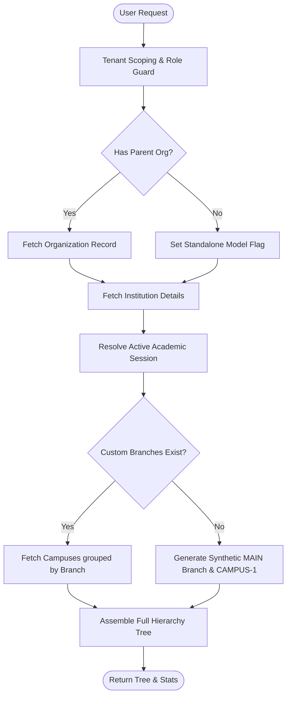

# ORGANIZATION HIERARCHY & DATA MODEL SPECIFICATION
**i2A SchoolOS | Phase 09: Organization, Branch, Campus & Academic Configuration OS**
**Date:** 2026-10-20  
**Phase:** 09 — Data Model & Hierarchy Architecture  
**Project Root:** `D:\i2A_School ERP & Managment`  
**Branch:** `phase-a-remediation`  
**Auditor:** Principal SaaS Architect & MongoDB Specialist  

---

## 1. Executive Summary

This document specifies the institutional hierarchy architecture and persistent MongoDB data schemas implemented in **Phase 09: Organization, Branch, Campus & Academic Configuration OS**.

Educational institutions operate across diverse organizational models—from single standalone schools (such as those onboarded in Phase 08) to multi-institution private trusts, corporate school chains, university satellite campuses, and test-prep federations. i2A SchoolOS provides a flexible, multi-tiered hierarchy engine with zero operational overhead for standalone institutions while guaranteeing strict cross-tenant boundaries, anti-cycle graph traversal, and non-destructive archival.

---

## 2. Canonical Hierarchy Topology

$$\text{Platform} \longrightarrow \text{Trust / Group} \longrightarrow (\text{Optional Region}) \longrightarrow \text{Institution} \longrightarrow \text{Branch} \longrightarrow \text{Campus} \longrightarrow \text{Academic Session} \longrightarrow \text{Program} \longrightarrow \text{Class} \longrightarrow \text{Section}$$

### Invariants:
1. **Zero-Overhead Standalone School Fallback:** A standalone institution operates without requiring the creation of parent trusts, regional federations, or auxiliary campuses. Synthetic/default primary units (`MAIN` branch, `CAMPUS-1` main campus) are resolved transparently.
2. **Code Scoping Invariants:**
   - Organization codes (`orgCode`) are globally unique across the platform.
   - Branch codes (`branchCode`) are unique within their parent institution.
   - Campus codes (`campusCode`) are unique within their parent branch.
   - Academic session names (`sessionName`) are unique within their parent institution.
3. **Single Active Academic Session:** Exactly one academic session per institution may have `isCurrent: true` at any instant. Activating a session atomically transitions any previous active session to `isCurrent: false` and `status: 'CONCLUDED'`.
4. **Non-Destructive Soft Archival:** Deleting or archiving an entity sets `status: 'ARCHIVED'`. Child entities cascade to `ARCHIVED`, ensuring historical records (students, attendance, marks, invoices) are never orphaned or erased.

---

## 3. Entity Schema Specifications

### 3.1 Organization Schema (`organizations`)
Represents educational trusts, corporate groups, or federations owning one or more institutions.
```typescript
interface Organization {
  id: string;                      // e.g. "org-dps-society" or UUID
  orgCode: string;                 // Globally unique uppercase alphanumeric code
  name: string;                    // Registered legal or group name
  orgType:                         // Enum:
    | 'INDEPENDENT_SCHOOL'
    | 'PRIVATE_TRUST'
    | 'CORPORATE_GROUP'
    | 'GOVT_DEPARTMENT'
    | 'COACHING_FEDERATION'
    | 'HIGHER_ED_SOCIETY';
  parentOrgId?: string | null;     // Self-referencing link for federated trusts
  status: 'ACTIVE' | 'ARCHIVED';
  createdAt: string;               // ISO 8601
  updatedAt: string;
}
```

### 3.2 Institution Tenant Schema (`tenants`)
Represents an authoritative school or college tenant boundary.
```typescript
interface InstitutionTenant {
  id: string;                      // Server-generated ID, e.g. "I2A-SCH-000001"
  name: string;                    // Institution display name
  code: string;                    // Institution code, e.g. "DPS-RKP"
  orgId?: string | null;           // Parent Organization FK (null for standalone)
  category:                        // Category slug:
    | 'k12-schools'
    | 'play-schools-daycare'
    | 'colleges-higher-ed'
    | 'coaching-institutes'
    | 'tuition-centres'
    | 'vocational-training'
    | 'hobby-sports-academies';
  board: 'CBSE' | 'ICSE' | 'STATE_BOARD' | 'IB' | 'CAMBRIDGE';
  city: string;
  adminName: string;
  adminEmail: string;
  adminPhone: string;
  studentLimit: number;
  status: 'ACTIVE' | 'SUSPENDED' | 'ARCHIVED';
  branding: {
    academicSession: string;       // Synced to current active sessionName
    address: string;
    primaryColor: string;
  };
}
```

### 3.3 Branch Schema (`branches`)
Represents autonomous operating branches, regional centers, or campuses of an institution.
```typescript
interface Branch {
  id: string;                      // e.g. "BR-SCH001-MAIN-xxxx"
  institutionId: string;           // FK -> tenants.id (Mandatory tenant boundary)
  orgId?: string | null;           // Inherited parent organization FK
  branchCode: string;              // Unique within institutionId (e.g. "MAIN", "NORTH")
  name: string;                    // Display name, e.g. "North Campus Branch"
  displayName?: string;            // Short UI label
  isMainBranch: boolean;           // True for primary/headquarters branch
  institutionType: string;         // 'K12_SCHOOL', 'SENIOR_SECONDARY_COLLEGE', etc.
  boardAffiliation: string;        // 'CBSE', 'ICSE', etc.
  address: {
    street: string;
    city: string;
    state: string;
    postalCode: string;
    country: string;
  };
  contact: {
    email: string;
    phone: string;
    principalName: string;
  };
  capacity: number;                // Maximum student capacity
  status: 'ACTIVE' | 'ARCHIVED' | 'INACTIVE';
  createdAt: string;
  updatedAt: string;
  createdBy: string;
}
```

### 3.4 Campus Schema (`campuses`)
Represents physical campus facilities, satellite grounds, or hostel blocks under a branch.
```typescript
interface Campus {
  id: string;                      // e.g. "CMP-BR01-CAMPUS1-xxxx"
  branchId: string;                // FK -> branches.id (Mandatory parent branch)
  institutionId: string;           // FK -> tenants.id (Tenant boundary match)
  orgId?: string | null;           // Inherited organization FK
  campusCode: string;              // Unique within branchId (e.g. "CAMPUS-1", "SPORTS-QUAD")
  name: string;                    // Display name, e.g. "Primary Wing Campus"
  campusType:                      // Facility category:
    | 'MAIN_CAMPUS'
    | 'SATELLITE_CAMPUS'
    | 'SPORTS_COMPLEX'
    | 'HOSTEL_BLOCK'
    | 'RESEARCH_CENTRE';
  facilities: string[];            // ['Smart Classrooms', 'Robotics Lab', 'Auditorium']
  capacity: number;
  address: {
    street: string;
    city: string;
    state: string;
    postalCode: string;
    country: string;
  };
  status: 'ACTIVE' | 'ARCHIVED' | 'INACTIVE';
  createdAt: string;
  updatedAt: string;
  createdBy: string;
}
```

### 3.5 Academic Session Schema (`academic_sessions`)
Represents educational calendar years and enforcement of the single-active-session invariant.
```typescript
interface AcademicSession {
  id: string;                      // e.g. "SESS-SCH001-2026-2027"
  institutionId: string;           // Tenant boundary
  schoolId: string;                // Compatibility alias for institutionId
  sessionName: string;             // e.g. "2026-2027" (Unique per institution)
  startDate: string;               // ISO date format "YYYY-MM-DD"
  endDate: string;                 // ISO date format "YYYY-MM-DD" (endDate > startDate)
  termType: 'ANNUAL' | 'SEMESTER' | 'TRIMESTER';
  category: string;                // 'k12-schools', 'colleges-higher-ed', etc.
  isCurrent: boolean;              // Exactly ONE session may be true per institution
  status: 'UPCOMING' | 'ACTIVE' | 'CONCLUDED' | 'ARCHIVED';
  createdAt: string;
  updatedAt: string;
  createdBy: string;
}
```

---

## 4. Hierarchy Resolution Flow



---

## 5. Architectural Verdict
The data model complies with all Enterprise SaaS multi-tenant guarantees, eliminates standalone school friction, and guarantees schema integrity through server-side validation and atomic session controls.
