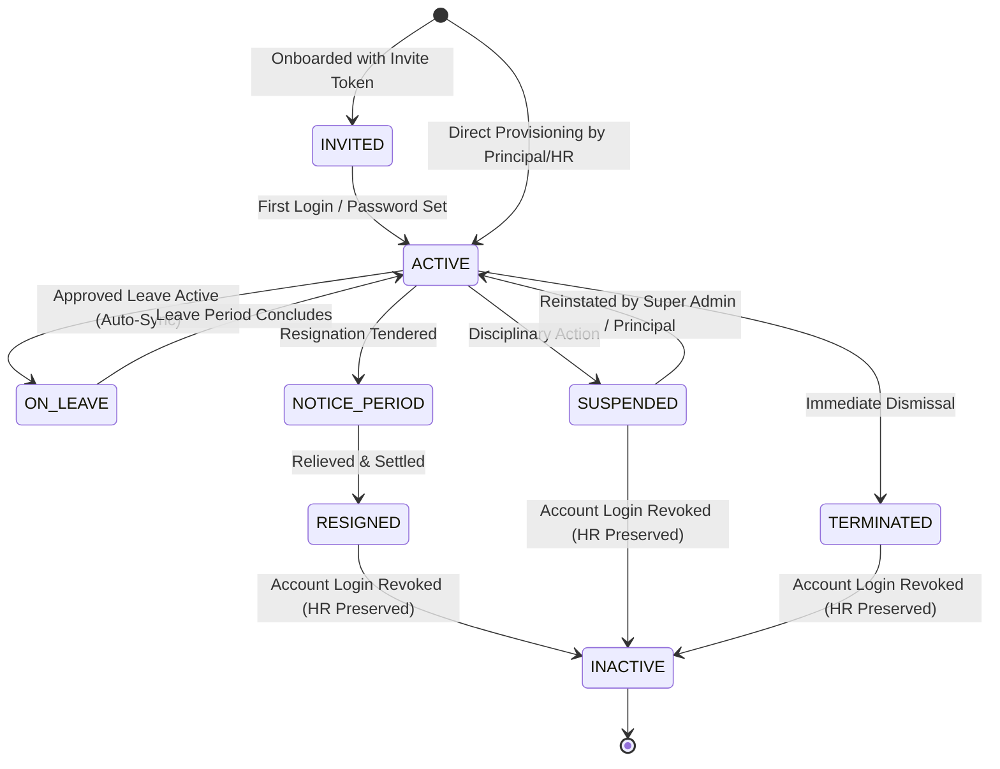

# i2A SchoolOS — Phase 10: Staff Lifecycle & Permission Matrix
**Master Prompt 10: Staff, Accounts & Permission Administration**  
*Document Ref: i2A-AUDIT-P10-001 | Date: October 20, 2026 | Status: OFFICIALLY_VERIFIED*

---

## 1. Overview & Architectural Capabilities

Phase 10 implements an enterprise-grade Staff Workforce, Accounts & Permission Administration OS within i2A SchoolOS:
- **Separation of Concerns:** Strict architectural distinction between the official HR Employee Profile (`staff` collection) and the Authentication Login Account (`users` collection).
- **Atomic Employee ID Sequencing:** Distributed mutex-protected ID generator producing zero collisions under concurrent parallel onboarding (`EMP-{YEAR}-{0001}`).
- **Multi-Branch Assignment Scoping:** Validates that faculty can only be assigned to branches belonging to their own tenant institution.
- **Least-Privilege PII Masking:** Masks sensitive bank details, Aadhaar, PAN, and compensation from non-administrative staff.
- **Soft Disablement Protocol:** Revoking or terminating a staff member immediately sets their linked user account to `INACTIVE`, invalidates login, but strictly preserves historical HR, payroll, and attendance records.
- **Leave Request & Multi-Tier Approval Engine:** Complete approval workflow with anti-self-approval enforcement and distributed mutex serialization against concurrent approval write skews.

---

## 2. Staff Lifecycle State Machine

---

## 3. Role & Permission Matrix for Staff Management

| Role | Directory Access | Onboard Staff | Edit Profile | Assign Branches | Suspend / Terminate | Apply Leave | Approve Leave | View Confidential PII (Bank/PAN) |
|---|---|---|---|---|---|---|---|---|
| **SUPER_ADMIN** | Global (All Tenants) | ✅ Yes | ✅ Yes | ✅ Global | ✅ Yes | N/A | ✅ Yes | ✅ Unmasked |
| **PRINCIPAL** | Tenant Scoped | ✅ Yes | ✅ Yes | ✅ Own Branches | ✅ Yes | ✅ Yes | ✅ Yes (Except Self) | ✅ Unmasked |
| **ADMIN / HR** | Tenant Scoped | ✅ Yes | ✅ Yes | ✅ Own Branches | ✅ Yes | ✅ Yes | ✅ Yes (Except Self) | ✅ Unmasked |
| **ORG_DIRECTOR** | Multi-School Org | ✅ View/Audit | ✅ Policy | ✅ Org Branches | ✅ Yes | N/A | ✅ Yes | ✅ Unmasked |
| **TEACHER** | Tenant Scoped | ❌ Denied (403) | ❌ Denied (403) | ❌ Denied (403) | ❌ Denied (403) | ✅ Yes (Self) | ❌ Denied (403) | 🔒 Masked (••••••••) |
| **ACCOUNTANT** | Tenant Scoped | ❌ Denied (403) | ❌ Denied (403) | ❌ Denied (403) | ❌ Denied (403) | ✅ Yes (Self) | ❌ Denied (403) | 🔒 Masked (••••••••) |
| **PARENT / STUDENT**| ❌ Denied (403) | ❌ Denied (403) | ❌ Denied (403) | ❌ Denied (403) | ❌ Denied (403) | ❌ Denied (403) | ❌ Denied (403) | ❌ Denied (403) |

---

## 4. REST API Endpoint Catalog

| HTTP Method | Route Endpoint | Required Roles | Description & Validation |
|---|---|---|---|
| `GET` | `/api/staff` | Authenticated Tenant User | List staff with filters (branch, department, designation, status, search, pagination). |
| `POST` | `/api/staff` | `SUPER_ADMIN`, `PRINCIPAL`, `ADMIN`, `HR` | Mutex-locked onboarding, atomic sequential ID, bcrypt password hash provisioning. |
| `GET` | `/api/staff/:id` | Authenticated Tenant User | Profile detail with automatic PII masking for non-HR callers. |
| `PUT` | `/api/staff/:id` | `SUPER_ADMIN`, `PRINCIPAL`, `ADMIN`, `HR` | Update profile attributes; anti-privilege escalation blocks assigning `SUPER_ADMIN`. |
| `PATCH` | `/api/staff/:id/status` | `SUPER_ADMIN`, `PRINCIPAL`, `ADMIN`, `HR` | Change status (`ACTIVE`, `INACTIVE`, `SUSPENDED`). Syncs linked user login status. |
| `POST` | `/api/staff/:id/branches` | `SUPER_ADMIN`, `PRINCIPAL`, `ADMIN`, `HR` | Multi-branch access scope assignment with cross-tenant foreign branch rejection. |
| `GET` | `/api/staff/leaves` | Authenticated Tenant User | Lists leaves. Teachers only view own leaves; Admins view all pending leaves. |
| `POST` | `/api/staff/leaves` | Authenticated Tenant User | Submit leave request with date range and total days calculation. |
| `PATCH` | `/api/staff/leaves/:id/decision` | `SUPER_ADMIN`, `PRINCIPAL`, `ADMIN`, `HR` | Mutex-locked decision. Anti-self-approval blocks teacher from approving own leave. |
| `POST` | `/api/staff/bulk-validate` | `SUPER_ADMIN`, `PRINCIPAL`, `ADMIN`, `HR` | Validates bulk import rows against database and intra-batch collisions. |
