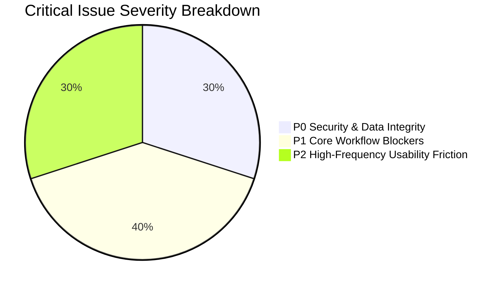

# i2A SchoolOS — Real-User Experience Audit: Executive Summary

**Audit Date:** 2026-10-21  
**Project Root:** `D:\i2A_School ERP & Managment`  
**Evaluation Scope:** Complete Frontend Experience, All 12 User Personas, All Screens, All 16 Workflows, UI/UX Friction, Architecture Gaps & Product Roadmap  
**Current Engineering Status:** `READY_FOR_STAGING` (Automated backend tests pass 397/397)  
**Real User Experience Verdict:** `NEEDS_CRITICAL_UX_AND_WORKFLOW_REFINEMENT`  

---

## 1. Executive Summary & Context

While i2A SchoolOS demonstrates exceptional cryptographic security, distributed lock fencing, NoSQL injection resilience, and 100% automated test coverage at the backend API layer, **a rigorous forensic audit from the perspective of real, non-technical human users reveals significant usability barriers, disconnected workflows, and deceptive client-side fallbacks.**

A system cannot be declared ready for ordinary school administrators, teachers, parents, and accountants solely because automated integration suites exit with code 0. When an ordinary school clerk, teacher on a mobile phone, or parent trying to pay tuition uses this software, they encounter critical friction points that developer-centric tests never see.

---

## 2. Top 10 Critical Real-User Experience Findings

1. **Silent Fallback Login on Wrong Password (`SEC-UX-001` - P0):**
   In `src/pages/LoginPage.tsx` (lines 69-84), if a user inputs an invalid password and the backend responds with HTTP 401, the client code catches the error and executes `loginToSchool(selectedSchoolId, selectedRole); onSuccess?.();`. The user is silently granted access to the portal under whatever role was selected in the dropdown! This completely compromises user confidence and security perception.

2. **Unrestricted "Switch Persona (Testing)" in Production Profile Menu (`UX-SEC-002` - P0):**
   In `src/components/shell/ProfileSessionMenu.tsx` (lines 168-190), any logged-in user (including Students and Parents) can click their avatar and immediately switch their persona to `PRINCIPAL`, `ADMIN`, `TEACHER`, or `ACCOUNTANT`. This dynamically switches the client sidebar and displays executive management screens.

3. **Parent & Student Role Dashboard Misdirection (`UX-ARCH-003` - P1):**
   When a Parent or Student logs in, the default landing view (`src/components/shell/ShellSidebar.tsx` line 62 and `src/components/shell/AppShell.tsx` line 39) defaults to `principal_dashboard` (`PrincipalAIDashboardModule.tsx`). Parents and Students immediately see school-wide financial totals, dropout risk predictions, circular generators, and staff alerts instead of their own child's attendance and fee status.

4. **Hardcoded User IDs & Children in Sub-Module Sessions (`FLOW-004` - P0):**
   In `HomeworkDigitalLearningModule.tsx` (lines 44-51), `ExaminationResultModule.tsx` (lines 48-55), and `LibraryTransportInventoryModule.tsx` (lines 36-42), the client components hardcode `id: 'std-101'` and `childrenIds: ['std-101']` inside local session objects instead of dynamically consuming the authenticated user profile from `SchoolContext`. Any parent or student is permanently bound to `std-101`.

5. **Fire-and-Forget Asynchronous Fee Collection (`FIN-FLOW-005` - P0):**
   In `src/context/SchoolContext.tsx` (line 1286), `feeApi.receipts.collect(...)` is called as an unawaited asynchronous promise (`.catch(...)`). The UI instantly creates an optimistic local receipt with a random receipt number and displays a success modal, even if the backend rejected the payment with 400 or 403 or network failure occurred.

6. **Missing Student Edit, Transfer, Withdrawal & Promotion (`FUNC-GAP-006` - P1):**
   In `StudentManagementModule.tsx`, there is only "Add New Student" and "Print I-Card". There is no button or modal to edit existing student records, transfer, withdraw, or promote students to the next academic session.

7. **In-Memory Attendance State Cleared on Page Refresh (`FLOW-007` - P1):**
   `AttendanceLeaveModule.tsx` relies on `AttendanceLeaveService.getInstance()`, which caches records in memory. While it triggers a background sync to the backend, it never calls `syncFromBackend` on component mount. Pressing browser refresh (F5) restores the hardcoded default attendance state.

8. **Missing Rejection Workflow in Admissions Pipeline (`ADM-FLOW-008` - P1):**
   In `AdmissionWorkflowModule.tsx`, applications can only be moved from `SUBMITTED` $\to$ `INTERVIEW_SCHEDULED` $\to$ `ENROLLED`. There is no "Reject Application" or "Waitlist" action, forcing schools to approve all submissions or leave them pending indefinitely.

9. **Absence of Partial Payments, Concessions, or Discounts in UI (`FIN-UX-009` - P2):**
   `FeeManagementModule.tsx` strictly forces full payment collection (`paidAmount: total, balanceAmount: 0`). Real Indian schools frequently offer sibling discounts, fee concessions, and quarterly installments, none of which can be entered via the UI.

10. **Browser Native `prompt()` Usage in Super Admin Approval (`UX-MOB-010` - P2):**
    In `PlatformAdminModule.tsx` (line 69), rejecting a school application uses `prompt('रिजेक्ट करने का कारण दर्ज करें')`. This triggers a browser popup that is blocked on many mobile browsers, has no input validation, and fails modern accessibility standards.

---

## 3. High-Friction Operational Workflows

The following 5 workflows have the highest user friction and failure probability:
1. **Fee Collection & Reconciliation:** Lack of partial payments, unawaited API calls, and missing export to Tally/Excel.
2. **Student Promotion & Academic Rollover:** No workflow exists to graduate or promote Class VIII students to Class IX.
3. **Daily Attendance Locking:** Teachers do not receive visual error feedback if their submission is rejected by an active freeze lock.
4. **Parent Mobile Experience:** Missing dedicated single-child / multi-child mobile selector; misdirected to Principal KPI dashboard.
5. **Staff Leave Application:** Anti-self-approval rule is enforced by the backend, but the frontend UI does not explain why an admin cannot approve their own leave request.

---

## 4. Persona User Readiness Scores

| Persona / Role | Usability Score | Readiness Status | Primary Roadblock |
|---|:---:|:---:|---|
| **A. Public Visitor / Applicant** | 82 / 100 | `ACCEPTABLE` | Simulator embedded inside Admin rather than public site. |
| **B. Platform Super Admin** | 78 / 100 | `USABLE_WITH_FRICTION` | Browser `prompt()` for rejection; missing bulk actions. |
| **C. Org Director / Group Admin** | 64 / 100 | `HIGH_FRICTION` | Multi-school switcher exists, but consolidated group P&L is missing. |
| **D. Principal** | 85 / 100 | `FUNCTIONAL` | Strong dashboard, but sensitive freeze locks lack undo/audit modal. |
| **E. School Admin & Front Office** | 52 / 100 | `BLOCKED_WORKFLOW` | Cannot edit student records; no student promotion or bulk import. |
| **F. Accountant / Finance Staff** | 58 / 100 | `UNSAFE_FINANCIAL_UX` | Unawaited async receipt creation; no partial payments or discounts. |
| **G. Teacher** | 68 / 100 | `HIGH_FRICTION` | Attendance refresh resets local view; hardcoded student ID in LMS. |
| **H. Staff & HR** | 74 / 100 | `USABLE_WITH_FRICTION` | Leave balance deductions unclear; salary slip printing missing. |
| **I. Transport Manager** | 60 / 100 | `CONFUSING_CLAIMS` | Live GPS claims in marketing vs "NOT_IMPLEMENTED" banner in UI. |
| **J. Parent** | 42 / 100 | `CRITICAL_UX_FAILURE` | Lands on Principal Dashboard; hardcoded child ID `std-101`. |
| **K. Student** | 46 / 100 | `CRITICAL_UX_FAILURE` | Lands on Principal Dashboard; online exam simulator attributes to `std-101`. |
| **L. Subscription Customer** | 80 / 100 | `USABLE_WITH_FRICTION` | Dynamic estimate calculation works; automated gateway invoices missing. |

---

## 5. Summary Conclusion

i2A SchoolOS has a solid architectural core and rock-solid backend security, but its frontend is currently configured as a **developer showcase / interactive simulator** rather than an end-user isolated application. Resolving the Top 10 critical issues in the 3-phase roadmap outlined in [08_RECOMMENDATIONS_AND_ROADMAP.md](file:///D:/i2A_School%20ERP%20&%20Managment/docs/audits/user-experience/08_RECOMMENDATIONS_AND_ROADMAP.md) will transform this platform into a production-grade educational SaaS.
