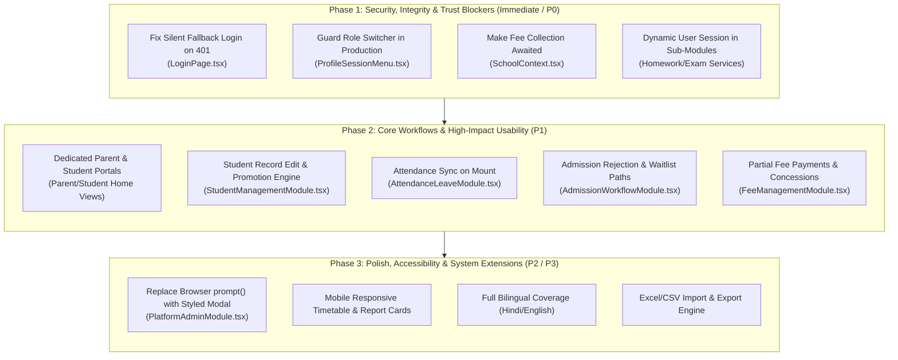

# i2A SchoolOS — Recommendations & 3-Phase Implementation Roadmap

**Roadmap Objective:** Transform i2A SchoolOS from a developer/demo simulation into a production-grade educational SaaS application with complete user trust.

---

## 1. Roadmap Architecture: 3-Phase Execution Strategy



---

## 2. Phase 1: Security, Integrity & Trust Blockers (P0 — Immediate)

### 1. Fix Silent Fallback on Invalid Credentials (`SEC-UX-001`)
- **Module / File:** `src/pages/LoginPage.tsx` (lines 69-84)
- **Proposed Change:** Check response status explicitly. If `res.status === 401` or `res.status === 400`, display error: *"Invalid email or password. Please verify your credentials."* Only trigger offline mode if `window.navigator.onLine === false` or `res.status === 0`.
- **User Benefit:** Users receive authentic authentication feedback; security perception is maintained.
- **Complexity:** Low (1 hour)
- **Regression Test:** Submit incorrect password for `principal@abcpublicschool.edu.in` and assert that user stays on login page with visible error alert.
- **Acceptance Criteria:** Failed login never transitions to portal; successful login transitions cleanly.

### 2. Guard Role Switcher Menu in Production (`UX-SEC-002`)
- **Module / File:** `src/components/shell/ProfileSessionMenu.tsx` (lines 168-190)
- **Proposed Change:** Wrap the "Switch Persona (Testing)" section with `{import.meta.env.DEV && (...)}`. In production builds, this entire menu is omitted from the DOM.
- **User Benefit:** Students and parents cannot artificially escalate client-side privileges to Principal or Admin.
- **Complexity:** Low (30 minutes)
- **Regression Test:** Run `npm run build && npm run preview` and verify that the avatar dropdown only shows Profile, Theme, Language, and Logout.
- **Acceptance Criteria:** Zero role switching buttons visible in production bundle.

### 3. Await Fee Collection API & Eliminate Fire-and-Forget (`FIN-FLOW-003`)
- **Module / File:** `src/context/SchoolContext.tsx` (lines 1280-1316), `src/components/modules/FeeManagementModule.tsx`
- **Proposed Change:** Change `processFeePayment` from synchronous optimistic generation to an asynchronous awaited call:
  ```ts
  const res = await feeApi.receipts.collect({ studentId, feeIds, paymentMode, amountCollected, discountAmount, fineAmount });
  if (!res.ok) throw new Error(res.error || 'Failed to collect payment');
  const authoritativeReceipt = res.data.receipt;
  setFeeReceipts(prev => [authoritativeReceipt, ...prev]);
  ```
- **User Benefit:** Prevents issuance of receipts that were never recorded in the database.
- **Complexity:** Medium (3 hours)
- **Regression Test:** Disconnect server and click collect fee; assert that error alert displays and receipt modal does NOT open.
- **Acceptance Criteria:** Client receipt number and database receipt number are identical.

### 4. Inject Dynamic Authentic User Session into LMS & Exam Sub-Modules (`FLOW-004`)
- **Module / Files:**
  - `src/components/modules/HomeworkDigitalLearningModule.tsx`
  - `src/components/modules/ExaminationResultModule.tsx`
  - `src/components/modules/LibraryTransportInventoryModule.tsx`
- **Proposed Change:** Replace hardcoded `id: 'std-101'` with `currentUser.id` and `currentUser.childrenIds` passed from `useSchool()`.
- **User Benefit:** Parents view their actual children's homework; teachers evaluate authentic class rosters.
- **Complexity:** Medium (4 hours)
- **Regression Test:** Log in as Parent `sanjay.kumar@gmail.com` with child `std-101`, and verify that child ID matches authentic profile.
- **Acceptance Criteria:** Zero hardcoded `'std-101'` strings in component render paths.

---

## 3. Phase 2: Core Workflows & High-Impact Usability Fixes (P1)

### 5. Create Dedicated Parent & Student Portal Dashboards (`UX-ARCH-005`)
- **Module / Files:** `src/components/shell/AppShell.tsx`, `src/components/public/ParentPortalHome.tsx`, `src/components/public/StudentPortalHome.tsx`
- **Proposed Change:**
  - If `currentRole === 'PARENT'`, render `ParentPortalHome`: Today's Attendance, Fee Dues Card, Homework Feed, Bus Status, and Notice Board.
  - If `currentRole === 'STUDENT'`, render `StudentPortalHome`: Today's Timetable, Pending Homework, Upcoming Exams, and Digital Library Books.
- **User Benefit:** Parents and students immediately see relevant personal data rather than executive financial dashboards.
- **Complexity:** Medium (6 hours)
- **Regression Test:** Log in as student `rahul.kumar@abcpublicschool.edu.in` and verify that the default view contains student timetable, not Principal AI tools.
- **Acceptance Criteria:** `principal_dashboard` is completely hidden from Parent and Student roles.

### 6. Implement Student Record Edit, TC Withdrawal & Promotion Engine (`FUNC-006`)
- **Module / Files:** `src/components/modules/StudentManagementModule.tsx`, `server/routes/students.js`
- **Proposed Change:**
  - Add "Edit Profile" button to student card and 360 modal opening `EditStudentModal`.
  - Add "Issue Transfer Certificate (TC) & Withdraw" action updating status to `WITHDRAWN`.
  - Add "Annual Class Promotion Wizard" allowing bulk promotion of Class VIII to Class IX.
- **User Benefit:** School clerks can maintain accurate student data and perform annual academic rollovers without database scripts.
- **Complexity:** High (8 hours)
- **Regression Test:** Edit a student's mobile number, save, refresh, and assert that the updated number persists in MongoDB.
- **Acceptance Criteria:** Full CRUD lifecycle available directly from the UI.

### 7. Sync Attendance from Backend on Component Mount (`FLOW-007`)
- **Module / File:** `src/components/modules/AttendanceLeaveModule.tsx`
- **Proposed Change:** In `useEffect`, invoke `attendanceService.syncFromBackend(schoolId, selectedClass, selectedSection, selectedDate)` before setting local state. Show loading skeleton while syncing.
- **User Benefit:** Teachers who refresh their browser retain the exact attendance roster marked earlier.
- **Complexity:** Low (2 hours)
- **Regression Test:** Mark attendance, press F5, and verify that marked present/absent statuses persist.
- **Acceptance Criteria:** Zero data loss on browser refresh.

### 8. Add Rejection and Waitlist Actions to Admissions Pipeline (`FLOW-008`)
- **Module / File:** `src/components/modules/AdmissionWorkflowModule.tsx`
- **Proposed Change:** Add "Reject Application" and "Move to Waitlist" buttons to candidate cards with a modal capturing rejection reason.
- **User Benefit:** School administrators can cleanly manage rejected applicants without forcing enrollment.
- **Complexity:** Low (2 hours)
- **Regression Test:** Reject an applicant with reason "Failed entrance test"; verify status updates to `REJECTED` and shows in filtered view.
- **Acceptance Criteria:** Candidates can transition to `REJECTED`, `WAITLISTED`, or `ENROLLED`.

### 9. Add Partial Payments, Concessions & Instalments (`FIN-009`)
- **Module / File:** `src/components/modules/FeeManagementModule.tsx`
- **Proposed Change:** In the Collect Fee Desk, add editable fields for:
  - `Amount Collected (₹)` (default: full amount)
  - `Discount / Concession (₹)`
  - `Late Fine (₹)`
  - Calculate `Balance Due = (Base + Fine - Discount) - Amount Collected`.
- **User Benefit:** Real-world payment flexibility for installment-paying parents.
- **Complexity:** Medium (4 hours)
- **Regression Test:** Collect ₹5,000 against ₹12,000 fee; verify receipt shows paid ₹5,000, balance ₹7,000, and ledger records ₹5,000.
- **Acceptance Criteria:** Partial payments generate valid receipts and maintain accurate outstanding balances.

---

## 4. Phase 3: Polish, Accessibility & System Extensions (P2 / P3)

### 10. Replace Native `prompt()` with Accessible Modal (`UX-010`)
- **Module / File:** `src/components/modules/PlatformAdminModule.tsx`
- **Proposed Change:** Use `ApplicationVerificationConsole.tsx`'s rejection modal with pre-defined reason dropdowns (`DOCS_INCOMPLETE`, `INVALID_AFFILIATION`, etc.).
- **Complexity:** Low (1 hour)

### 11. Mobile-Optimized Timetable & Report Card Views (`UX-012`)
- **Module / File:** `src/components/modules/TimetableModule.tsx`
- **Proposed Change:** On mobile screens ($\le$ 640px), render timetable as a vertical single-day card list (e.g. "Monday's Schedule") with a day-switcher carousel rather than a 7x6 desktop table.
- **Complexity:** Medium (3 hours)

### 12. Full Bilingual Localization Coverage (`I18N-013`)
- **Module / File:** `src/utils/translations.ts`, all module headers
- **Proposed Change:** Expand translation keys to cover all form labels, table headers, and error banners in Hindi and English.
- **Complexity:** Medium (4 hours)

### 13. Excel / CSV Importer & Exporter (`FUNC-016`)
- **Module / Files:** `StudentManagementModule.tsx`, `FeeManagementModule.tsx`
- **Proposed Change:** Add CSV parser to bulk import students and export daily fee registers.
- **Complexity:** Medium (5 hours)

---

## 5. Implementation Priority Matrix

| Order | Task | Phase | Target Timeline | Risk Level |
|:---:|---|:---:|:---:|:---:|
| **1** | Fix Silent Fallback Login on 401 (`SEC-UX-001`) | Phase 1 | Day 1 | Low |
| **2** | Guard Role Switcher in Production (`UX-SEC-002`) | Phase 1 | Day 1 | Low |
| **3** | Await Fee Collection API Call (`FIN-FLOW-003`) | Phase 1 | Day 2 | Low |
| **4** | Dynamic User Context in Sub-Modules (`FLOW-004`) | Phase 1 | Day 2 | Medium |
| **5** | Dedicated Parent & Student Portal Views (`UX-ARCH-005`) | Phase 2 | Day 3 | Medium |
| **6** | Student Edit, TC & Promotion Engine (`FUNC-006`) | Phase 2 | Day 4 | Medium |
| **7** | Attendance Sync on Mount (`FLOW-007`) | Phase 2 | Day 5 | Low |
| **8** | Admission Rejection & Waitlist Actions (`FLOW-008`) | Phase 2 | Day 5 | Low |
| **9** | Partial Fee Payments & Concessions (`FIN-009`) | Phase 2 | Day 6 | Medium |
| **10** | Mobile Responsive Layout Refinements | Phase 3 | Day 7 | Low |
| **11** | Full Bilingual Translations | Phase 3 | Day 8 | Low |
