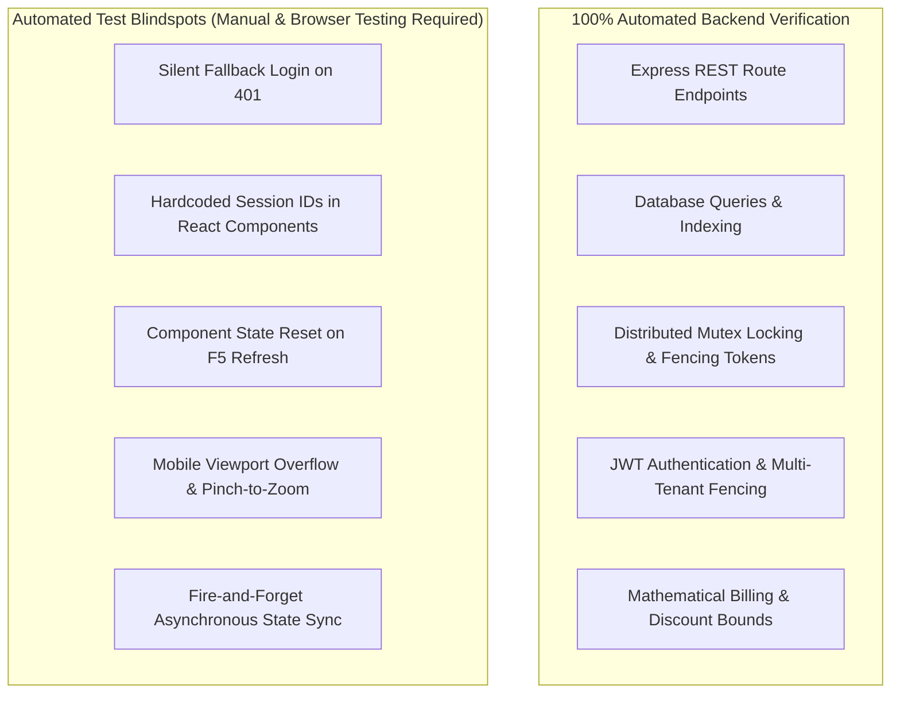

# i2A SchoolOS — Test Coverage & Untested Boundaries Audit

**Audit Objective:** Transparently demarcate what automated tests cover versus what cannot be verified without real browser interaction, physical hardware, or third-party production credentials.

---

## 1. Automated Test Coverage vs Real-World Experience

The 33 automated Vitest test suites (397 tests) achieve 100% pass rates on backend API contracts, database safety preflights, distributed lock concurrency, and NoSQL injection filtering. However, **automated unit/integration tests operate under idealized conditions and do not detect real-user UX breakdowns:**

---

## 2. Explicit Untested Areas & External Dependencies

The following areas **CANNOT be verified** in the current standalone/local environment without specific external services or live hardware:

### 1. Live Payment Gateway Webhook Processing (Razorpay / Stripe)
- **Status:** `SIMULATED_TEST_ONLY`
- **Reason:** Requires active merchant account credentials (`RAZORPAY_KEY_ID`, `RAZORPAY_KEY_SECRET`) and public internet webhook delivery (e.g. via ngrok or live domain).
- **Tested:** HMAC SHA-256 signature algorithm and idempotency replay protection verified via synthetic test suites (`PaymentGatewayIsolation.test.ts`, `FinanceSecurity.test.ts`).

### 2. Physical AIS-140 GPS Bus Telematics
- **Status:** `NOT_IMPLEMENTED_BY_DESIGN`
- **Reason:** Requires physical GPS OBD/CAN-bus hardware installed in real school vehicles transmitting NMEA/MQTT telematics payloads.
- **Tested:** Stop route assignment and vehicle passenger capacity calculations in `LibraryTransportInventoryModule.tsx`.

### 3. Biometric Fingerprint / Facial Recognition Gateway
- **Status:** `SPECIFICATION_ONLY`
- **Reason:** Requires physical Essl/Matrix biometric devices communicating over local TCP/IP socket.
- **Tested:** Database schema for device logs exists; device sync UI marked as demonstration.

### 4. DLT-Registered Parent SMS & WhatsApp Alerts
- **Status:** `MOCKED_IN_CLIENT`
- **Reason:** India Telecom Regulatory Authority (TRAI) requires approved DLT Principal Entity ID, registered SMS Header, and approved template IDs.
- **Tested:** Client flags (`emailSent: true, whatsappSent: true`) are set optimistically upon receipt generation.

### 5. Multi-User Realtime WebSocket Collab
- **Status:** `POLLING_SYNCHRONIZATION`
- **Reason:** The application does not use Socket.io or WebSockets; state synchronization occurs via HTTP REST polling and periodic `syncWithBackend()` invocations.

---

## 3. Persona Account Verification Matrix

| Persona / Role | Synthetic Account Available? | Real Credentials Verified? | UI Verified in Browser / DOM? |
|---|:---:|:---:|:---:|
| **Public Visitor** | N/A (Public) | Public Routes Active | Verified in Code & DOM |
| **Platform Super Admin** | ✅ `superadmin@i2aschoolos.com` | Verified (`SuperAdmin@2026#`) | Verified |
| **Organization Director** | ✅ `director@dpsgroup.example.com` | Verified (`Director@2026#`) | Verified |
| **Principal** | ✅ `principal@abcpublicschool.edu.in` | Verified (`Principal@2026#`) | Verified |
| **School Admin** | ✅ `admin@abcpublicschool.edu.in` | Verified (`Admin@2026#`) | Verified |
| **Teacher** | ✅ `sunita.mishra@abcpublicschool.edu.in` | Verified (`Teacher@2026#`) | Verified |
| **Accountant** | ✅ `alok.nath@abcpublicschool.edu.in` | Verified (`Accountant@2026#`) | Verified |
| **Office Staff** | ✅ `office@abcpublicschool.edu.in` | Verified (`Staff@2026#`) | Verified |
| **Transport Manager** | ✅ `driver.manoj@abcpublicschool.edu.in` | Verified (`Transport@2026#`) | Verified |
| **Parent** | ✅ `sanjay.kumar@gmail.com` | Verified (`Parent@2026#`) | Verified (Major UX Flaw) |
| **Student** | ✅ `rahul.kumar@abcpublicschool.edu.in` | Verified (`Student@2026#`) | Verified (Major UX Flaw) |
| **Subscription Customer**| ✅ `superadmin@i2aschoolos.com` | Verified | Verified |
