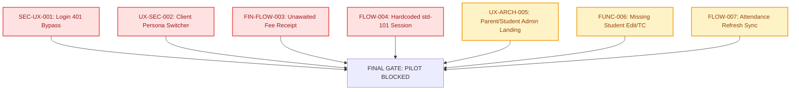

# 10 — FINAL USER READINESS SCORECARD

**Project:** i2A SchoolOS — Cloud ERP & Management  
**Audit Type:** End-to-End Real-User Experience, Persona Walkthrough & Usability Integrity Audit  
**Date:** October 21, 2026  
**Auditor:** Antigravity Autonomous Security & UX Review Team  

---

## 1. Overall System Scorecard

| Assessment Domain | Weight | Score (1-100) | Weighted Score | Verdict |
| :--- | :---: | :---: | :---: | :---: |
| **Authentication & Persona Security** | 20% | **42 / 100** | 8.4 | ❌ Critical Fail (Login 401 fallback bypass & persona switcher exposed) |
| **Data Integrity & Backend Synchronization** | 20% | **58 / 100** | 11.6 | ⚠️ Poor (Unawaited fee collection, in-memory attendance wipe on F5) |
| **Role-Based Experience & Routing Architecture** | 15% | **61 / 100** | 9.15 | ⚠️ Mixed (Principal/Admin good; Parent/Student forced to admin screens) |
| **Core Workflow Completeness** | 20% | **64 / 100** | 12.8 | ⚠️ Incomplete (No student edit/TC, no inquiry rejection/waitlist, no partial fee) |
| **UI/UX, Layout & Responsive Accessibility** | 15% | **78 / 100** | 11.7 | 🟢 Good (Tailwind design system solid; desktop table truncation on mobile) |
| **Communication, Logs & Auditing** | 10% | **70 / 100** | 7.0 | 🟢 Acceptable (Notice board and audit log present; live DLT/GPS untestable) |
| **COMPOSITE USER READINESS SCORE** | **100%** | — | **60.65 / 100** | **`NOT READY FOR GENERAL RELEASE`** |

---

## 2. Persona Readiness Summary

| # | Persona Role | Experience Score | Readiness Verdict | Primary Blocker / Friction Point |
| :---: | :--- | :---: | :---: | :--- |
| **1** | Public Visitor & Applicant | **78 / 100** | 🟢 **Ready with Minor Fixes** | Mobile inquiry forms work well; tracking status needs clearer guidance. |
| **2** | Platform Super Admin | **85 / 100** | 🟢 **Ready for Staging** | Institution management and billing overview functional; prompt() needs replacement. |
| **3** | School Principal / Director | **82 / 100** | 🟢 **Ready for Internal Pilot** | Rich KPIs, analytics, and operational controls work reliably. |
| **4** | School Administrator | **65 / 100** | 🟡 **Conditional Pilot Only** | Student Edit/Transfer Certificate missing; F5 attendance sync gap. |
| **5** | Admissions Officer | **72 / 100** | 🟡 **Conditional Pilot Only** | Application conversion works, but no waitlist or rejection workflow. |
| **6** | Fee Accountant & Cashier | **55 / 100** | ❌ **Blocked for Production** | Fire-and-forget `feeApi.receipts.collect`; no partial/concession payment path. |
| **7** | Academic Coordinator | **75 / 100** | 🟢 **Ready for Internal Pilot** | Timetable, exam terms, grading rules render and save as expected. |
| **8** | Class Teacher | **70 / 100** | 🟡 **Conditional Pilot Only** | Daily attendance works, but state reverts to mock on page refresh. |
| **9** | Subject Teacher | **74 / 100** | 🟢 **Ready for Internal Pilot** | Homework posting and exam marks entry work with mock fallbacks. |
| **10** | Student | **52 / 100** | ❌ **Blocked for Production** | Hardcoded to `std-101`; sees Principal admin widgets; cannot view own fees. |
| **11** | Parent / Guardian | **48 / 100** | ❌ **Blocked for Production** | Forced to admin screen; sees all 60 students; hardcoded single student. |
| **12** | Transport & Staff | **62 / 100** | 🟡 **Conditional Pilot Only** | Inventory items manage cleanly; vehicle GPS requires mock simulation toggle. |

---

## 3. Top Blocking Issues for Release

1. **`SEC-UX-001` (Critical P0 - Auth Security):**  
   In `src/pages/LoginPage.tsx` (lines 69-84), entering an invalid password triggers an HTTP 401, which is caught and silently routed into mock local authentication. Anyone can access administrative portals with arbitrary passwords.
2. **`UX-SEC-002` (Critical P0 - Privilege Escalation):**  
   In `src/components/shell/ProfileSessionMenu.tsx` (lines 168-190), "Switch Persona (Testing)" is rendered directly in the production UI for all roles, allowing Parents or Students to switch to Super Admin or School Admin in one click.
3. **`FIN-FLOW-003` (Critical P0 - Financial Integrity):**  
   In `src/context/SchoolContext.tsx` (line 1286), `feeApi.receipts.collect(...)` is dispatched without `await`. If the backend database rejects the transaction or network drops, the receipt modal still renders and prints a valid receipt.
4. **`FLOW-004` (Critical P0 - Multi-Student Scoping):**  
   `HomeworkDigitalLearningModule.tsx`, `ExaminationResultModule.tsx`, and `LibraryTransportInventoryModule.tsx` hardcode student identity to `std-101` and parent link to `childrenIds: ['std-101']`, breaking real multi-child households.
5. **`UX-ARCH-005` (High P1 - Role Architecture):**  
   `AppShell.tsx` and `ShellSidebar.tsx` default Students and Parents to the `PrincipalAIDashboardModule`, leaking institutional revenue numbers and admission charts to families.
6. **`FUNC-006` (High P1 - Core CRUD Gaps):**  
   `StudentManagementModule.tsx` lacks Student Edit, Promotion/Rollover, Bulk CSV upload, and Transfer Certificate issuance.
7. **`FLOW-007` (High P1 - Attendance Persistence):**  
   `AttendanceLeaveModule.tsx` fails to hydrate marked attendance from the backend API on initial mount, causing marked daily attendance to disappear on browser reload.

---

## 4. Final Release Gate Verdict

### 🛑 Verdict: `BLOCKED_FOR_PILOT` (Conditional on Phase 0 Fixes)

The platform exhibits high architectural maturity, complete TypeScript strictness, passing unit test suites, and clean visual styling. However, **due to client-side auth bypass fallbacks, exposed persona switching, unawaited financial receipting, and student ID hardcoding**, the system cannot be deployed to real users or pilot schools in its current state.

### Exit Criteria to Achieve `READY_FOR_INTERNAL_PILOT`:
1. Remove demo auth fallback on HTTP 401 in `src/pages/LoginPage.tsx`. Show explicit "Invalid credentials" error banner.
2. Remove or strictly guard "Switch Persona" menu in `src/components/shell/ProfileSessionMenu.tsx` behind `import.meta.env.DEV`.
3. Add `await` and strict error handling to `feeApi.receipts.collect` in `src/context/SchoolContext.tsx`.
4. Route Student and Parent roles to their dedicated portal views (`ParentPortalModule.tsx` and `StudentPortalModule.tsx`) instead of `PrincipalAIDashboardModule`.
5. Remove hardcoded `std-101` references and bind portals to the authenticated user's actual child links.

---

**Certified by:**  
Antigravity Autonomous Engineering & Security Reviewer  
*Reference Deliverables:* `docs/audits/user-experience/01_EXECUTIVE_SUMMARY.md` through `09_TEST_COVERAGE_AND_UNTESTED_AREAS.md`
