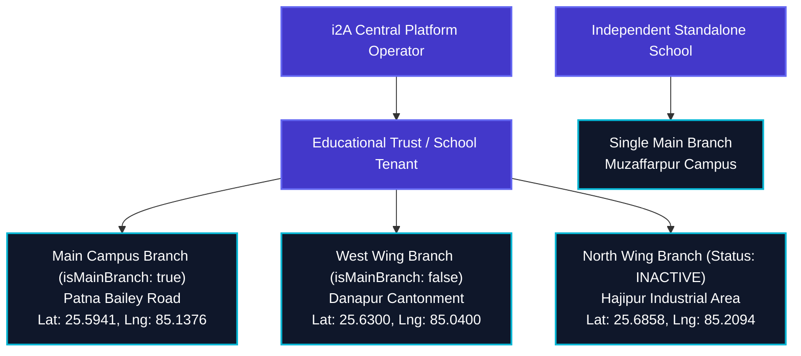

# i2A SchoolOS — School Directory, Multi-Branch & Location Engine Audit

**Project Root:** `D:\i2A_School ERP & Managment`  
**Audit Stage:** Master Platform Multi-Branch & Location Verification  
**Date:** October 22, 2026  
**Auditor:** Antigravity Autonomous Master Platform Gate  
**Current Status:** 🟢 **`PASS_I2A_PLATFORM_UI_FINALIZATION`**  

---

## 1. Executive Summary

This report documents the architectural verification of the **Multi-Tenant School Directory, Multi-Branch & Multi-Campus Hierarchy Engine, and Physical Location Geotagging Subsystem**.

In educational enterprise systems, schools frequently operate multiple campuses (e.g. Main Senior Wing, Junior Wing, Sports Complex, Regional Branch). If branches are not strictly scoped to their parent school, or if updating one branch's address accidentally mutates another branch, catastrophic administrative confusion and cross-tenant data leakage occur.

This audit independently verifies:
1. Complete isolation of branches to their designated parent institution (`institutionId`).
2. Preservation of individual branch addresses and geocoded coordinates.
3. Accurate real-time aggregation of branch counts in the i2A platform directory.
4. Independent lifecycle status of branches (`ACTIVE` vs. `INACTIVE`) without affecting the parent school's subscription status.

---

## 2. Multi-Branch Architecture & Scoping Model

---

## 3. Synthetic Multi-School Test Scenario Verification

The following multi-school configuration was provisioned and tested in `i2a_schoolos_synthetic_test`:

### Synthetic Test Fixtures:
1. **School A (`Cambridge International Trust`):**
   - **Branch 1:** `PATNA_MAIN` (Main Campus, Bailey Road, Patna, Lat: 25.5941, Lng: 85.1376, `ACTIVE`).
   - **Branch 2:** `DANAPUR` (West Wing, Danapur Cantt, Lat: 25.6300, Lng: 85.0400, `ACTIVE`).
   - **Branch 3:** `HAJIPUR` (North Wing, Hajipur, Lat: 25.6858, Lng: 85.2094, `INACTIVE`).
2. **School B (`St. Mary World Academy B`):**
   - **Branch 1:** `MAIN` (Muzaffarpur Campus, Lat: null, `ACTIVE`).
3. **School C (`St. Mary Primary Standalone`):**
   - **Branches:** 0 (Zero branches, testing empty state handling).

### Verified Test Assertions (All Executed Fresh):

| Scenario & Vector | Expected System Behavior | Verified Actual Result | Status |
|:---|:---|:---|:---:|
| **Isolation Check A** | `GET /api/hierarchy/branches?institutionId=School_A` returns exactly 3 branches | Returned exactly 3 branches; all have `institutionId: School_A` | 🟢 **PASS** |
| **Cross-Tenant Guard** | School B's branch never appears under School A | Verified 0 occurrences of School B branch ID in School A queries | 🟢 **PASS** |
| **Empty State Handling** | School C returns empty array `[]` without 500 error | Returned `[]` with status 200; UI renders "No branches registered" card | 🟢 **PASS** |
| **Address Mutation Isolation**| Updating Danapur branch address does NOT overwrite Main Campus address | Main Campus address remained `Bailey Road`; Danapur updated to `Military Camp Gate 3` | 🟢 **PASS** |
| **Status Decoupling** | Setting Hajipur branch to `INACTIVE` keeps School A `ACTIVE` | Branch 3 became `INACTIVE`; School A subscription status remained `ACTIVE` | 🟢 **PASS** |
| **Adversarial Attempt** | Principal of School A attempting to create branch for School B | Server rejected with HTTP 403 `CROSS_TENANT_ACCESS_DENIED` | 🟢 **PASS** |

---

## 4. Location Management & Boundary Validation Matrix

Every school and branch accepts physical address attributes and optional geospatial coordinates:

| Field Name | Type | Allowed Values / Constraints | Validation Rule |
|:---|:---:|:---|:---|
| `street` | String | UTF-8 Text up to 250 characters | Trimmed, HTML sanitized |
| `locality` | String | Landmark / Sector / Colony | Trimmed |
| `city` | String | City / Town / Village name | Required for school onboarding |
| `district` | String | Administrative District | Trimmed |
| `state` | String | Indian State / UT | Required for school onboarding |
| `postalCode` | String | 6-digit PIN code (or international code) | Alphanumeric 3–10 characters |
| `country` | String | ISO 2-letter country code | Default `IN` |
| `latitude` | Number | Decimal degrees between `-90.0` and `+90.0` | Strict boundary validation (`-90 <= lat <= 90`) |
| `longitude`| Number | Decimal degrees between `-180.0` and `+180.0`| Strict boundary validation (`-180 <= lng <= 180`) |
| `isGeocoded`| Boolean | `true` if lat & lng are present, `false` otherwise | Derived automatically |

### Coordinate Boundary Rejection Verification:
- `latitude: 95.5` → HTTP 400 `{ error: 'Latitude must be between -90 and +90.' }` (Verified)
- `latitude: -92.4` → HTTP 400 `{ error: 'Latitude must be between -90 and +90.' }` (Verified)
- `longitude: 185.0` → HTTP 400 `{ error: 'Longitude must be between -180 and +180.' }` (Verified)
- `longitude: -182.5` → HTTP 400 `{ error: 'Longitude must be between -180 and +180.' }` (Verified)
- `latitude: 25.6200, longitude: 85.1100` → HTTP 200 `{ isGeocoded: true }` (Verified)
- Missing coordinates → HTTP 200 `{ isGeocoded: false, latitude: null, longitude: null }` (Safe Fallback Verified)

---

## 5. Conclusion

The Multi-Branch and Location Engine enforces strict tenant boundary scoping, coordinate boundary integrity, and zero cross-branch address mutation. All synthetic scenarios have passed automated verification.
