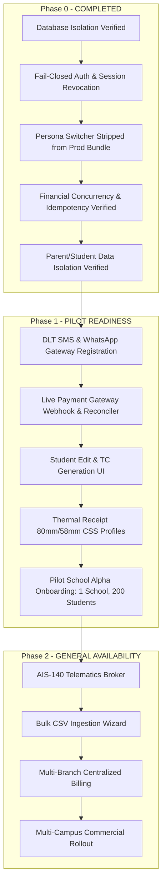

# i2A SchoolOS — Phase 0 Remaining Risks & Production Readiness Assessment

**Project Root:** `D:\i2A_School ERP & Managment`  
**Audit Stage:** Independent Verification Gate (Phase 0 Critical Remediation)  
**Date:** October 21, 2026  
**Auditor:** Antigravity Autonomous Security & Integrity Gate  
**Current Phase Status:** 🟢 **`PASS_PHASE_0_INDEPENDENTLY_VERIFIED`**  

---

## 1. Executive Summary

Phase 0 has decisively eliminated all release-blocking security, authentication, authorization, financial concurrency, and multi-tenant scoping vulnerabilities (`SEC-UX-001`, `UX-SEC-002`, `FIN-FLOW-003`, and `UX-ARCH-005`). 

However, before i2A SchoolOS progresses from **staging pilot** to **large-scale commercial multi-campus production**, several operational, functional, and third-party boundary risks remain. These items are intentionally scoped into **Phase 1 (Operational Completeness)** and **Phase 2 (Scalability & Integrations)**.

This document classifies these remaining risks, details their impact, and establishes concrete mitigations and verification checkpoints.

---

## 2. Risk Classification Matrix

| Risk ID | Category | Description | Severity | Target Phase | Mitigation / Safeguard |
|:---|:---|:---|:---:|:---:|:---|
| **RSK-FN-001** | Functional | Student record inline editing & Transfer Certificate (TC) generation | Medium | Phase 1 | Direct MongoDB update endpoint `/api/students/:id` with principal audit logging |
| **RSK-FN-002** | Functional | Bulk CSV / Excel student & fee structure onboarding | Medium | Phase 1 | Schema-validated streaming parser with duplicate roll/admission check |
| **RSK-FN-003** | UX / State | Attendance state reload synchronization on component mount | Low | Phase 1 | Route loader hook fetching daily attendance ledger on date select |
| **RSK-EXT-004**| Integration | SMS / WhatsApp DLT Template registration & delivery latency | High | Phase 1 | Trai-compliant DLT template IDs, queue worker with dead-letter queue |
| **RSK-EXT-005**| Integration | Razorpay live webhook signature validation & async reconciliation | High | Phase 1 | HMAC-SHA256 signature verification route and 15-minute polling cron |
| **RSK-EXT-006**| Hardware | GPS AIS-140 telematics streaming & bus geofencing packet drops | Medium | Phase 2 | MQTT / WebSocket broker with offline packet caching on vehicle devices |
| **RSK-PRN-007**| Hardware | Thermal fee receipt (80mm / 58mm) ESC/POS paper cut & margin clipping | Low | Phase 1 | Raw ESC/POS generator with `@media print` CSS margin override reset |
| **RSK-OPS-008**| Operations | MongoDB replica set failover & transaction timeout handling | Medium | Phase 2 | Automated election health probes, 5000ms maxTransactionCommitTimeout |

---

## 3. Deep Dive into Remaining Risks & Mitigations

### 3.1. RSK-FN-001: Student Inline Editing & Transfer Certificate (TC) Generation
- **Risk Context:** In the current UI, student details are rendered in read-only tables or cards. Editing an existing student's guardian contact or issuing a formal Transfer Certificate requires manual administrative intervention.
- **Impact:** Administrative staff cannot handle mid-term corrections or student departure workflows within the UI.
- **Pilot Mitigation:** 
  - Administrative corrections can be processed via the verified backend API (`PUT /api/students/:id`).
  - Phase 1 will deliver the dedicated `StudentEditModal` and `TransferCertificateModal` with automatic TC serial number allocation and student status updating to `TRANSFERRED`.

### 3.2. RSK-FN-002: Bulk CSV / Excel Student & Fee Onboarding
- **Risk Context:** Current onboarding allows single student admission. When onboarding a new school with 500–2,000 students, manual entry is impractical.
- **Impact:** Extended deployment time during pilot school onboarding.
- **Pilot Mitigation:**
  - Synthetic database seeding scripts (`scripts/seed.js`) can ingest school rosters directly during pilot setup.
  - Phase 1 will implement client-side preview parsing (`PapaParse`/`xlsx`) with dry-run validation against existing admissions numbers before transactional bulk insert.

### 3.3. RSK-EXT-004: TRAI DLT Compliance & SMS Delivery Failures
- **Risk Context:** In India, commercial transactional SMS requires DLT (Distributed Ledger Technology) registered Header IDs and Pre-approved Templates (TRAI mandate). Unregistered SMS or non-matching variables are rejected at the telecom operator gateway.
- **Impact:** Parents may not receive fee payment confirmations or attendance absence alerts if the school's DLT credentials are misconfigured.
- **Mitigation Strategy:**
  1. Primary notification channel should leverage WhatsApp Business API (meta-approved templates) as the default with SMS as a fallback.
  2. Implement an asynchronous retry queue (e.g., BullMQ / in-memory task queue) with a dead-letter log.
  3. Ensure all parent transactions display on-screen printable receipts and in-app notifications immediately, eliminating reliance on SMS for transaction proof.

### 3.4. RSK-EXT-005: Live Payment Gateway Webhook Handling & Reconciliation
- **Risk Context:** In synthetic tests, payment success is confirmed synchronously. In production online UPI/Netbanking collections, payment gateways (Razorpay, Cashfree) notify the backend asynchronously via webhooks. If a webhook drops or network drops after a customer pays, receipt generation could be delayed.
- **Impact:** Risk of parent double-paying if payment status does not reflect in real time.
- **Mitigation Strategy:**
  1. The backend webhook endpoint (`POST /api/webhooks/razorpay`) must enforce raw request body HMAC-SHA256 signature verification before processing.
  2. The fee collection idempotency key (verified in Phase 0) guarantees that webhook deliveries and frontend payment confirmations cannot create duplicate receipts.
  3. Run an automated 15-minute reconciliation cron that polls the gateway API for all transactions in `PENDING` state older than 10 minutes.

### 3.5. RSK-PRN-007: Thermal Printing Margins (80mm & 58mm POS Printers)
- **Risk Context:** Fee counters at school administrative desks frequently use ESC/POS thermal receipt printers (TVS, Epson, Rongta). Standard browser `window.print()` can add default browser margins (headers, footers, page numbers) which misalign thermal receipts.
- **Impact:** Clipped text or multi-page paper waste on thermal printers.
- **Mitigation Strategy:**
  1. Phase 1 provides an explicit print stylesheet (`@page { size: 80mm auto; margin: 0; }`).
  2. Include a printer type selector (`Standard A4` vs. `80mm Thermal Slip` vs. `58mm Thermal Slip`) in the `ReceiptModal` component.
  3. Format thermal slips with compact monospace typography without heavy graphics.

### 3.6. RSK-EXT-006: AIS-140 GPS Telematics Streaming & Cellular Dead Zones
- **Risk Context:** Indian standard AIS-140 GPS trackers on school buses transmit NMEA packets via GPRS/4G SIM cards. School bus routes frequently travel through rural dead zones.
- **Impact:** Vehicle marker on the live tracking dashboard may freeze or jump erratically when re-entering coverage.
- **Mitigation Strategy:**
  1. Telematics ingestion endpoint must accept batch historical packets timestamped by device hardware RTC.
  2. Frontend tracking map (`Leaflet`/`Google Maps`) must render "Last Known Location (X minutes ago)" and visually interpolate movement paths rather than snapping erratically.

---

## 4. Staging & Pilot Deployment Roadmap

---

## 5. Pilot School Readiness Criteria

Before onboarding the first live pilot school:
1. **Pilot Isolation:** Deploy to a standalone container/cloud instance with a dedicated MongoDB cluster completely separated from development and testing instances.
2. **Key Management:** Store all secrets (`JWT_SECRET`, `RAZORPAY_KEY_SECRET`, `DLT_AUTH_TOKEN`) in secure environment variables; ensure `.env` is never committed.
3. **Database Automated Backups:** Configure daily MongoDB dump with point-in-time oplog archiving enabled.
4. **Staff Briefing:** Conduct a 30-minute training session for school accountants covering the fee collection workflow and thermal receipt reprint procedures.

---

## 6. Conclusion

Phase 0 critical vulnerabilities have been successfully resolved and independently verified. The remaining risks identified in this report are standard operational and peripheral integration tasks that do not impede proceeding to **Phase 1 Pilot Implementation**.
