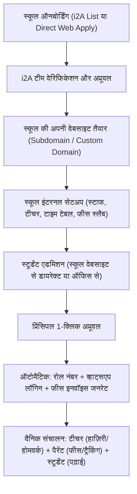

# 🚀 i2A SchoolOS — 10X Complete Workflow & Master Architecture Specification
> **End-to-End Operating System: i2A Platform → School Management → Principal → Teachers → Staff → Transport → Students → Parents**  
> *Simple Hinglish Language • Zero Confusion • 100% Practical & Optimized • Pro-Level Aesthetics*

---

## 🌟 1. Executive Summary & Core 10X Vision (सोच और विज़न)

**i2A SchoolOS** का एकमात्र लक्ष्य है: **"Enter Once, Automate Everywhere"** (एक बार जानकारी डालो, पूरे सिस्टम में अपने-आप सब सेट हो जाए)।  
स्कूल चलाने में सबसे बड़ी परेशानी यह होती है कि काम बहुत उलझा हुआ होता है—कागज़ी फॉर्म, अलग-अलग रजिस्टर, माता-पिता की शिकायतें, फीस की देरी, और टीचरों का टाइम टेबल का झंझट।

i2A SchoolOS इन सभी समस्याओं को हमेशा के लिए खत्म करता है:
1. **कोई भारी-भरकम शब्द (No Heavy Jargon)**: हर स्क्रीन, हर बटन और हर वर्कफ़्लो इतना सरल और सीधा है कि 10वीं पास स्टाफ या ड्राइवर भी 1 मिनट में समझकर चला सके।
2. **सुपर फ़ास्ट ऑनबोर्डिंग**: स्कूल चाहे तो खुद अप्लाई करे, या i2A की टीम उसे डायरेक्ट जोड़े। 1-क्लिक वेरिफिकेशन के बाद स्कूल तुरंत लाइव हो जाता है।
3. **हर स्कूल की अपनी ब्रांडेड वेबसाइट**: हर स्कूल को उसका अपना सब-डोमेन (जैसे `dpspatna.i2aschool.com`) या खुद का पर्सनल डोमेन (जैसे `www.dpspatna.edu.in`) तुरंत मिल जाता है।
4. **3-तरफ़ा एडमिशन (Zero Hassle Admissions)**: माता-पिता घर बैठे स्कूल की वेबसाइट से फॉर्म भरें, या छात्र खुद अप्लाई करे, या स्कूल ऑफिस डायरेक्ट ऐड करे। प्रिंसिपल का 1-क्लिक अप्रूवल होते ही रोल नंबर, आईडी कार्ड, व्हाट्सएप मैसेज और फीस इनवॉइस खुद-ब-खुद बन जाते हैं।
5. **8 लेवल्स का सुरक्षित विभाजन**: किसी का डेटा किसी दूसरे को नहीं दिखता, पर सब आपस में एक धागे की तरह जुड़े रहते हैं।

---

## 👥 2. आठ लेवल्स का संपूर्ण ढाँचा (The 8 Levels Hierarchy)

नीचे दिया गया चार्ट स्पष्ट करता है कि सिस्टम में कौन क्या करेगा:

| Level | रोल का नाम (Role Name) | यह कौन है? | इसका मुख्य काम क्या है? | इसका मुख्य अधिकार (Permission) |
|---|---|---|---|---|
| **Level 0** | **i2A Super Platform (Master Admin)** | i2A का मुख्य ऑपरेटर / हेड ऑफिस | नए स्कूलों को वेरिफाई करना, अप्रूव करना, सर्वर और प्लान मैनेज करना | पूरे प्लेटफ़ॉर्म पर सभी स्कूलों का सेंट्रल कंट्रोल |
| **Level 1** | **School Management / Administration** | स्कूल का ट्रस्टी / डायरेक्टर / ओनर | स्कूल की कुल कमाई, स्टाफ वेतन, लाभ-हानि और स्कूल की ब्रांडिंग देखना | स्कूल का पूर्ण वित्तीय और प्रशासनिक नियंत्रण |
| **Level 2** | **School Principal** | स्कूल का मुख्य शैक्षणिक लीडर | एडमिशन अप्रूव करना, टाइम टेबल देखना, टीचर का काम जांचना, AI असिस्टेंट से रिपोर्ट लेना | अंतिम शैक्षणिक और अनुशासन अप्रूवल अधिकार |
| **Level 3** | **Teachers (शिक्षक)** | क्लास और विषय के टीचर्स | रोज़ की 1-क्लिक हाज़िरी, होमवर्क देना, AI से टेस्ट पेपर बनाना, नंबर चढ़ाना | अपनी क्लास और विषय तक सीमित एक्सेस |
| **Level 4** | **School Staff (Accounts / Office)** | अकाउंटेंट, क्लर्क, फ्रंट-डेस्क | फीस जमा करना (UPI/Cash), रसीद देना, खर्चे दर्ज करना, टीसी/सर्टिफिकेट बनाना | फीस काउंटर और कागज़ी दस्तावेज़ मैनेजमेंट |
| **Level 5** | **Transport Team (परिवहन)** | बस इंचार्ज और बस ड्राइवर्स | बस रूट देखना, स्टॉप्स पर बच्चों की पिक-अप/ड्रॉप मार्किंग, बस की लाइव लोकेशन | केवल बस रूट्स और अपने रूट के बच्चों की लिस्ट |
| **Level 6** | **Students (विद्यार्थी)** | स्कूल के छात्र | ऑनलाइन टेस्ट देना, होमवर्क देखना, डिजिटल किताबें पढ़ना, टाइम टेबल और रिज़ल्ट देखना | केवल अपनी पढ़ाई और रिज़ल्ट का व्यक्तिगत पोर्टल |
| **Level 7** | **Parents (अभिभावक / माता-पिता)** | बच्चों के माता-पिता | 1-क्लिक से फीस भरना (UPI/Card), बच्चे की हाज़िरी देखना, रिज़ल्ट देखना, छुट्टी की अर्ज़ी देना | केवल अपने बच्चे (या बच्चों) का 360° डैशबोर्ड |

---

## 🔄 3. एंड-टू-एंड मास्टर वर्कफ़्लो (Life-Cycle of School & Student)



---

### 🔹 Step 1: स्कूल का ऑनबोर्डिंग (दो रास्ते - Two Paths)
स्कूल सिस्टम में दो तरह से आ सकता है:

#### रास्ता A: i2A टीम डायरेक्ट लिस्ट करे (Direct Onboarding)
- i2A की सेल्स या ऑपरेटर टीम स्कूल को कॉल करती है या खुद स्कूल के डायरेक्टर से मिलती है।
- i2A Super Admin पोर्टल में "Add School Manually" पर क्लिक करके स्कूल का नाम, पता, बोर्ड (CBSE/ICSE/State), डायरेक्टर का नाम, फोन और ईमेल डालती है।
- स्कूल तुरंत एक्टिवेट हो जाता है।

#### रास्ता B: स्कूल खुद i2A की मुख्य वेबसाइट से डायरेक्ट अप्लाई करे (Self-Serve Application)
- स्कूल का प्रिंसिपल या डायरेक्टर `i2aschoolos.com` पर जाता है और **"Register My School"** पर क्लिक करता है।
- एक साफ़-सुथरा फॉर्म भरता है:
  1. **स्कूल की बेसिक जानकारी**: नाम, शहर, राज्य, बोर्ड, मान्यता संख्या (Affiliation No.)।
  2. **डायरेक्टर/प्रिंसिपल की जानकारी**: नाम, मोबाइल नंबर (व्हाट्सएप सहित), ऑफिशियल ईमेल।
  3. **डोमेन का चुनाव (Domain Choice)**: 
     - या तो फ्री सब-डोमेन: `[school-name].i2aschool.com` (जैसे `dpspatna.i2aschool.com`)
     - या स्कूल का अपना डोमेन: `www.dpspatna.edu.in`
  4. **दस्तावेज़ (KYC Documents)**: स्कूल रजिस्ट्रेशन सर्टिफिकेट और एफिलिएशन लेटर की कॉपी।
  5. **सब्सक्रिप्शन प्लान**: Starter (250 बच्चे), Pro (1,000 बच्चे), या Enterprise (असीमित)।
- फॉर्म सबमिट होते ही स्कूल को एक **Application Tracking ID** (जैसे `REG-2026-9041`) मिल जाती है।

---

### 🔹 Step 2: i2A द्वारा वेरिफिकेशन और अप्रूवल (Zero Liability Check)
- i2A Super Admin के पास **"Pending School Verification Queue"** में नया आवेदन दिखने लगता है।
- i2A ऑपरेटर चेक करता है:
  - क्या स्कूल का नाम और एफिलिएशन नंबर सही है?
  - क्या फोन नंबर पर बात करके पुष्टि हो गई है?
- i2A ऑपरेटर **"Verify & Approve School"** बटन दबाता है।
- **बटन दबते ही क्या होता है?**
  1. स्कूल का मल्टी-टेनेंट अकाउंट तुरंत तैयार हो जाता है।
  2. स्कूल का डोमेन/सब-डोमेन DNS पर ऑटो-पॉइंट हो जाता है और फ्री SSL सर्टिफिकेट लग जाता है।
  3. स्कूल के डायरेक्टर के व्हाट्सएप और ईमेल पर ऑटोमैटिक वेलकम मैसेज और प्रिंसिपल पोर्टल का लॉगिन पासवर्ड चला जाता है।

---

### 🔹 Step 3: हर स्कूल की अपनी डेडिकेटेड वेबसाइट (Instant School Website)
हर अप्रूव्ड स्कूल को i2A द्वारा बनाई गई एक **अल्ट्रा-मॉडर्न, रेस्पॉन्सिव और सुंदर पब्लिक वेबसाइट** मिलती है:
- **वेबसाइट का पता**:
  - `https://dpspatna.i2aschool.com` YA `https://www.dpspatna.edu.in`
- **वेबसाइट पर क्या-क्या दिखेगा?**:
  1. **होम पेज (Hero Section)**: स्कूल का लोगो, नाम, स्लोगन, फोटो गैलरी और "Admissions Open 2026-2027" का चमकता हुआ बैनर।
  2. **प्रिंसिपल का संदेश**: प्रिंसिपल की फोटो और उनका प्रेरणादायक संदेश।
  3. **स्कूल की सुविधाएं**: स्मार्ट क्लास, साइंस लैब, लाइब्रेरी, सुरक्षित बस सेवा, खेल का मैदान।
  4. **ऑनलाइन एडमिशन फॉर्म (Apply Online)**: अभिभावक और छात्र यहीं से सीधे एडमिशन फॉर्म भर सकते हैं।
  5. **क्विक लॉगिन गेटवे**: स्टूडेंट लॉगिन, पैरेंट लॉगिन, टीचर लॉगिन, और स्टाफ लॉगिन के सीधे बटन।

---

### 🔹 Step 4: स्कूल का आंतरिक सेटअप (Internal School Setup)
प्रिंसिपल या एडमिन अपने पोर्टल में पहली बार लॉगिन करता है और 4 आसान चरणों में स्कूल तैयार कर लेता है:
1. **स्टाफ और टीचर प्रोफाइल (Staff Setup)**:
   - टीचर का नाम, मोबाइल नंबर, पढ़ाने वाला विषय (Maths, Science आदि), और क्लास टीचर का पद।
   - ऑफिस स्टाफ और ड्राइवर की प्रोफाइल।
2. **टाइम टेबल और क्लास शेड्यूल (Conflict-Free Timetable)**:
   - पीरियड का समय (जैसे 08:00 AM से 02:00 PM तक 8 पीरियड)।
   - सिस्टम का AI खुद चेक कर लेता है कि एक ही टीचर दो क्लास में एक ही समय पर न लग जाए (Zero Conflict)।
3. **फीस स्ट्रक्चर (Fee Structure)**:
   - ट्यूशन फीस (महीने की), एनुअल फीस, एडमिशन फीस, और बस फीस।
4. **ट्रांसपोर्ट रूट्स (Bus Routes)**:
   - बस नंबर, ड्राइवर का नाम, मोबाइल नंबर, और स्टॉप्स के हिसाब से तय फीस।

---

### 🔹 Step 5: स्टूडेंट एडमिशन का सरल वर्कफ़्लो (3 रास्ते)
एडमिशन लेने के तीन सबसे आसान तरीके:

```
[तरीका 1: स्कूल की वेबसाइट से पैरेंट अप्लाई करे] ──┐
[तरीका 2: स्टूडेंट खुद वेबसाइट से फॉर्म भरे]      ───┼─► [स्कूल एडमिशन डेस्क] ─► [प्रिंसिपल 1-क्लिक अप्रूवल] ─► [ऑटो रोल नंबर + फीस इनवॉइस + व्हाट्सएप लॉगिन]
[तरीका 3: स्कूल ऑफिस में आकर वॉक-इन एडमिशन]     ──┘
```

1. **आवेदन सबमिट होना**:
   - पैरेंट या छात्र स्कूल की वेबसाइट पर जाकर नाम, जन्मतिथि, क्लास, माता-पिता का फोन नंबर और पिछली क्लास की मार्कशीट अपलोड करता है।
2. **एडमिशन डेस्क पर वेरिफिकेशन**:
   - स्कूल का क्लर्क दस्तावेज़ चेक करता है और अगर टेस्ट/इंटरव्यू है तो उसका स्टेटस अपडेट करता है।
3. **प्रिंसिपल का 1-क्लिक अप्रूवल (Approve & Enroll)**:
   - प्रिंसिपल के डैशबोर्ड पर पेंडिंग एडमिशन दिखता है। प्रिंसिपल **"Approve & Enroll"** बटन दबाता है।
4. **सिस्टम का ऑटोमैटिक जादू (Zero Manual Work)**:
   - छात्र को ऑटोमैटिक **एडमिशन नंबर** और **रोल नंबर** मिल जाता है।
   - छात्र का नाम क्लास और सेक्शन की अटेंडेंस लिस्ट में जुड़ जाता है।
   - छात्र का फीस लेज़र और पहली फीस की रसीद/इनवॉइस तैयार हो जाती है।
   - माता-पिता के व्हाट्सएप पर एक सुंदर डिजिटल एडमिशन लेटर और पैरेंट पोर्टल का लॉगिन आईडी-पासवर्ड पहुंच जाता है।

---

## 🛠️ 4. आठों लेवल्स का दैनिक सरल वर्कफ़्लो (Daily Working Guide)

### 👑 Level 0: i2A Master Platform (Super Admin)
- **दैनिक कार्य**:
  - कितने नए स्कूल जुड़े?
  - पेंडिंग स्कूल एप्लिकेशन्स की जांच करके 1-क्लिक में अप्रूव करना।
  - पूरे प्लेटफॉर्म का सब्सक्रिप्शन रेवेन्यू (MRR) और सर्वर हेल्थ देखना।
  - अगर किसी स्कूल की फीस बकाया है, तो उसका प्लान अपडेट या सस्पेंड करना।

### 🏛️ Level 1: School Administration (Director / Trustee)
- **दैनिक कार्य**:
  - स्कूल में आज कुल कितनी फीस आई (Online UPI + Cash)?
  - स्कूल के खर्चे (बिजली, मेंटेनेंस, स्टेशनरी) कितने हुए?
  - स्टाफ का वेतन (Payroll) महीने के अंत में 1-क्लिक में अप्रूव करना।
  - स्कूल के कुल बच्चे और नए एडमिशन्स की रिपोर्ट देखना।

### 🎓 Level 2: School Principal
- **दैनिक कार्य**:
  - सुबह स्कूल की ओवरऑल उपस्थिति (छात्र और शिक्षक) देखना।
  - नए एडमिशन्स को रिव्यू करके अप्रूव करना।
  - टीचर्स द्वारा बनाए गए एग्जाम पेपर्स को चेक करके पब्लिश करने की अनुमति देना।
  - **AI Principal Assistant** से सवाल पूछना: *"आज क्लास 8 की हाज़िरी कितनी है?"* या *"किस क्लास में फीस सबसे ज़्यादा बाकी है?"*

### 👩‍🏫 Level 3: Teachers (शिक्षक)
- **दैनिक कार्य**:
  - **सुबह की हाज़िरी**: मोबाइल या टैबलेट पर क्लास खोली, जो एब्सेंट है बस उसपर क्लिक किया, 15 सेकंड में हाज़िरी डन! (जो बच्चे नहीं आए उनके पैरेंट को ऑटो व्हाट्सएप अलर्ट चला गया)।
  - **होमवर्क देना**: आज का होमवर्क टाइप किया या कॉपी की फोटो खींची और "Send to Class" कर दिया।
  - **AI टेस्ट पेपर बनाना**: चैप्टर चुना, "Generate 25 Mark Quiz" पर क्लिक किया, AI ने सवाल तैयार कर दिए, टीचर ने देखा और ओके कर दिया।
  - **नंबर चढ़ाना**: टेस्ट के बाद मार्क्स एंटर किए, सिस्टम ने अपने-आप ग्रेड और रैंक निकाल दी।

### 💼 Level 4: School Staff (Accountant & Clerk)
- **दैनिक कार्य**:
  - **फीस काउंटर**: जो पैरेंट स्कूल में फीस जमा करने आया, उसका एडमिशन नंबर डाला। UPI क्यूआर कोड दिखाया या कैश लेकर "Receive Payment" दबाया।
  - **ब्रांडेड डिजिटल रसीद**: स्कूल के लोगो, मोहर (Stamp) और डिजिटल सिग्नेचर के साथ रसीद बनी और सीधे पैरेंट के व्हाट्सएप पर पीडीएफ चली गई।
  - **सर्टिफिकेट बनाना**: ट्रांसफर सर्टिफिकेट (TC), बोनाफाइड या कैरेक्टर सर्टिफिकेट 1-क्लिक में ऑटो-फिल होकर प्रिंट के लिए तैयार।

### 🚌 Level 5: Transport Team (Driver & Bus Incharge)
- **दैनिक कार्य**:
  - अपने रूट की बस चुनी (जैसे "Route 01 - Kankarbagh Express")।
  - रूट के सभी स्टॉप्स और बच्चों की लिस्ट देखी।
  - स्टॉप पर बच्चे के बस में चढ़ने पर "Boarded" मार्क किया, जिससे माता-पिता को तसल्ली रहे कि बच्चा बस में बैठ गया है।
  - बस की इमरजेंसी या देरी होने पर 1-क्लिक में उस रूट के सभी अभिभावकों को ब्रॉडकास्ट मैसेज भेजना।

### 🎒 Level 6: Students (विद्यार्थी)
- **दैनिक कार्य**:
  - अपने फोन या कंप्यूटर पर अपना स्टूडेंट पोर्टल खोला।
  - आज का होमवर्क और कल का टाइम टेबल देखा।
  - डिजिटल लाइब्रेरी से NCERT या स्कूल की किताबें और नोट्स पढ़े।
  - ऑनलाइन वीकली टेस्ट दिया, जिसका स्कोर तुरंत सामने आ गया।
  - अपना रिपोर्ट कार्ड और अटेंडेंस प्रतिशत देखा।

### 👨‍👩‍👧 Level 7: Parents (अभिभावक)
- **दैनिक कार्य**:
  - पैरेंट पोर्टल खोला या व्हाट्सएप पर आए लिंक को क्लिक किया।
  - **फीस का भुगतान**: बाकी फीस देखी और Google Pay / PhonePe / Paytm / कार्ड से 1-क्लिक में फीस भर दी। तुरंत स्कूल की पक्की रसीद मिल गई।
  - **उपस्थिति**: बच्चा आज स्कूल पहुंचा या नहीं, यह नोटिफिकेशन देखा।
  - **छुट्टी की अर्ज़ी**: अगर बच्चा बीमार है, तो पोर्टल से सीधे 1 दिन की लीव रिक्वेस्ट भेजी, जो क्लास टीचर को तुरंत दिख गई।
  - **रिज़ल्ट**: बच्चे का टर्मिनल और फाइनल रिपोर्ट कार्ड देखा।

---

## 💻 5. तकनीकी वास्तुकला (Technical Architecture & APIs)

### A. डोमेन और सब-डोमेन रूटिंग (Multi-Tenant Domain Engine)
```
[User Request] 
      │
      ▼
[Cloudflare Edge / Caddy Reverse Proxy]
      │
      ├── If *.i2aschool.com ──► Extract Subdomain Slug ──► Look up School Tenant ID
      │                          (e.g., dpspatna -> I2A-SCH-000001)
      │
      └── If Custom Domain ───► Match CNAME / SSL Host ──► Look up School Tenant ID
                                 (e.g., dpspatna.edu.in -> I2A-SCH-000001)
```

### B. कोर एपीआई एंडपॉइंट्स (Core REST API Contracts)

#### 1. i2A Super Admin APIs
- `GET /api/v1/platform/applications` : पेंडिंग स्कूल रजिस्ट्रेशन एप्लिकेशन्स की लिस्ट।
- `POST /api/v1/platform/applications/:id/verify` : स्कूल के दस्तावेज़ वेरिफाई करना।
- `POST /api/v1/platform/applications/:id/approve` : स्कूल को अप्रूव करना, सब-डोमेन एक्टिवेट करना, और क्रेडेंशियल्स भेजना।
- `POST /api/v1/platform/applications/:id/reject` : आवेदन को कारण सहित रिजेक्ट करना।

#### 2. School Public Website APIs
- `GET /api/v1/public/school-profile?domain=:host` : सब-डोमेन या कस्टम डोमेन के आधार पर स्कूल का लोगो, नाम, बैनर और कॉन्टैक्ट लाना।
- `POST /api/v1/public/admissions/apply` : स्कूल वेबसाइट से ऑनलाइन एडमिशन फॉर्म सबमिट करना।

#### 3. School Admin & Principal APIs
- `POST /api/v1/school/admissions/:id/approve` : एडमिशन अप्रूव करके ऑटोमैटिक स्टूडेंट और फीस लेज़र बनाना।
- `POST /api/v1/school/staff` : नया टीचर या स्टाफ जोड़ना।
- `GET /api/v1/school/timetable` : टाइम टेबल कॉन्फ़िगरेशन और कॉन्फ्लिक्ट चेकर।

#### 4. Teacher & Academic APIs
- `POST /api/v1/academic/attendance/batch` : पूरी क्लास की हाज़िरी एक साथ सबमिट करना।
- `POST /api/v1/academic/homework` : क्लास के लिए होमवर्क पोस्ट करना।
- `POST /api/v1/academic/exams/generate-ai` : AI क्वेश्चन बैंक से टेस्ट पेपर जनरेट करना।

#### 5. Fee & Accounting APIs
- `POST /api/v1/finance/pay-fee` : UPI/गेटवे से फीस भरना और डिजिटल रसीद बनाना।
- `GET /api/v1/finance/receipt/:id/pdf` : स्कूल स्टाम्प और सिग्नेचर वाली रसीद डाउनलोड करना।

#### 6. Transport & Fleet APIs
- `GET /api/v1/transport/routes` : सभी बस रूट्स और स्टॉप्स की लिस्ट।
- `POST /api/v1/transport/routes/:id/trip-status` : ट्रिप शुरू/समाप्त करना।

---

## 🔒 6. सुरक्षा और डेटा पृथक्करण (Multi-Tenant Data Isolation)

1. **हर टेबल में Tenant ID (`school_id`) अनिवार्य**:
   - चाहे कोई भी क्वेरी चले (`SELECT`, `INSERT`, `UPDATE`), सिस्टम हमेशा `WHERE school_id = ?` लगाएगा।
   - एक स्कूल का डाटा कभी भी किसी दूसरे स्कूल के सामने नहीं आ सकता।
2. **भूमिका आधारित सुरक्षा (RBAC)**:
   - टीचर कभी भी फीस का बैंक खाता या किसी दूसरे टीचर की सैलरी नहीं देख सकता।
   - क्लर्क कभी भी प्रिंसिपल की अनुमति के बिना एडमिशन अप्रूव नहीं कर सकता।
   - माता-पिता सिर्फ अपने ही बच्चे का डेटा देख सकते हैं।

---

## 📊 7. संक्षेप में 10X बदलाव (Summary of Transformation)

| पुरानी प्रणाली (Old Manual Way) | i2A SchoolOS 10X तरीका |
|---|---|
| कागजी फॉर्म लेकर स्कूल के चक्कर काटना | घर बैठे स्कूल की वेबसाइट से 2 मिनट में ऑनलाइन अप्लाई |
| घंटों रजिस्टर में रोल नंबर और नाम लिखना | प्रिंसिपल का 1-क्लिक अप्रूवल → रोल नंबर, आईडी, इनवॉइस तुरंत तैयार |
| टाइम टेबल बनाने में हफ़्तों माथापच्ची और टीचरों की भिड़ंत | AI ऑटो-शेड्यूलर से बिना किसी टकराव के 1 मिनट में टाइम टेबल रेडी |
| बैंक में लाइन लगकर फीस भरना और रसीद खोना | WhatsApp और फोन से 1-क्लिक UPI पेमेंट + हमेशा सुरक्षित डिजिटल रसीद |
| माता-पिता को रिजल्ट के लिए पीटीएम का इंतज़ार | बच्चे के टेस्ट खत्म होते ही तुरंत लाइव रिपोर्ट कार्ड मोबाइल पर |
| स्कूल के पास अपनी कोई आधुनिक वेबसाइट न होना | हर स्कूल की अपनी प्रीमियम वेबसाइट (Subdomain या Custom Domain) |

---
*© 2026 i2A SchoolOS Platform Architecture. All Rights Reserved.*
