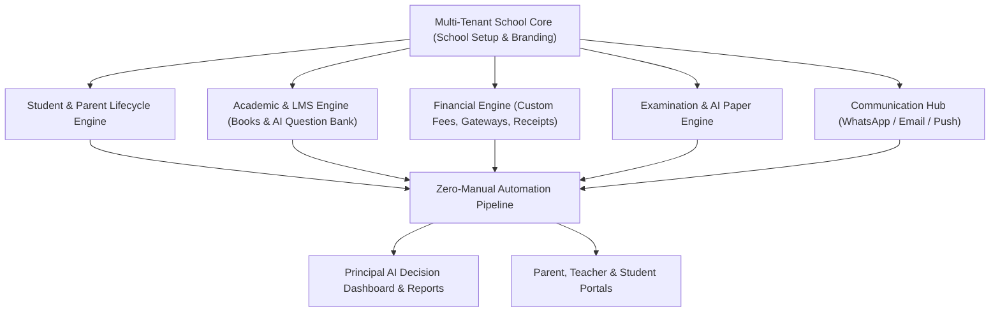

# 🏫 i2A SchoolOS — Master Blueprint & System Architecture Specification
> **AI-Powered Complete Cloud SaaS School Operating System**  
> *"Enter Once, Automate Everywhere with School-Controlled Approval Workflows"*

---

## 📌 Executive Summary & Core Identity

**i2A SchoolOS** is an Enterprise-Grade Multi-Tenant Cloud SaaS Platform designed to digitize, automate, and optimize the complete operational lifecycle of schools — from online admissions, digital fee collection, and AI-driven question paper generation to offline/online exams, automated report cards, parent-teacher communication, staff payroll, and principal AI decision-assist.

### Core Philosophy
1. **Zero/Low Manual Administrative Workload**: *"Enter once, automate everywhere."* Data captured at admission automatically populates student, parent, academic, attendance, fee, exam, transport, library, and communication profiles.
2. **Controlled Approval Architecture (Liability Reduction)**: AI and System automation operate in a draft mode (`Draft -> Review -> Approve -> Publish`). The school retains ultimate authority for admissions, fee policies, exam paper publishing, result publication, and payroll release.
3. **Enterprise Multi-Tenant SaaS Isolation**: Schools operate with zero technical friction — no server management, no database configuration, with custom branding (Logo, Color Palette, Stamps, Signatures, Invoice Headers, Report Card Themes).

---

## 🏗️ Master System Architecture & Data Model Scope



### Core Architecture Pillars & System Modules
| # | Module | Core Functionality & Automation Scope |
|---|---|---|
| 1 | **School Setup & Branding** | Multi-Tenant setup, Logo, Color palette, Registration details, Boards, Custom Invoice/Report Card/Certificate headers, Signatures & Stamps. |
| 2 | **Student & Parent Management** | Digital 360° Student Profile, Parent linkage, Academic tracking, Financial ledgers, Document vault (TC, Birth Cert, Records). |
| 3 | **Online Admission Automation** | Website Admission Portal -> Doc Upload -> Verification -> Interview/Test -> School Approval -> Automatic Fee Invoice -> Account Creation. |
| 4 | **Complete Fee & Accounting Engine** | Custom Fee Creation (Tuition, Annual, Transport, Tour, Activity), Multi-frequency (Monthly, Quarterly, Custom), Gateway Auto-Reconciliation. |
| 5 | **Branded Digital Receipts & Delivery** | Instant PDF generation with School Header/Stamp -> Auto Email PDF -> Approved WhatsApp Business API Receipt Notification. |
| 6 | **Digital Books & AI Book Reader** | Book PDF Upload -> OCR & Extraction -> Chapter/Topic Decomposition -> Concept & Candidate Question Identification. |
| 7 | **AI Question Bank & Test Generator** | Multi-format Question Generation (MCQ, Fill-in-blanks, Match, Short/Long, Numerical, Competency-based) with Teacher Review + Approval Workflow. |
| 8 | **Preloaded Exams & Auto Evaluation** | Academic Calendar Scheduling, Auto Paper Generation, Online Timer Exam Engine, Instant Auto-Grading (Objective) & Teacher Interface (Subjective). |
| 9 | **AI Student Performance Insights** | Chapter-level weakness identification, Class-wide concept gaps, Performance trends & Teacher Actionable Recommendations. |
| 10 | **Automated Report Card & Certificates** | One-click Report Card PDF generation, Bonafide, Character, TC, Fee Certificates & Student/Staff Branded ID Cards. |
| 11 | **Teacher, Parent & Student Portals** | Role-specific responsive dashboards for Class Attendance, Homework, Assignments, Fee dues, Exam Schedules, Results & Direct Messaging. |
| 12 | **Attendance & Conflict-Free Timetable** | 1-Click Present/Absent, Auto Low Attendance Warning to Parent, Automated Timetable Engine with Teacher/Room Conflict Detection. |
| 13 | **Staff, Payroll & Expense Management** | Staff Profile, Attendance, Leave Management, Salary Calculation, Expense Tracking (Rent, Electricity, Supplies) & Income vs Expense Analytics. |
| 14 | **Library, Transport & Inventory** | Book Cataloging & Issuance, Bus Routes & Stops, Asset Tracking & Audit Logs. |
| 15 | **School Website Builder** | Integrated sub-domain/custom domain public website with Admission Form, Notices, Gallery, Principal Message & Faculty Listing. |
| 16 | **AI Principal Assistant & Audit Trail** | Natural Language Querying ("What is today's fee collection?", "Which class has lowest attendance?"), Full Forensic Audit Trail (Who, What, When, Approved By). |

---

## 🗺️ Master 40-Phase Development Roadmap

Each prompt/phase will be executed following the strict 4-Layer Execution Mandate:
**BUILD → INTEGRATE → TEST → FORENSIC AUDIT**

```
Phase 01: Core Architecture, Multi-Tenant State Engine & Design Tokens Setup
Phase 02: Multi-Tenant School Setup & Dynamic Branding Customizer Wizard
Phase 03: Unified Role-Based Access Control (RBAC) & Dynamic Portal Navigation Engine
Phase 04: Digital 360° Student Profile Management & Document Vault
Phase 05: Public Online Admission Workflow & Automated School Approval Pipeline
Phase 06: Class, Section, Subject & Academic Session Master Configuration
Phase 07: Custom Fee Structure Engine & Flexible Billing Scheduler
Phase 08: Online Fee Payment Gateway Simulator & Auto-Reconciliation Engine
Phase 09: Dynamic Branded Digital Fee Receipt Generator (PDF & Canvas Engine)
Phase 10: Multi-Channel Communication Engine (WhatsApp Business API & Email Simulator)
Phase 11: Digital Book Storage Engine & Hierarchy Builder (Class -> Subject -> Chapter)
Phase 12: AI Book OCR & Concept Extraction Engine (Mock/Live AI Engine)
Phase 13: Dynamic AI Question Bank Repository & Multi-Tag Filtering Engine
Phase 14: One-Click AI Test & Paper Generator with Teacher Review Workflow
Phase 15: Automated Weekly Test Scheduler & Auto-Publish Control Toggle
Phase 16: Preloaded Academic Examination Calendar & Schedule Automation
Phase 17: End-to-End Exam Automation Engine (Paper Validation & Difficulty Balancing)
Phase 18: Interactive Online Examination Portal (Timer, Auto-Save, Navigation, Proctoring)
Phase 19: Hybrid Evaluation System (Objective Auto-Grading + Subjective Teacher Grading)
Phase 20: AI Student Performance & Concept-Gap Diagnostic Engine
Phase 21: One-Click Branded Comprehensive Report Card Generator
Phase 22: Teacher Management & Dedicated Teacher Operational Dashboard
Phase 23: Parent Portal Dashboard (Child 360° View, Fees, Attendance, Results)
Phase 24: Student Portal Dashboard (Digital Books, Exams, Assignments, Timetable)
Phase 25: Automated Attendance Engine & Low-Attendance Parent Alert Pipeline
Phase 26: Conflict-Free Timetable Generator & Substitution Management Engine
Phase 27: Staff Management, Leave Application & Automated Payroll Processor
Phase 28: School Expense Management & Financial Ledger Analytics
Phase 29: Digital Library Management System (Cataloging, Issue, Return, Fine Calculation)
Phase 30: Transport Management System (Vehicles, Drivers, Routes, Stop-wise Fees)
Phase 31: Asset & Inventory Tracking System (Lab, Computer, Sports Equipment Audit)
Phase 32: Automated ID Card & Multi-Certificate Generator (TC, Bonafide, Character)
Phase 33: Public School Website Builder & Content Management System (CMS)
Phase 34: Principal Command Dashboard & Real-Time Financial/Academic KPI Center
Phase 35: AI Principal Natural Language Conversational Assistant
Phase 36: System-Wide Controlled Approval & Liability Protection Audit Engine
Phase 37: Immutable Forensic Audit Trail Logger (Who, What, When, IP, Change Delta)
Phase 38: Multi-Tenant Backup Engine & Data Export Utility (School Data Ownership)
Phase 39: End-to-End Integration, Cross-Module Data Automation & E2E Testing Suite
Phase 40: Production Polish, Dark/Light Mode Themes, Mobile Responsiveness & Final Audit
```

---

## 🛡️ Operational Liability & Safety Architecture

To guarantee the software provider is shielded from operational liability, the platform enforces strict **Controlled Approvals**:

1. **AI Question Papers**: `AI Draft -> Teacher Review & Edit -> Principal Approval -> Published Exam`.
2. **Student Admission**: `Parent Application -> Document Verification -> Interview Marks -> Principal Approval -> Fee Payment & Account Creation`.
3. **Fee Calculation & Discounts**: `System Fee Rule -> Accountant Concession Entry -> Principal Sign-Off -> Receipt Issuance`.
4. **Examination Results**: `Auto-Graded Marks -> Teacher Subjective Evaluation -> Principal Result Lock -> Published to Parent Portal`.
5. **Payroll Release**: `System Calculation (Days Worked + Allowances - Leaves) -> HR/Principal Verification -> Payout Release`.

---

## 🎨 UI/UX Design System Specification

- **Design Style**: Glassmorphism + Vibrant Accent Palette + Clean Enterprise Typography (Inter / Outfit / Plus Jakarta Sans).
- **Color Tokens**:
  - `Primary`: Deep Indigo (`#4F46E5`), Electric Violet (`#7C3AED`)
  - `Success / Automation`: Emerald (`#10B981`)
  - `Warning / Pending Approval`: Amber (`#F59E0B`)
  - `Financial / Urgent`: Crimson (`#EF4444`)
  - `Background`: Ultra-Clean Slate (`#F8FAFC`) / Sleek Dark Glass (`#0F172A`)
- **Micro-Animations**: Smooth tab transitions, status badges with pulse indicators, live calculation tickers, interactive modal dialogs.
- **Zero Empty States**: Built-in rich realistic seed data engine providing instant, usable data for Patna Public School (Class I - XII), real fee structures, active exams, AI question banks, and financial receipts.
