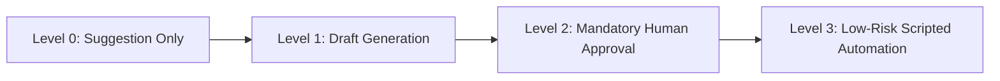

# Artificial Intelligence & Automation Strategy Blueprint
**i2A SchoolOS — Global Multi-Tenant Education Management Platform**  
*Document Ref: i2A-STRAT-013 | Date: October 17, 2026 | Status: ARCHITECTURAL_BLUEPRINT*

---

## 1. Architectural Philosophy & The 4 Action Levels

Artificial Intelligence in **i2A SchoolOS** is designed as a secure, controlled institutional utility rather than a speculative consumer chatbot. To prevent legal liability, educational hallucination, and privacy violations, every AI-assisted action operates under strict **Action Levels**:

### The 4 Action Levels
- **Level 0 (L0) — Passive Suggestion:** Real-time contextual guidance displayed to the user without writing any database records (e.g. recommending available substitute teachers for an absent educator).
- **Level 1 (L1) — Draft Generation:** AI models synthesize candidate content (e.g. drafting 10 exam questions from a chapter text) saved with immutable status `DRAFT`.
- **Level 2 (L2) — Human Review Gate:** An authorized human professional (Teacher, Principal, Admin) must inspect, modify, and click "Approve & Publish". Unapproved drafts are never visible to students or parents.
- **Level 3 (L3) — Controlled Low-Risk Automation:** Scripted, deterministic background rules executing pre-authorized notifications (e.g. sending daily attendance alerts when attendance falls below 85%).

> **Absolute System Invariant:** AI is strictly prohibited from autonomously modifying student grades, deciding admissions, issuing disciplinary suspensions, authorizing payroll disbursements, or altering tenant permissions.

---

## 2. Capability Specification Matrix

| AI Capability | User Role | Action Level | Input Data Scope | Human Review Gate | Quota & Cost Control | Fallback Mode |
| :--- | :--- | :--- | :--- | :--- | :--- | :--- |
| **Question Paper Generator** | Teacher | **L1 / L2** | Class, Subject, Chapter Text, Difficulty | Mandatory Teacher Approval | 50 papers / month / teacher | Curated Seed Question Bank |
| **Homework / Quiz Drafting** | Teacher | **L1 / L2** | Topic, Learning Outcomes, Bloom's Taxonomy | Mandatory Teacher Approval | 100 drafts / month / teacher | Textbook Exercises Library |
| **Lesson Summary Generator** | Teacher / Student | **L0** | Uploaded Chapter PDF / Reading Material | Teacher Sign-off | 200 pages / month / school | Plain Text Extraction (OCR) |
| **Report Card Narrative Draft**| Teacher | **L1 / L2** | Student Subject Grades, Attendance, Trend | Mandatory Class Teacher Review| 1 draft per student / term | Standard Template Sentences |
| **Timetable Conflict Detection**| Coordinator | **L0** | Teacher Workload, Room Allocations | Coordinator Manual Select | Unlimited (Deterministic Engine)| Heuristic Conflict Warnings |
| **Data Incompleteness Detector**| Admin Staff | **L0** | Student Roster vs. UDISE+ / Aadhaar Fields | Staff Data Entry | Unlimited (Rule Engine) | Static Validation Flags |
| **Principal Assistant (NLQ)** | Principal | **L0** | Current School Attendance, Fees, Headcount| Read-Only Output | 500 queries / month / school | Pre-aggregated KPI Widgets |
| **Automated Fee Due Alerts** | Accountant | **L3** | Overdue Fee Invoices, Due Dates, Phone | Pre-approved Rule Template | 5 WhatsApp msgs / student / mo| In-App Notification Hub |
| **Low Attendance Alerts** | Class Teacher | **L3** | Daily Attendance Percentage (< 85%) | Automatic on Batch Mark | 1 alert per student / week | Teacher Manual Notice |

---

## 3. Data Privacy & AI Minimization Guardrails

1. **Zero Personally Identifiable Information (PII) Exposure:**
   - When generating question papers or lesson summaries, only academic curricular text is transmitted to the AI provider. Zero student names, student IDs, or school locations are shared.
   - When generating report card comments, student records are anonymized (e.g., `"Student_A achieved 88% in Science and demonstrated strong lab engagement"`).
2. **Provider Abstraction Gateway:**
   - Application code calls `AiGatewayService.generateCompletion(prompt, options)`.
   - The gateway dynamically routes requests between:
     - Primary: Google Gemini 1.5 Pro / Flash (High-speed, long-context chapter ingestion).
     - Secondary / Fallback: OpenAI GPT-4o / GPT-4o-mini.
     - Sovereign / Air-Gapped: Local Ollama / Llama 3 instance for sensitive government deployments.
3. **Audit Trail Logging:**
   - Every AI invocation records `modelName`, `promptTokens`, `completionTokens`, `executingUserId`, `latencyMs`, and `costInPaise` in `ai_usage_logs`.
   - If an AI generation produces hallucinated or inappropriate output, teachers have a 1-click "Flag Inaccurate Question" button that records the prompt for tuning and removes the candidate item from the bank.

---

## 4. Current State vs. Target State Disclosure (Zero-False-Pass)

- **Current Repository State (Phase A Verified):**
  - AI features in `PrincipalAIDashboardModule.tsx` and `generateAIExamPaper` operate using **deterministic rule-based heuristics** and keyword matching (filtering preloaded question banks by subject/class).
  - No remote LLM provider API keys (`OPENAI_API_KEY`, `GEMINI_API_KEY`) are active.
  - The system operates cleanly and safely in offline/local development without crashing.
- **Target Implementation State (Phase 20):**
  - Implement the formal `AiGatewayService` adapter layer with dynamic API key injection, rate limiting, and fallback to the existing verified heuristic question bank whenever external network or API quotas are exhausted.
