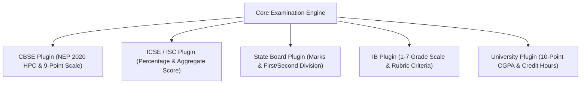

# Globalization, Localization & Curriculum Configuration Strategy
**i2A SchoolOS — Global Multi-Tenant Education Management Platform**  
*Document Ref: i2A-STRAT-016 | Date: October 17, 2026 | Status: ARCHITECTURAL_BLUEPRINT*

---

## 1. Globalization Architectural Standards

To ensure i2A SchoolOS serves diverse markets across India, the Middle East, Southeast Asia, and globally without codebase bifurcation, the application layer implements strict internationalization (i18n) and localization (l10n) abstractions.

---

## 2. Localization Dimensions & Configuration Matrix

| Localization Dimension | Default Configuration (India) | Extended Regional Support (India) | International Support |
| :--- | :--- | :--- | :--- |
| **Primary System Language** | English (`en-IN`) | Hindi (`hi-IN`) | Arabic (`ar-AE`), Spanish (`es`), French (`fr`). |
| **Regional UI Languages** | English / Hindi bilingual UI | Marathi, Tamil, Telugu, Bengali, Gujarati | Full RTL (Right-to-Left) support for Arabic. |
| **Number & Currency Formatting**| Indian Lakhs / Crores (e.g. `₹1,25,000.00`) | Indian Numbering System (`en-IN`) | International Millions / Billions (`$125,000.00` / `AED 125,000.00`). |
| **Standard Currency Code** | `INR` (₹) represented in integer paise | `INR` (₹) | `USD` (\$), `AED` (د.إ), `GBP` (£), `EUR` (€). |
| **Timezone Management** | `Asia/Kolkata` (IST - UTC+05:30) | `Asia/Kolkata` | `Asia/Dubai` (UTC+04:00), `UTC`, `America/New_York`. |
| **Calendar Cycle (Academic)** | **April to March** (Typical North/Central India)| **June to April** (South India / Maharashtra) | **September to June** (US / UK / International). |
| **Standard Display Date Format**| `DD/MM/YYYY` (e.g. `17/10/2026`) | `DD/MM/YYYY` | `YYYY-MM-DD` (ISO) or `MM/DD/YYYY` (US). |
| **Tax Calculation Schema** | 18% GST (SaaS) / 5% GST (Store) | State GST (SGST) + Central GST (CGST) | VAT (5% UAE / 20% UK) or Zero-Tax Exempt. |

---

## 3. Curriculum & Educational Board Adaptation Layer

Educational boards enforce fundamentally different grading scales, passing criteria, and report card layouts. i2A SchoolOS abstracts these rules into **Assessment Strategy Plugins**:

### Supported Curriculum Engines:
1. **CBSE (Central Board of Secondary Education):**
   - Scholastic areas graded on 8-point / 9-point positional grading scales ($A1, A2, B1, \dots, E$).
   - Co-scholastic areas (Work Education, Art, Health & Physical Education) graded on 3-point / 5-point scale.
   - Support for **NEP 2020 Holistic Progress Card (HPC)** capturing peer self-assessment and competency rubrics.
2. **ICSE (Council for the Indian School Certificate Examinations):**
   - Individual subject percentage marks with passing mark threshold of 33% (Secondary) or 35% (Higher Secondary).
   - Socially Useful Productive Work (SUPW) mandatory certification.
3. **Coaching & Test-Prep Academies (IIT-JEE / NEET):**
   - Negative marking engine (+4 for correct, -1 for incorrect, 0 for unattempted).
   - All-India Rank (AIR) and percentile calculation based on multi-center score normalizations.
4. **Colleges & Higher Education:**
   - Choice Based Credit System (CBCS) / Cumulative Grade Point Average (CGPA) on 10-point scale.
   - Semester-wise credit hours and back-paper/re-evaluation workflows.

---

## 4. Accessibility Standards (WCAG 2.1 AA Compliance)

1. **Color Contrast:** All text elements adhere to minimum contrast ratio of **4.5:1** for standard text and **3:1** for large text against background palettes.
2. **Screen Reader Compatibility:** Form fields, interactive buttons, and data tables feature semantic HTML5 tags and `aria-label` attributes.
3. **Keyboard Navigation:** Complete operational flows (attendance marking, student search, menu navigation) fully operable via keyboard tab indexes without mouse dependency.
