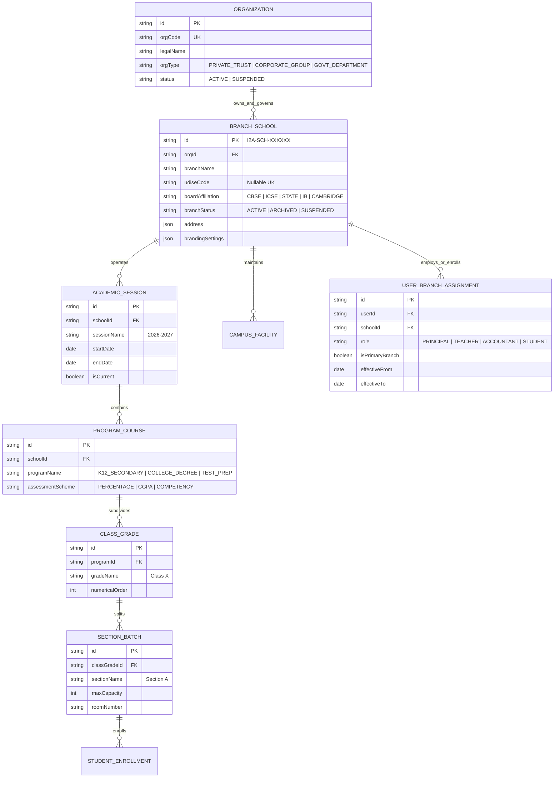

# Organization Hierarchy, Multi-Branch & Campus Domain Model
**i2A SchoolOS — Global Multi-Tenant Education Management Platform**  
*Document Ref: i2A-STRAT-005 | Date: October 17, 2026 | Status: ARCHITECTURAL_BLUEPRINT*

---

## 1. Architectural Foundation & Multi-Level Hierarchy

To prevent the common architectural failure of forcing single-school assumptions onto educational trusts and government bodies, i2A SchoolOS establishes a flexible, recursive organizational tree.

### 1.1 Conceptual Organization Tree
```
i2A Platform Core (Global SaaS Root)
  └── Organization / Department / Educational Trust (e.g., "Delhi Public School Society" / "State Dept of Education")
        ├── [Optional Intermediate Jurisdiction Level] (e.g., Zone / State / District / Block / Cluster)
        │     └── School / Branch / Campus (e.g., "DPS R.K. Puram" - Unique i2A ID: I2A-SCH-000101)
        │           ├── Academic Session (e.g., "2026-2027")
        │           │     ├── Program / Course (e.g., "Senior Secondary" / "NEET Fast-Track")
        │           │     │     ├── Class / Grade (e.g., "Class XI")
        │           │     │     │     └── Section / Batch (e.g., "Section A - Science")
        │           │     │     │           ├── Enrolled Students & Guardians
        │           │     │     │           ├── Assigned Teachers
        │           │     │     │           └── Subjects & Timetable Schedule
        │           └── Auxiliary Campus Facilities (Transport Fleet, Library, Uniform Counter)
        └── School / Branch / Campus (e.g., "DPS Vasant Kunj" - Unique i2A ID: I2A-SCH-000102)
```

---

## 2. Institutional Identity & Identification Invariants

1. **Immutable System Identifiers:**
   - Every Organization entity is assigned an internal UUID: `org_uuid` (e.g. `org_9f83a12b...`) and unique public code `ORG-XXXXXX`.
   - Every Branch / School entity is assigned an immutable internal UUID: `school_uuid` and public identifier `I2A-SCH-XXXXXX`.
2. **Name Non-Uniqueness Rule:**
   - Institutional name (e.g., "St. Xavier's High School" or "Ideal Public School") is **never** treated as a primary or unique key. Thousands of independent schools share identical names across India.
   - Multiple schools bearing the same name belong to a shared group **only** after legal ownership or trust affiliation is verified by a Super Admin.
   - Independent schools with identical names remain 100% physically and logically isolated in their own tenant containers.
3. **Official External Identifiers (UDISE / Affiliation Codes):**
   - Official government codes, such as the 11-digit **UDISE+ Code** (Unified District Information System for Education) or CBSE Affiliation Number, are stored as separate, optional, verified attributes (`officialIdentifiers.udiseCode`, `officialIdentifiers.cbseAffiliationNo`).
   - i2A SchoolOS **never** auto-generates, fabricates, or guesses official government codes.
   - External identifiers must undergo format validation (e.g., UDISE code must match regex `^[0-9]{11}$`).

---

## 3. Entity Relationship Diagram (ERD)



---

## 4. Multi-Branch Permissions & Cross-Branch Access Matrix

| Role | Scope Level | Cross-Branch Query Allowed? | Cross-Branch Mutation Allowed? | Financial Access Scope |
| :--- | :--- | :--- | :--- | :--- |
| **i2A Platform Super Admin** | Global Platform | **YES** (All schools) | **YES** (Authorized platform ops) | Global Platform SaaS Billing (Flow A) |
| **Education Trust / Group Director** | Assigned Org / Trust | **YES** (All subordinate branches) | **LIMITED** (Policy / Org branding only)| Consolidated View (No direct branch spends) |
| **Branch School Principal** | Assigned Branch Only | **NO** (Strictly blocked - 403) | **NO** (Only own branch) | Own branch student fee collection & budget |
| **Branch School Admin / Bursar** | Assigned Branch Only | **NO** (Strictly blocked - 403) | **NO** (Only own branch) | Own branch fees, receipts, and payroll |
| **Multi-Branch Visiting Teacher** | Permitted Branches | **YES** (Only assigned classes in assigned branches) | **YES** (Only attendance & grades in assigned branches) | **NONE** (No financial access) |
| **Parent / Guardian** | Linked Student Wards | **CONDITIONAL** (If children attend different branches of same trust) | **NO** (Only own child fee payments) | Own child fee receipts only |
| **Student** | Enrolled Branch Only | **NO** (Strictly blocked) | **NO** | Own dues only |

---

## 5. Multi-Branch Operational Scenarios & Lifecycle Rules

### 5.1 Staff Assigned to Multiple Branches (Visiting Faculty)
- An educator teaching Physics across two campuses belonging to the same Trust (e.g., Branch A on Mon/Wed and Branch B on Tue/Thu) receives a single `userId` linked via two separate `UserBranchAssignment` records.
- When logging in, the educator selects their active branch context, or the application presents a unified dashboard with clear campus badges.
- Access to gradebooks, student records, and attendance grids is filtered by both `schoolId` and active schedule. Cross-branch student grade tampering is strictly prevented.

### 5.2 Branch Lifecycle Operations (Auditability Invariants)
1. **Branch Relocation / Renaming:** Changing a school's operating address or public display name creates an auditable historical entry in `school_lifecycle_events`. Prior academic transcripts, diplomas, and fee receipts retain their historical legal name.
2. **Branch Suspension:** If an institution defaults on platform billing or regulatory mandates, its status transitions to `SUSPENDED`. Staff and students receive a read-only message upon login.
3. **Branch Ownership Transfer:** If a branch changes ownership from one educational trust to another, an explicit multi-signature sign-off workflow is executed, migrating institutional pointers while preserving historical financial audit ledgers under the prior entity.
