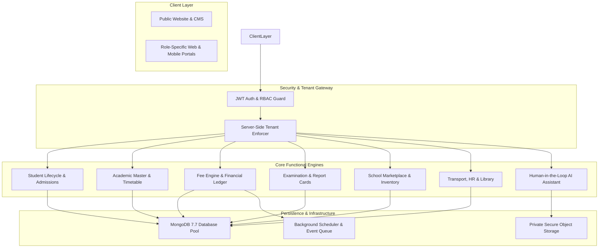

# Product Requirements Document (PRD)
**i2A SchoolOS — Global Multi-Tenant Education Management Platform**  
*Document Ref: i2A-PRD-001 | Date: October 17, 2026 | Status: ARCHITECTURAL_BLUEPRINT*

---

## 1. Product Identity & Vision

### 1.1 Product Statement
**i2A SchoolOS** is an Enterprise-Grade, Cloud-Native, Multi-Tenant Educational Operating System designed to digitize, unify, and automate administrative, academic, financial, logistical, and communication workflows across the entire spectrum of educational institutions:
- Independent K-12 Private Schools (Playgroup to Senior Secondary).
- School Groups, Educational Trusts, and Multi-Branch Campuses.
- Colleges, Polytechnics, and Higher Education Faculties.
- Coaching Centers, Test-Prep Academies (IIT-JEE, NEET, Civil Services), and Tuition Institutes.
- Activity-Based Schools (Dance, Sports, Fine Arts, Skill Centers).
- Authorized Government-Sector Deployments (District / State / Cluster models).

### 1.2 Core Architectural Principles
1. **Zero / Low Manual Workload ("Enter Once, Automate Everywhere"):** Data ingested at student admission seamlessly cascades to the master directory, parent linkage, academic roster, fee ledger, exam eligibility, transport manifest, and notification pipeline.
2. **Human-in-the-Loop Liability Protection:** All automated algorithms and AI assistants operate strictly under draft mode (`DRAFT -> REVIEWED -> APPROVED -> PUBLISHED`). School leadership retains 100% legal authority over grades, fees, admissions, and payroll.
3. **Pure Multi-Tenant Isolation:** Zero physical database sprawl per school; single shared codebase with cryptographically enforced tenant scoping (`schoolId`), custom white-label branding, and sub-domain isolation.
4. **Decoupled Financial Architecture:** Strict physical and logical boundary between **Platform Subscription Billing (Flow A)** and **Institutional Student Fee Collection (Flow B)**.
5. **Universal Dynamic Academic Engine:** Zero hardcoded grade levels. Configurable program structures accommodate everything from kindergarten and CBSE/ICSE schools to university semesters and weekend coaching batches.

---

## 2. Stakeholder Personas & Portal Experiences

| Stakeholder Role | Primary Responsibilities | Portal Interface & Key Capabilities |
| :--- | :--- | :--- |
| **Platform Super Admin** | Global platform health, tenant provisioning, subscription billing, plan entitlement enforcement, security audits. | **Super Admin Console:** Multi-school registry, plan switcher, commercial discount approvals, audit logger. |
| **Group / Trust Director** | High-level governance across multiple affiliated schools, consolidated financial reports, cross-branch metrics. | **Executive Group Dashboard:** Multi-branch aggregator, comparative enrollment, group-wide fee collection KPI. |
| **School Owner / Director** | Institutional vision, financial health, staff compensation, fee policies, final legal approvals. | **Owner Command Dashboard:** Net revenue ledger, P&L summaries, approval center, fee structure sign-off. |
| **School Principal** | Daily operational leadership, teacher assignments, academic progress, disciplinary oversight, parent escalations. | **Principal AI Command Center:** Real-time attendance KPIs, fee collection pulse, conflict review, natural language queries. |
| **Academic Teacher** | Classroom attendance, daily homework posting, exam blueprinting, subjective marks entry, student evaluation. | **Teacher Workspace:** 1-click attendance grid, homework creator, AI question selector, marks entry gradebook. |
| **Accountant / Bursar** | Fee collection, overdue follow-ups, payment gateway reconciliation, expense logging, payroll disbursement. | **Bursar Financial Desk:** Counter fee collection, POS receipt generation, expense ledger, salary slip generator. |
| **Transport Manager** | Bus routes, vehicle fleet upkeep, driver roster, student pickup stops, transport fee mapping. | **Transport Logistics Console:** Route planner, vehicle document vault, passenger manifest, maintenance log. |
| **Vehicle Driver** | Daily trip execution, student attendance at boarding/drop-off, emergency breakdown alerts. | **Driver Mobile Web App:** Route passenger checklist, 1-tap student pickup/drop confirmation, emergency SOS. |
| **Parent / Guardian** | Child progress tracking, fee payments, report card downloads, teacher messaging, school store orders. | **Parent Portal (Mobile/PWA):** Child 360° card, fee payment checkout, instant receipt download, homework feed. |
| **Enrolled Student** | Homework submissions, timetable review, online test taking, revision video access, digital library loans. | **Student Learning Portal:** Daily schedule, assignment uploader, timed exam engine, revision video library. |

---

## 3. High-Level System Architecture & Scope Pillars

---

## 4. Functional Scope Classification (Owner vs. Implemented vs. Proposed)

To ensure complete transparency, requirements are classified into four strict categories:
- **Category A (Owner Specified):** Explicitly dictated business requirements and pricing models.
- **Category B (Verified Implemented):** Built and passing automated tests in the existing codebase.
- **Category C (Proposed Improvement):** Architectural recommendations introduced to satisfy enterprise standards.
- **Category D (External Dependency):** Features requiring third-party credentials or hardware (e.g., live Razorpay keys, SMTP relays, GPS trackers).

### 4.1 Master Module Scope Matrix

| Module | Classification | Current State in Repository | Required Target State |
| :--- | :--- | :--- | :--- |
| **Public Website & Discovery** | Category A | Partially implemented (`PublicSaasLandingPage.tsx`) | Educational category cards, verified school directory, CMS banners. |
| **Institution Onboarding** | Category A | Basic setup wizard (`SchoolSetupModule.tsx`) | 5-step registration: Info, OTP, Document Vault, Academic Setup, Review. |
| **Authentication & RBAC** | Category B | **Verified** (`server/middleware/auth.js`, 9 roles) | Multi-factor auth, session revocation, single-use reset tokens. |
| **Tenant Isolation** | Category B | **Verified** (403 on breach, Super Admin bypass) | Organization hierarchy, multi-branch consolidated data scoping. |
| **Dynamic Academic Engine** | Category C | Fixed grade structures in local master | Universal Program -> Class -> Section -> Subject entity hierarchy. |
| **Student Lifecycle & SIS** | Category B | **Verified** (MongoDB `students` & `admissions`) | Complete 360° profile, TC generation, medical & document vault. |
| **Attendance & Leave** | Category B | **Verified** (Batch mark, lock state, summary) | 1-click class grid, auto parent alerts (<85%), staff leave approvals. |
| **Timetable & Scheduling** | Category B | **Verified** (Conflict detection 409, upsert) | Algorithmic constraint solver, daily teacher substitution assignment. |
| **Homework & Learning** | Category B | **Verified** (Assignment creation & submission) | Homework feed, attachment upload, teacher feedback & rubric grading. |
| **Examination & Grading** | Category B | **Verified** (Paper generation & marks entry) | Preloaded exam calendar, CBSE/ICSE/NEP 2020 report card PDFs. |
| **Fee Engine & Receipts** | Category B | **Verified** (Fee types, receipts in paise) | Flexible installments, automated fine engine, Tally XML export. |
| **School Marketplace** | Category B | **Verified** (Products, orders, kit bundles) | Direct fulfillment, uniform size variants, stock replenishment. |
| **Auxiliary Operations** | Category B | **Verified** (Staff, payroll, expenses) | Transport bus routes, driver app manifests, library barcode scanner. |
| **Platform Subscription** | Category A/B | **Verified** (40% discount cap, trial logic) | Published 5-plan monthly tiers (₹10–₹50) + Annual contract billing. |
| **Payment Gateway Security** | Category B/D | **Verified** (HMAC webhook, BLOCKED without keys)| Live Razorpay, PhonePe, Paytm onboarding & dual-flow split. |
| **Notification Engine** | Category B/D | **Verified** (In-app hub, BLOCKED without SMTP) | WhatsApp Business Cloud API, transactional email relay, SMS gateway. |
| **Human-in-the-Loop AI** | Category A/C | Heuristic pattern matching in place | L0-L3 action levels, teacher review gate, OpenAI/Gemini abstraction. |
| **Revision Video Library** | Category A | Out of scope in Phase A (deferred) | 1-Month retention (₹40) vs 1-Year archive (₹50), streaming player. |
| **Public Sector & UDISE+** | Category C | Not yet integrated | UDISE+ Data Capture Format export, DPDP Act 2023 compliance. |

---

## 5. Non-Functional & Quality Requirements

1. **Security & Data Isolation:**
   - Multi-tenant tenant ID (`schoolId`) must be strictly validated server-side on every read, write, and search query.
   - Zero Insecure Direct Object References (IDOR): A parent querying student data must have a verified `ParentStudentLink` record in the database.
   - All passwords must use `bcryptjs` with salt rounds $\ge 10$.
   - Live payment orders and webhooks must enforce cryptographic SHA256 HMAC verification.
2. **Performance & Concurrency:**
   - Database read operations must complete in $< 50\text{ms}$ under standard indexed query conditions.
   - PDF generation (Receipts, Report Cards, ID Cards) must stream asynchronously without blocking the event loop.
   - Frontend bundle size must remain optimized with code splitting for modules $> 300\text{kB}$.
3. **Auditability & Compliance:**
   - Every financial mutation (fee collected, refund issued, payroll disbursed, discount applied) must write an immutable entry to `audit_logs`.
   - Audit logs must record `userId`, `userRole`, `ipAddress`, `timestamp`, `action`, `module`, and before/after delta snapshots.
